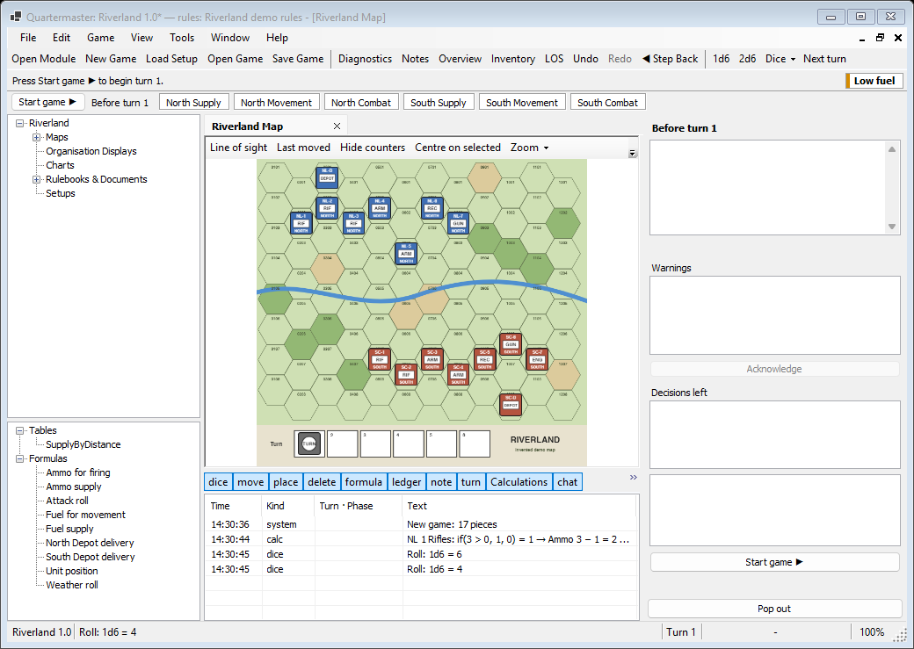
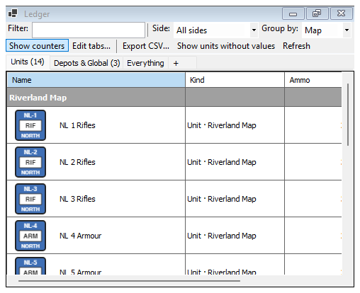
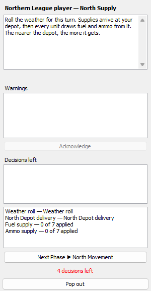
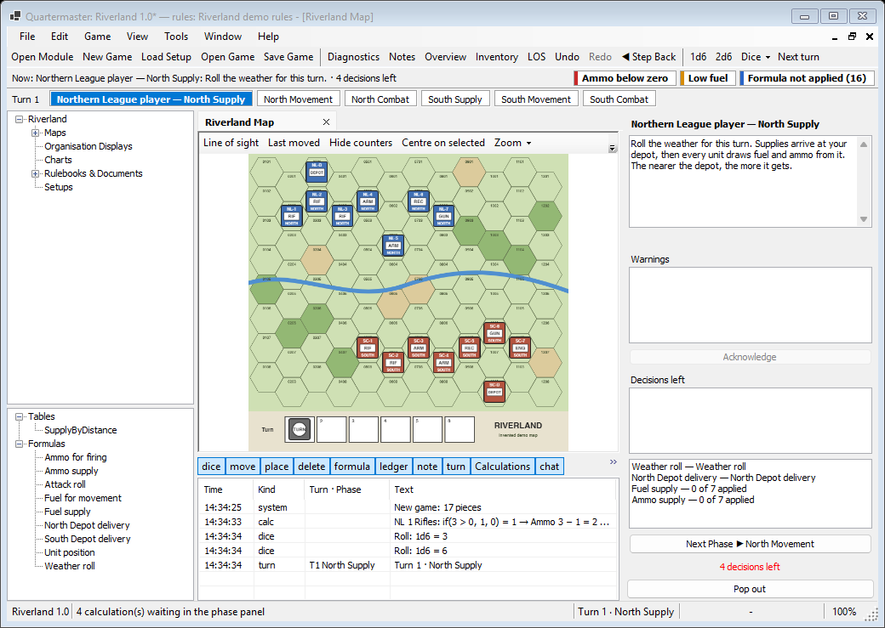

# Quartermaster

Quartermaster is a desktop program for playing hex wargames on your computer. It opens the [VASSAL](https://vassalengine.org) modules you already own, with their maps, counters, stacks and dice, and then takes the paperwork off your hands. It runs the game's procedures, does the arithmetic, rolls the dice and keeps count of everything a big game asks you to track, from fuel and ammunition to whose turn it is.

It runs on Windows today, with Mac and Linux builds in progress.

*The main window, showing the invented Riverland demo game that this wiki uses for every example.*

## How it relates to VASSAL

If you know VASSAL, you know most of the basics. Quartermaster reads the same `.vmod` module files, so your existing modules open as they are. The file is not copied or changed. What Quartermaster adds is a **rules pack** (a `.qrules` file) that sits beside the module. A rules pack holds a game's tables, formulas and per-unit values such as fuel and ammunition, so the program can do the lookups and sums that you would normally do by hand.

Quartermaster ships no game content. You bring a module you own, and you enter the rules data yourself. The examples in this wiki use a small invented game, Riverland, which you can [download from the repository](https://github.com/EmojiPlay88/Quartermaster/tree/master/docs/wiki/demo).

## A quick tour

- **Play a module.** Drag stacks and selections around the map, with smooth zoom and rulebook PDFs open in tabs. See [Your First Game](Your-First-Game).
- **Track values in ledgers.** Fuel, ammunition and stores sit in spreadsheet-style ledgers, and every change is logged.

  

- **Let formulas do the arithmetic.** A formula dialog shows the formula with a box for each variable and calculates as soon as every box is filled. See [Making a Rules Pack](Making-a-Rules-Pack).
- **Follow the turn sequence.** A strip shows the turn, the acting side and the phase, and a panel lists what the phase expects of you.

  

- **Pick how much help you want.** Hardcore, Semi-automatic and Fully automatic modes decide how much of the lookup work the program does.
- **Undo and step back.** Undo works on whole actions, and Step Back returns to the start of a phase or any earlier turn.
- **Spot trouble early.** An alert bar shows what needs attention, for example units that are low on fuel.

  

- **Play with other people.** Share one computer, play live through a relay, or pass turn files back and forth. See [Playing With Others](Playing-With-Others).

## Where to start

1. [Install and Update](Install-and-Update) gets the program onto your computer.
2. [Your First Game](Your-First-Game) walks through the Riverland demo.
3. [Playing With Others](Playing-With-Others) covers hot-seat, online and play-by-file games.
4. [Menus and Windows](Menus-and-Windows) lists every menu and window.
5. [FAQ](FAQ) answers common questions.

Quartermaster is an early, hobby-built project, so expect rough edges.
