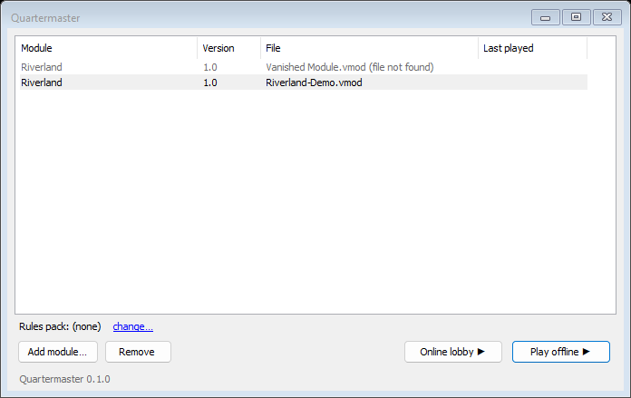
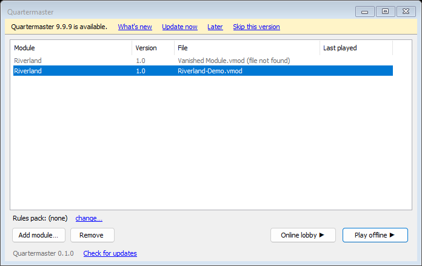

# Install and Update

## Requirements

- Windows 10 or 11.
- Microsoft Edge WebView2 Runtime, which Windows 11 includes. Quartermaster uses it to show rulebook PDFs.

The release download is self-contained, so you do not need to install .NET or anything else.

## Install

1. Open the [Releases page](https://github.com/EmojiPlay88/Quartermaster/releases) and download `Quartermaster-<version>-win-x64.zip`, where `<version>` is the release number.
2. Unzip it into a folder you can write to, for example `%USERPROFILE%\Quartermaster`. Do not put it inside `Program Files`: the updater needs to replace the files in that folder.
3. Run `Quartermaster.App.exe`.

### The SmartScreen warning

Windows may show "Windows protected your PC", because the program is new and not code-signed. Choose **More info**, then **Run anyway**.

There is no code signing. The `.sha256` file next to each download only guards against a damaged download. It does not prove who made the file. If you want to be certain what you are running, build the program from source; the steps are in the repository's README.

## The launcher

When you start Quartermaster, the launcher opens with your list of modules.

- **Add module...** lists a `.vmod` file. The file is not copied or changed, and **Remove** only takes it off the list.
- The line under the list shows the module's rules pack. **change...** points the module at another one.
- **Play offline** and **Online lobby** start a game. See [Your First Game](Your-First-Game) and [Playing With Others](Playing-With-Others).

## Updating

Quartermaster checks GitHub for a newer release about once a day. When one exists, a yellow bar appears at the top of the launcher.

The bar offers four links:

- **What's new** shows what changed in that release.
- **Update now** downloads the zip, checks it against the release's `.sha256` file, closes Quartermaster, swaps the files and starts the new version. If the new version does not start, the old one is put back.
- **Later** hides the bar until you next start the program.
- **Skip this version** hides that one release. Newer releases still show.

The **Check for updates** link at the bottom of the launcher checks on demand.

What the updater does and does not do:

- It never updates while a game is open or while another Quartermaster window is running, and never without you clicking Update now. Close the game and use the launcher.
- Only the files named in the release's `quartermaster-files.txt` are swapped, so anything else you keep in that folder is left alone.
- The previous version is kept as one `Quartermaster.backup-<version>` folder beside the program folder. Older backups are removed after a successful update.
- Your modules, rules packs, saves and settings live outside the program folder and are not touched.

### Copies that cannot update themselves

The updater only works on a copy that was unzipped from a release into a writable folder. If the folder is not writable (for example under `Program Files`), or the copy is one you built yourself from source, Quartermaster says it cannot update itself and offers to open the download page instead. Download the new zip there and update by hand.

### Updating by hand

Unzip the new zip over the old folder, or into a new one. Your saves and settings are kept either way.

## The online relay

Online play needs a relay, which is a separate download needed only by whoever hosts games. See [Hosting a Relay](Hosting-a-Relay).
