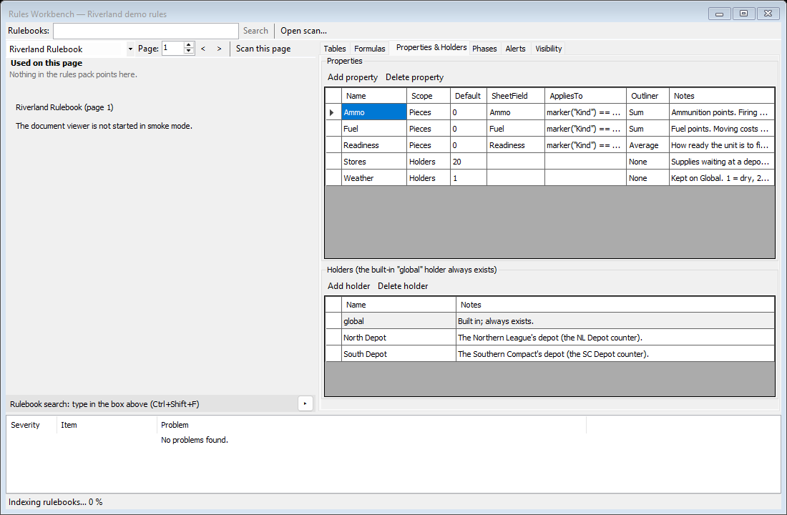
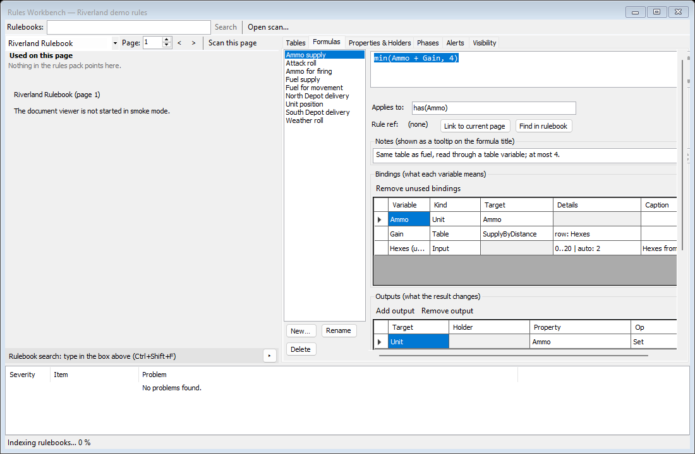
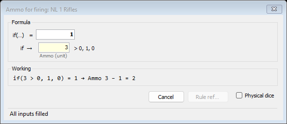

# Making a Rules Pack

A rules pack (a `.qrules` file) teaches Quartermaster the parts of your game that VASSAL leaves to you: the values each unit tracks, the charts, the sums, the order of play, warnings, and what each side may see. You write it once in the Rules Workbench, and then every game of that module uses it.

This page builds a rules pack from nothing for Riverland, the invented demo game, step by step. When you finish you will have a working copy of `Riverland-Demo.qrules`, and you will know how to do the same for your own module. The checklist at the end sums it up.

Every formula on this page is copied from the demo pack, so you know it works. For what each control does, see [Rules Workbench](Window-Rules-Workbench). For the full list of functions, see [Formula Reference](Formula-Reference).

## Before you start

- Install Quartermaster ([Install and Update](Install-and-Update)) and download `Riverland-Demo.vmod` and `Riverland-Demo.qrules` (see [Your First Game](Your-First-Game#get-the-demo-files)).
- Keep `Riverland-Demo.qrules` close by. If you get stuck, open it in a second copy of Quartermaster and compare.

Riverland in one paragraph: two sides, the Northern League and the Southern Compact, face each other across a river. Each unit has Fuel, Ammo and Readiness, printed on its property sheet in the module. Each side has a depot that holds Stores. Every turn the weather is rolled, supplies arrive, units draw fuel and ammo by their distance to the depot, then they move (moving costs fuel) and fight. Readiness is secret from the other side.

## Step 1: Create the pack

1. Start Quartermaster. In the launcher, select `Riverland-Demo.vmod` (use **Add module…** if it is not listed yet).
2. Choose **Play offline**, then **New game…**, then **OK**. The main window opens with the map.
3. Choose **File > New Rules Pack...**. Type a name, for example `My Riverland rules`, and choose OK.
4. Choose **Tools > Rules Workbench** (Ctrl+Shift+W). The Workbench opens on the new, empty pack.

If you are happy with a command line, you can do steps 1 to 3 in one go by starting Quartermaster with the module and the `--new-rules` option:

```
Quartermaster.App.exe Riverland-Demo.vmod --new-rules "My Riverland rules"
```

Keep the game open while you work. Everything you change in the Workbench applies to the open game at once, so you can test as you go.

Watch the **Problems** list at the bottom of the Workbench. While the pack is half-built it lists what is still missing. When everything is in place it reads "No problems found." Double-click a problem to jump to it.

## Step 2: Properties (the values units track)

Open the **Properties & Holders** tab.



Choose **Add property** three times and fill in the rows:

| Name | Scope | Default | SheetField | AppliesTo | Outliner |
|---|---|---|---|---|---|
| Fuel | Pieces | | Fuel | `marker("Kind") == "Unit"` | Sum |
| Ammo | Pieces | | Ammo | `marker("Kind") == "Unit"` | Sum |
| Readiness | Pieces | | Readiness | `marker("Kind") == "Unit"` | Average |

- **SheetField** is the name of a row on the counters' property sheet in the module. Riverland's units have a sheet called "Unit Sheet" with the rows Fuel, Ammo and Readiness, so each property starts at the number printed there. The drop-down suggests the row names it finds in the module.
- **AppliesTo** says which counters have the property. Riverland's counters carry a marker called Kind, which is `Unit` for fighting units, `Depot` for depots and `Marker` for the turn marker. So this filter means "only units":

```formula
marker("Kind") == "Unit"
```

Now the values that do not belong to a counter. Add two more properties:

| Name | Scope | Default | Notes |
|---|---|---|---|
| Stores | Holders | 20 | Supplies waiting at a depot |
| Weather | Holders | 1 | Kept on global. 1 = dry, 2 = mud |

A **holder** is a place that keeps values without being a counter. The built-in **global** holder always exists; Weather lives there. For the depots, choose **Add holder** twice and name the holders `North Depot` and `South Depot`.

**Test it:** in the main window choose **View > Ledger** (Ctrl+L). The **Units** tab already lists every unit with its Fuel, Ammo and Readiness from the module. The **Depots & Global** tab lists global and the two depots, with Stores 20. See [Ledger](Window-Ledger).

## Step 3: A table (the supply chart)

Riverland's supply chart: a unit 0 hexes from its depot gets 3 points, 1-2 hexes gets 2, 3-4 hexes gets 1, 5 or more gets nothing.

Open the **Tables** tab and choose **New…**. Name the table `SupplyByDistance` (one word: formulas refer to tables by name). Leave **Kind:** on **OneD** (one row key and one value). Choose **Add row** until there are four rows, and type:

| Row key | Value |
|---|---|
| 0 | 3 |
| 1-2 | 2 |
| 3-4 | 1 |
| 5+ | 0 |


Row keys can be single numbers, ranges like `1-2`, or open ranges like `5+`. A chart from a spreadsheet can be pasted in with **Paste from clipboard…**, and a scan of a printed chart can be read with **Open scan…** (see [Rulebook search and OCR](Window-Rulebook-Search-and-OCR)).

## Step 4: Formulas

Open the **Formulas** tab. For each formula below, choose **New…**, type the name, then type the formula in the big box. Every name you use in the formula (Fuel, Hexes and so on) appears as a row under **Bindings**. Fill in each row's **Kind**, **Target** and **Details** as shown, so Quartermaster knows where each value comes from. Then set the **Outputs**: what the result changes in the ledger.



### Fuel supply: reading the table with lookup

```formula
min(Fuel + lookup(SupplyByDistance, Hexes), 6)
```

In words: the unit's fuel plus the chart value for its distance to the depot, but never more than 6. **Applies to:**

```formula
has(Fuel)
```

| Variable | Kind | Target | Details | Caption |
|---|---|---|---|---|
| Fuel | Unit | Fuel | | |
| Hexes | Input | | `0..20 \| auto: 2` | Hexes from this unit to its depot |

- A **Unit** binding reads a property of the counter the formula runs on.
- An **Input** binding is a number the player types in the formula dialog. `0..20` limits it; `auto: 2` is the value used when the game fills things in by itself (Fully automatic). The caption is shown under the box.
- Choices instead of a range are separated by commas: `Coast, Inland`. If a choice itself holds a comma, put it in double quotes: `"North, coast", Inland` (write a quote inside a quoted choice twice).
- Add `| always ask` (for example `0..20 | always ask`) when the player must answer every time. Fully automatic then never uses the `auto:` value for this input and asks instead.
- `SupplyByDistance` inside `lookup(...)` is the table's name, so it needs no binding.

**Outputs:** choose **Add output** and set Target **Unit**, Property **Fuel**, Op **Set**. (A new output starts as Subtract; change it.)

### Ammo supply: the same table through a table variable

```formula
min(Ammo + Gain, 4)
```

**Applies to:** `has(Ammo)`. Here the table is read by a binding instead of `lookup`:

| Variable | Kind | Target | Details | Caption |
|---|---|---|---|---|
| Ammo | Unit | Ammo | | |
| Gain | Table | SupplyByDistance | `row: Hexes` | |
| Hexes | Input | | `0..20 \| auto: 2` | Hexes from this unit to its depot |

When you type `row: Hexes` into Gain's Details, a Hexes row appears in the bindings by itself, because the row expression uses it. Set it up as in Fuel supply. With a table variable the formula stays short, and the cheat sheet shows the whole table with the cell that was used (see [Formula dialog](Window-Formula-Dialog#cheat-sheet)).

**Outputs:** Target **Unit**, Property **Ammo**, Op **Set**.

### Fuel for movement: distance moved and a global value

```formula
ceil(Moved * Weather / 2)
```

One fuel for every two hexes moved, rounded up, and twice that in mud. **Applies to:** `has(Fuel)`.

| Variable | Kind | Target | Details |
|---|---|---|---|
| Moved | Moved | | |
| Weather | Global | Weather | |

**Moved** is the distance the counter just moved, in hexes. **Global** reads a value kept on the global holder. **Outputs:** Target **Unit**, Property **Fuel**, Op **Subtract**.

### Attack roll: dice

```formula
Die + floor(Readiness / 2)
```

**Applies to:**

```formula
has(Readiness)
```

| Variable | Kind | Target | Details |
|---|---|---|---|
| Die | Roll | | `1d6` |
| Readiness | Unit | Readiness | |

A **Roll** binding rolls dice; Details takes dice notation such as `1d6` or `2d6`. This formula has no outputs: it only shows the result, and the player decides what happens.

### A range chart and a roll per plane

Some charts print a different range in each cell of a row, and some are rolled once for every plane of a squadron. Two functions cover them: `lookuprange` and `count`.

**A range chart.** Make a table `Landing` with the altitude bands as rows (`1`, `2`, `3`) and the landing results as columns (`Hard`, `Rough`, `Smooth`). Put a range in each cell: in row `2` the `Hard` cell holds `1-3`, the `Rough` cell `4-5` and the `Smooth` cell `6+`. Then the formula is `lookuprange(Landing, Altitude, Roll)` with these bindings:

| Variable | Kind | Details |
|---|---|---|
| Altitude | Input | `1..3` |
| Roll | Roll | `1d6` |

With Altitude 2 and a Roll of 5 the formula gives `Rough`. If no cell of the row holds the roll, the run stops with `No column of Landing row 2 holds 7`, so end each row with an open range such as `6+`.

**A roll per plane.** A squadron of Riverland bombers rolls one die per plane. Bind `Planes` as Kind **Roll**, Details `1d6`, and put an expression in the **Dice count** column of the bindings grid: `Squadron` (an Input of `1..12`). Leave it blank to use the fixed number from Details. The expression may read inputs and other bindings, but not the roll itself, and must give a whole number from 1 to 100. Then count the dice with `count(Planes, 1, 2) * 10 + count(Planes, 6, 6)`.

This gives 10 for every plane that rolled 1 or 2, plus 1 for every 6. With **Physical dice** on in the formula dialog, type the dice of `Planes` separated by spaces (`1 2 5 6`); the dice are logged one by one.

### Ammo for firing

```formula
if(Ammo > 0, 1, 0)
```

**Applies to:** `has(Ammo)`. One binding: Ammo, Kind **Unit**, Target **Ammo**. **Outputs:** Target **Unit**, Property **Ammo**, Op **Subtract**.

### Weather roll: writing to global

```formula
if(Die >= 5, 2, 1)
```

No **Applies to** (leave it empty: the formula is not about a counter). Die is a **Roll** with `1d6`. **Outputs:** Target **Global**, Property **Weather**, Op **Set**.

### Depot deliveries: reading and writing a holder

Make two formulas, `North Depot delivery` and `South Depot delivery`, with the same text:

```formula
min(Stores + Delivery, 30)
```

| Variable | Kind | Target | Details |
|---|---|---|---|
| Stores | Holder | North Depot: Stores | |
| Delivery | Roll | | `1d6` |

For South Depot delivery, pick **South Depot: Stores** instead. **Outputs:** Target **Holder**, Holder **North Depot** (or **South Depot**), Property **Stores**, Op **Set**.

### One roll, several supply losses; picking a slot

An output can have its own value, and can pick its property when the formula runs. Both are optional, and both are described under [Outputs](Formula-Reference#outputs) in the Formula Reference.

**One roll, several losses.** Make a formula `Raid` whose text is `Loss`, with `Loss` bound as a **Roll** of `1d6`. Add three outputs on the Unit target with Op **Subtract**: Property **Fuel** (leave **Value** blank, so it loses the roll), Property **Ammo** with **Value** `Loss * 2`, and Property **Rations** with **Value** `max(Loss - 1, 0)`. One roll now takes from all three, and the working line shows each loss.

**Picking a slot by an input.** Add an Input `Slot` with Details `1..3`. On one output, fill **Choose from** with `Fuel, Ammo, Rations` and **Pick by** with `Slot`. Slot 2 changes Ammo. One formula does the work of three.

### Try each formula

Under the bindings, the **Preview** shows the [formula dialog](Window-Formula-Dialog) as players will see it. Pick a counter in **Test piece:** (for example NL 1 Rifles) and try values. Nothing you type in the preview is saved.



You can also try a formula in the game itself: right-click a unit on the map and choose **Calculate**, then the formula. **Apply to ledger** writes the result, and the Ledger shows the new value. **Edit > Undo** (Ctrl+Z) takes it back.

## Step 5: Sides and phases

Open the **Phases** tab.


### Sides

Under **Sides**, choose **Add…** and type `Northern League`. In **Units of this side:** type the filter that picks its units:

```formula
marker("Side") == "Northern League"
```

Do the same for `Southern Compact`:

```formula
marker("Side") == "Southern Compact"
```

Sides decide whose turn it is, which units a phase works on, and who may see private values.

### North Supply

Under **Phases, in order**, choose **Add** and name the phase `North Supply`. Set **Side:** to Northern League and write the **Instructions** (shown to players while the phase is current), for example "Roll the weather for this turn. Supplies arrive at your depot, then every unit draws fuel and ammo from it."

In **On start: run formulas**, choose **Add** four times:

| Formula | For each | Filter (units) |
|---|---|---|
| Weather roll | Once | |
| North Depot delivery | Once | |
| Fuel supply | Units | `has(Fuel)` |
| Ammo supply | Units | `has(Ammo)` |

**Once** runs the formula one time. **Units** runs it for every unit of the acting side that passes the filter.

### North Movement

Add a phase `North Movement`, side Northern League. In **On move: run formulas for moved units**, add the **Fuel for movement** formula from the tutorial above with the filter `has(Fuel)`. Now every move during this phase charges fuel.

Under **Warnings**, add a row with this **Condition**:

```formula
Fuel <= 0
```

and the **Message** `{unit} has no fuel and cannot move`. `{unit}` is replaced by the unit's name.

### North Combat

Add a phase `North Combat`, side Northern League. Under **Checklist**, choose **Add…** for each item: "Choose attackers", "Run Attack roll for each attacker", "Run Ammo for firing for each attacker". Add a warning:

```formula
Ammo <= 0
```

with the message `{unit} is out of ammo`.

### The Southern Compact's phases

Select North Supply and choose **Duplicate**. Change the copy's **Name:** to `South Supply`, set **Side:** to Southern Compact, remove the Weather roll row (the weather is rolled once a turn) and change North Depot delivery to **South Depot delivery**. Duplicate North Movement and North Combat the same way. Use **Move Up** and **Move Down** until the order is North Supply, North Movement, North Combat, South Supply, South Movement, South Combat.

**Test it:** in the main window choose **Start game**. The phase strip shows North Supply, and the phase panel shows your instructions and the formulas waiting to run. See [Phases](Window-Phases).

### End-of-phase formulas

Some work belongs at the end of a phase. In **On end: run formulas**, add rows just as under **On start**. Example: first create a formula `Fuel upkeep` (or reuse one of the formulas above), then add it at the end of North Combat with For each **Units** and the filter `has(Fuel)`. When a player presses Next Phase, these formulas run first. If they all run by themselves, the game moves on in the same press; if one needs input, the game stays in the phase until you finish it and then press Next Phase again (`Finish the end-of-phase runs, then press Next Phase again`). See [Phases](Window-Phases#end-of-phase-formulas).

### Moves by the other side

On **North Movement**, give an **On move** row **Fires for** **Other side**, and the formula runs when a Southern Compact counter moves during the Northern League's phase (a reaction move). **Acting side** is the default; **Any side** reacts to every move. To limit an entry to moves on one map (for example, to ignore drags into an off-board box), filter on `map()`: `map() == "Main Map"`. See [Phases](Window-Phases#moves-by-the-other-side).

### Formulas limited to phases

To stop a formula being used in the wrong phase, tick the phases it belongs to under **Only in phases** on the Formulas tab (for example, tick North Movement for **Fuel for movement**). Everywhere else it is greyed in the counter menu with the tooltip `Only in: North Movement`, and the formula dialog will not run it. Leave all boxes empty and the formula is allowed in any phase. Formulas that phases run by themselves ignore the limit. The validator reports a phase that no longer exists (`Formula "{name}": phase list names unknown phase "{id}"`) and warns when a phase's entry runs a formula limited to other phases (`Phase "{phase}": {start|move|end} entry runs "{formula}", which is limited to other phases`). See [Phases](Window-Phases#formulas-limited-to-phases).

### Formulas that can refuse to run

A formula can insist on a condition before it runs. On the Formulas tab, write it in **Only runs when**, for example `Fuel > 0` on **Fuel for movement**. When the condition is false the run is refused: nothing is rolled, nothing is written to the ledger, and the formula dialog shows the reason in its status line with **Apply to ledger** greyed out. The reason is the **Refusal message** you typed, or, when you left it empty, `Fuel for movement cannot be run now`. A formula that a phase runs by itself logs the refusal as `{formula}: {unit}: {message}`; a run waiting in the phase panel stays waiting.

While the condition reads a value the player has not typed yet, the formula waits and its dice are not rolled until the condition can be decided.

The condition may read variables of the formula and anything else a formula may read, but it **cannot use a Roll variable or `dice()`**: the validator reports `Formula "{name}": the precondition cannot use the roll {variable}` or `Formula "{name}": the precondition cannot use dice()` (this includes a roll reached through a table row, an auto value or an **Only when** condition). A variable that only the condition reads still gets its own row under **Bindings**.

### Variables used only sometimes

A binding can have an **Only when** condition (the last column of the bindings grid). Example, on a formula `if(Coast == 1, Fuel - Surf, Fuel)`: give the input `Surf` the condition `Coast == 1`. The condition may read another input, so one answer decides whether the next is asked: while `Coast` is empty the `Surf` box is blank and closed, once `Coast` is 0 the box shows `not used`, and once it is 1 the box asks for a value. A binding whose condition is false is skipped: it is not asked, rolled or looked up.

Only the branch that is taken may read such a variable. If the formula reads `Surf` when its condition is false, the run stops with `Surf is not used here: its "Only when" condition is false`. Wrap every read in an `if` that matches the condition, as above.

A skipped Table binding is not looked up, but the inputs and rolls that feed only its row or column are still asked and rolled. Give those feeder bindings the same **Only when** condition.

### Phase conditions

A phase can run only some of the time. In the **Runs only if** field, write a formula that must be true for the phase to run. Leave it empty and the phase always runs. When the condition is false, Next Phase (and Start game) skip the phase without running anything in it: no start formulas, no warnings, no checklist. A condition may read only global properties, tables, `turn()`, `stage()` and `phaseside()` (see [What a phase condition may read](Formula-Reference#what-a-phase-condition-may-read)).

Recipes:

- **Two copies of a side's turn.** Add a global property `Flag` (Default 0). Make two copies of North Movement. Put one copy before South Supply (the other side's turn) and one after it, and give the first the condition `Flag == 1` and the second `Flag == 0`. Only one of them runs, depending on the flag.
- **Only at the start of the game.** A phase with `turn() == 1` runs on the first turn only.
- **Every fourth turn.** A phase with `mod(turn(), 4) == 1` runs on turns 1, 5, 9 and so on.

If a condition is always false, the Workbench warns that the phase never runs. If every phase is skipped, Quartermaster checks one full turn, then stops at the very next phase and shows a notice saying so.

## Step 6: An alert

Open the **Alerts** tab and choose **Add**. Set **Name:** to `Low fuel`, the **Condition** to

```formula
Fuel < 2
```

the **Message ({unit} = unit name):** to `{unit} is low on fuel`, and **Severity:** to Warning. Leave **Side:** on (any).

**Test it:** a **Low fuel** chip appears in the main window's alert bar at once, because NL 6 Recon starts with 1 fuel. See [Main window](Window-Main-Window#alert-bar).

## More recipes

Short formulas for common needs. Each uses the invented Riverland names; adapt them to your own pack.

- **A rate per side and turn.** Make a table `Rate` with the sides as columns and the turns as rows, then write `lookup(Rate, turn(), side())`. Each unit reads the column of its own side.
- **A weather entry filter.** On a phase's start formula, set the entry's filter to `Weather == 2`. `Weather` is a global property (scope Holders), so in a filter it reads the game-level value: the entry runs only while the weather is 2.
- **A capacity warning.** On a phase, add a warning with the condition `holder(Rail, Tonnage) > holder(Rail, Capacity)` and the message `Rail line is overloaded`. It reads no unit, so it shows once in the [phase panel](Window-Phases), with no units under it. Use the same condition in an alert to get one chip.
- **A phasing modifier.** In a formula, `if(side() == phaseside(), 1, 0)` is 1 for the units of the side whose phase it is, and 0 for the rest.
- **Upkeep on the main map only.** Set a formula's **Applies to** to `map() == "Main Map"` so units on other maps are left alone.
- **The stack has an engineer.** Say your units carry a marker Type, and engineers have the Type `Engineer`. In a formula run on a unit, `if(hexcount("marker(\"Type\") == \"Engineer\"") > 0, 1, 0)` is 1 when an engineer shares the unit's hex (the unit itself included), so the player no longer types it in. The filter is quoted text, so quotes inside it are written `\"`.
- **A side's total trucks.** `countof("marker(\"Type\") == \"Truck\" and side() == \"Southern Compact\"")` counts the Southern Compact's trucks wherever they are. Use it in a formula, or in a phase warning such as `countof("marker(\"Type\") == \"Truck\" and side() == \"Southern Compact\"") < 3`; that condition reads no single unit, so it shows once.
- **All the fuel in a hex.** `hexsum(Fuel, "marker(\"Kind\") == \"Unit\"")` adds up the Fuel of every unit in the unit's hex. `sum`, `maxof` and `minof` do the same over the whole game. Counts and sums of Private values count as hidden data in online play; see [Formula Reference](Formula-Reference#sumproperty-filter).

## Step 7: Visibility (who may see what)

Open the **Visibility** tab.

- In **Properties**, new properties start as **Private**. Set Fuel, Ammo, Stores and Weather to **Public**, and leave **Readiness** Private. Now only the side that owns a unit sees its Readiness.
- In **Holders**, set North Depot's owner to Northern League and South Depot's to Southern Compact. Each depot now belongs to its side.
- Leave **Maps and org displays** and **Formulas** as they are. (Tick **Private dice** on a formula when its rolls should be secret.)

How hidden values behave in hot-seat and online play is explained in [Playing With Others](Playing-With-Others).

## Step 8: Test in the Ledger

With the game open and the Workbench beside it:

1. Open the **Ledger** (Ctrl+L). Check that every unit has the Fuel, Ammo and Readiness printed on its counter sheet, and that the depots have Stores 20.
2. Choose **Start game** (or **Next Phase**) to reach North Supply. In the phase panel, under **Decisions left**, double-click each waiting calculation (for example "Fuel supply — 0 of 7 applied") and apply it. The Fuel and Ammo columns go up, but never above 6 and 4.
3. Choose **Next Phase** to reach North Movement and drag a unit two hexes. The Fuel for movement dialog opens; apply it and see the unit's Fuel drop by 1 (2 in mud).
4. Hover a value in the Ledger to see its breakdown: every change, step by step.

If a number is wrong, fix the formula in the Workbench, then undo (Ctrl+Z) and try again. The Workbench shows the changed pack straight away.

## Step 9: Save the pack

Choose **File > Save Rules Pack** in the main window. The first time, it asks where to save; name the file `My-Riverland-rules.qrules`. Later saves go to the same file, and **Save Rules Pack As...** makes a copy. Quartermaster asks before closing if the pack has unsaved changes.

Quartermaster remembers the pack for this module, so the next time you open the module the launcher shows it under "Rules pack:".

## Step 10: Share it

The `.qrules` file is all another player needs, together with the same module file. They choose **change…** in the launcher and pick it ([Launcher](Window-Launcher)). A rules pack is made for one exact module file: if the module is a different version, Quartermaster warns "Rules pack was made for a different module". In an online game, guests get the host's pack automatically and cannot change it.

A rules pack holds only what you typed in. It never contains the module's rulebooks, pictures or counters, so you can share your own work without sharing anyone else's.

## Rule references

A rule reference ("rule ref") points at a page of the module's rulebook, so a player can open the rule behind a value, a warning or a checklist item. Tables, formulas and phases get one with **Link to current page** in the Workbench ([Rule references](Window-Rules-Workbench#rule-references)); that also adds the ref to the pack. Properties, holders, alerts, phase warnings and checklist items then pick one of the pack's refs from a list that reads **(none)**, then each ref as `{label}, page {page}`, for example "Ferry rules, page 4".

Say Riverland's ferry rules are on page 4. Link the **North Depot delivery** formula to that page, then pick "Ferry rules, page 4" as the rule ref of the North Depot holder and of the Stores property.

If a ref is deleted while something still points at it, the Problems list warns, for example `Property "Stores": rule reference "r-ferry" does not exist`, and the picker shows `r-ferry (missing)` so you can pick **(none)**. The same warning can name a `Holder "{name}"`, an `Alert "{name}"`, `Phase "{name}": warning {n}` or `Phase "{name}": checklist item {n}` (counting from 1).

## Checklist item ids and links

A checklist item can have an **Id:** (letters, digits, `-`, `_` or `.`), set below the checklist on the Phases tab. Ids are unique across the whole pack. An item with an id stays ticked when you reorder the items during a game; an item without one is ticked by its place in the list.

With ids, one item can point at another. In North Supply, add an item "Count the spare boats at the ferry landing" with the id `spare`, then write a second item:

`Load the ferry once {item:spare} is done, then run {formula:f-north-delivery}`

The phase panel shows `{item:spare}` as the linked item's text in double quotes, cut to 40 characters with `…`, and `{formula:f-north-delivery}` as the formula's name, "North Depot delivery". A link whose target does not exist is shown as written. A link to an item of a phase whose checklist a player may not see is also shown as written, so its text never reaches that player. In the Workbench the list row reads `{id}: {shown text}`, and the **Links:** line under it lists each link's target, or `{token} (missing)`.

The Problems list checks ids and links:

- error: `Phase "North Supply": checklist item 2 has an unusable id "two words"; use letters, digits, '-', '_' or '.'`
- error: `Phase "North Supply": checklist item id "spare" is used more than once`
- warning: `Phase "{p}": checklist item {n} names item "{id}", which does not exist`
- warning: `Phase "{p}": checklist item {n} names formula "{id}", which does not exist`

A pack whose items are only text keeps exactly the same file when you save it.

## Labels for numbers

A value can show a word next to its number. Say Riverland's weather had three kinds: 1 is clear, 2 is rain and 3 is fog. Make a one-dimension table **Weather names**:

| Row key | Name |
|---|---|
| 1 | Clear |
| 2 | Rain |
| 3 | Fog |

Then on the Properties & Holders tab set Weather's **Labels** to Weather names. A Weather of 3 now shows as `3 (Fog)` in the Ledger, the outliner, the counter popup, the breakdown title and the working of a formula (a variable's value and the `Weather = 3 (Fog)` part of a Set output; Add and Subtract outputs stay bare numbers). The value is still the number 3 everywhere it is stored or used: formulas, filters and the CSV export see 3. A value with no row in the table, or a blank cell, shows only the number. In the outliner a group's total or average stays a bare number; a lowest value shows its label.

The labels table must have one column (one dimension or dice). The Problems list reports `Property "Weather" takes its labels from a table that no longer exists`, or `Property "Weather" takes its labels from table "{t}", which has more than one column`. Labels never show anything a player could not already see: a label sits next to a value the player already has, and hidden working stays hidden.

## Properties some holders keep

By default every holder keeps every holder property. Some values belong to one holder only. Say only the North Depot takes ferry tolls: add a property **Ferry tolls** with scope Holders and type `North Depot` in its **Holders** cell (several names are separated by commas; `global` is the built-in holder; blank means every holder). An unknown name is refused with `No holder named "{name}"`.

Then:

- In the Ledger the South Depot and Global show a blank, read-only Ferry tolls cell. Typing there is refused with `South Depot does not keep Ferry tolls`. On the **Depots & Global** tab and on your own tabs a column is left out when none of the rows shown keeps it.
- In the Formulas tab, a Holder binding's Target and a Holder or Global output's Property offer each holder only the properties it keeps.
- A run that reads or writes a value its holder does not keep fails with `{holder} does not keep {property}`.

The Problems list reports `Property "Ferry tolls" names holder "{id}", which does not exist`, `Property "{name}" lists holders but is not a holder property` (a Pieces property), and formulas that use a value a holder does not keep: a binding `{variable} reads "Ferry tolls", which holder "South Depot" does not keep`, an output `output {n} writes "Ferry tolls", which holder "Global" does not keep`, or, for `holder(South Depot, Ferry tolls)`, `refers to "Ferry tolls", which holder "South Depot" does not keep`.

## Clone and ledger values

The VASSAL **Clone** command copies a counter. By default the copy gets the counter's current ledger values. A property's **Clone as** column on the Properties & Holders tab chooses: **Copy** (the default) gives the copy this counter's current value; **Default** gives it what a new counter starts with (its sheet value or Default). Computed properties are never stored, so they are worked out for the copy as for any counter.

If the copy, with the copied values, would belong to another side than the original, nothing is copied and the log warns `Clone of "{name}" belongs to another side, so its values were not copied`. In an online game a guest may clone only a counter it may act on.

## Testing a pack outside the engine (stable)

`PackHarness` (in `Quartermaster.Render`) runs a pack without any window, so you can keep automated tests for your own pack. Its members keep their names and meaning across releases (except `Session`, which is there for tests that need more and may change).

| Member | What it does |
|---|---|
| `PackHarness.Open(vmod, rules, cacheDir?)` | Opens the module and the pack. Without `cacheDir` a temp folder is used and deleted on `Dispose()` |
| `NewGame(setup?, difficulty)` | Starts a game from the named setup (case does not matter), or from the module's setup stacks. An unknown name throws `No setup named "{name}"` |
| `Run(formulaId, pieceName?, inputs?, dice?)` | Runs a formula on a unit (a unique piece name), with typed inputs by variable name and dice served in order, and applies it when it produced a result. Returns `Applied`, `Refused`, `Error`, `Result`, `Working`, `Missing` and `DiceUsed`. Running out of dice throws `The harness ran out of dice (formula "{name}")` |
| `Advance()` | Presses Next Phase |
| `Value(name, property)` | The value of a property on a holder (`Global` for the global holder) or a unique piece; an unset stored value reads its Default. Errors: `No holder or piece named "{name}"`, `No piece named "{name}"`, `{n} pieces are named "{name}"; use a unique name`, `No property named "{name}"` |
| `Log` | The full host log, every side's lines |
| `Phase`, `Pending` | The current phase's name, and the runs waiting for input |
| `ViewFor(sides)` | What those sides see (`PlayerView.For`), to check that hidden values stay hidden |
| `Dispose()` | Closes everything |

The harness plays every side with the full game, so a test sees everything; use `ViewFor` to check a side's view. A short test with the Riverland demo:

```csharp
using var h = PackHarness.Open("Riverland-Demo.vmod", "Riverland-Demo.qrules").NewGame();
var run = h.Run("f-fuel-supply", "NL 1 Rifles", new Dictionary<string, string> { ["Hexes"] = "0" });
Assert.True(run.Applied, run.Error);
Assert.Equal(6, h.Value("NL 1 Rifles", "Fuel"));
Assert.Equal(20, h.Value("North Depot", "Stores"));
```

A log line of a run that failed or was refused carries an error flag (`LogEntry.Error`), so a test can look for failures with `h.Log.Where(l => l.Error)`.

## Do it for your own module

- [ ] Open your module, start a game, and choose **File > New Rules Pack...**. Open **Tools > Rules Workbench**.
- [ ] Open the module in VASSAL's editor and note the **markers** your counters carry (side, unit type, and so on) and the **property sheet** rows they have. Those are what your filters and sheet fields use.
- [ ] **Properties & Holders:** add a property for each number your game tracks per unit. Point **SheetField** at a property-sheet row if the module already prints it, and set **AppliesTo** so only the right counters have it. Add **holders** for depots, pools or anything else that keeps values off the map, and properties with Scope **Holders** for game-wide values on global.
- [ ] **Tables:** type in or paste the charts your formulas read. Name each table with one word.
- [ ] **Formulas:** one per calculation in the rules. For each variable choose where it comes from (Unit, Global, Holder, Table, Location, Input, Roll or Moved), and add an output for each ledger value it changes. Try it in the **Preview** with a **Test piece:**.
- [ ] **Phases:** add your sides with their unit filters, then the phases in order, with the side that plays each one, instructions, formulas to run at the start or on each move, checklists and warnings.
- [ ] **Alerts:** add a condition for each situation players must not miss.
- [ ] **Visibility:** make public every property both sides may see (new ones start Private), and give each holder its owner.
- [ ] Wait for "No problems found." in the Problems list.
- [ ] Play a turn and check the Ledger.
- [ ] **File > Save Rules Pack**, then share the `.qrules` file with the people you play with.
