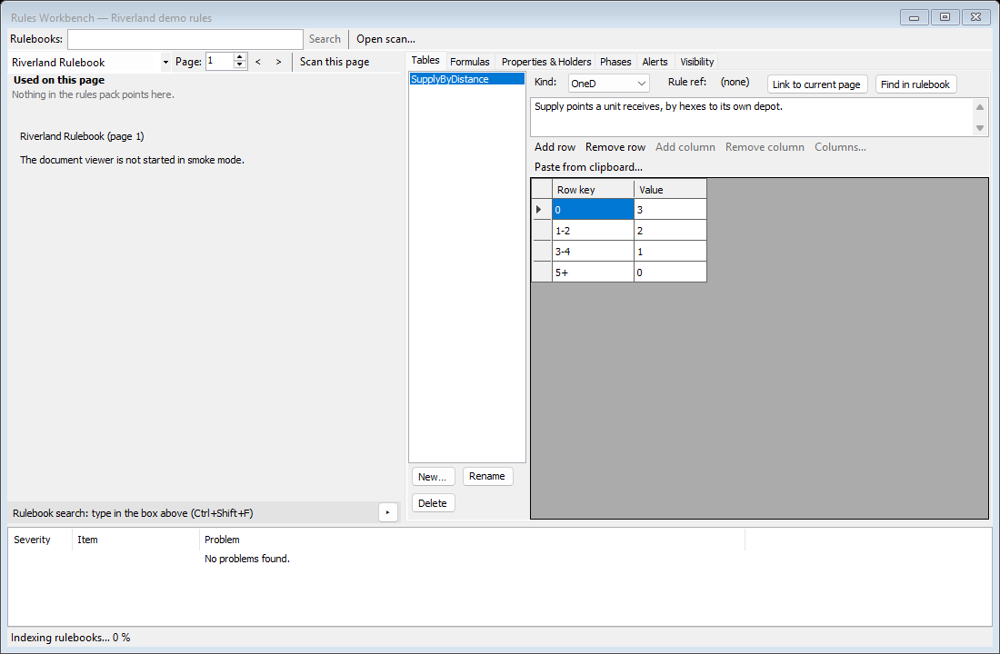
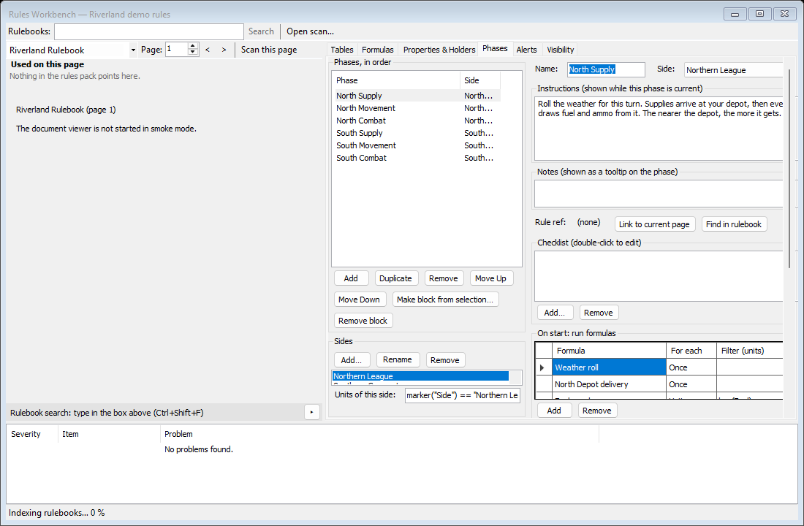

# Making a Rules Pack

A rules pack (a `.qrules` file) teaches Quartermaster the parts of your game that VASSAL leaves to you: the values each unit tracks, the charts, the sums, the order of play, warnings, and what each side may see. You write it once in the Rules Workbench, and then every game of that module uses it.

This page builds a rules pack from nothing for Riverland, the invented demo game, step by step. When you finish you will have a working copy of `Riverland-Demo.qrules`, and you will know how to do the same for your own module. The checklist at the end sums it up.

Every formula on this page is copied from the demo pack, so you know it works. For what each control does, see [Rules Workbench](Window-Rules-Workbench). For the full list of functions, see [Formula Reference](Formula-Reference).

## Before you start

- Install Quartermaster ([Install and Update](Install-and-Update)) and download `Riverland-Demo.vmod` and `Riverland-Demo.qrules` (see [Your First Game](Your-First-Game#get-the-demo-files)).
- Keep `Riverland-Demo.qrules` close by. If you get stuck, open it in a second copy of Quartermaster and compare.

Riverland in one paragraph: two sides, the Northern League and the Southern Compact, face each other across a river. Each unit has Fuel, Ammo and Readiness, printed on its property sheet in the module. Each side has a depot that holds Stores. Every turn the weather is rolled, supplies arrive, units draw fuel and ammo by their distance to the depot, then they move (moving costs fuel) and fight. Readiness is secret from the other side.

## Step 1: Create the pack

1. Start Quartermaster. In the launcher, select `Riverland-Demo.vmod` (use **Add module…** if it is not listed yet).
2. Choose **Play offline**, then **New game…**, then **OK**. The main window opens with the map.
3. Choose **File > New Rules Pack...**. Type a name, for example `My Riverland rules`, and choose OK.
4. Choose **Tools > Rules Workbench** (Ctrl+Shift+W). The Workbench opens on the new, empty pack.

If you are happy with a command line, you can do steps 1 to 3 in one go by starting Quartermaster with the module and the `--new-rules` option:

```
Quartermaster.App.exe Riverland-Demo.vmod --new-rules "My Riverland rules"
```

Keep the game open while you work. Everything you change in the Workbench applies to the open game at once, so you can test as you go.

Watch the **Problems** list at the bottom of the Workbench. While the pack is half-built it lists what is still missing. When everything is in place it reads "No problems found." Double-click a problem to jump to it.

## Step 2: Properties (the values units track)

Open the **Properties & Holders** tab.


Choose **Add property** three times and fill in the rows:

| Name | Scope | Default | SheetField | AppliesTo | Outliner |
|---|---|---|---|---|---|
| Fuel | Pieces | | Fuel | `marker("Kind") == "Unit"` | Sum |
| Ammo | Pieces | | Ammo | `marker("Kind") == "Unit"` | Sum |
| Readiness | Pieces | | Readiness | `marker("Kind") == "Unit"` | Average |

- **SheetField** is the name of a row on the counters' property sheet in the module. Riverland's units have a sheet called "Unit Sheet" with the rows Fuel, Ammo and Readiness, so each property starts at the number printed there. The drop-down suggests the row names it finds in the module.
- **AppliesTo** says which counters have the property. Riverland's counters carry a marker called Kind, which is `Unit` for fighting units, `Depot` for depots and `Marker` for the turn marker. So this filter means "only units":

```formula
marker("Kind") == "Unit"
```

Now the values that do not belong to a counter. Add two more properties:

| Name | Scope | Default | Notes |
|---|---|---|---|
| Stores | Holders | 20 | Supplies waiting at a depot |
| Weather | Holders | 1 | Kept on global. 1 = dry, 2 = mud |

A **holder** is a place that keeps values without being a counter. The built-in **global** holder always exists; Weather lives there. For the depots, choose **Add holder** twice and name the holders `North Depot` and `South Depot`.

**Test it:** in the main window choose **View > Ledger** (Ctrl+L). The **Units** tab already lists every unit with its Fuel, Ammo and Readiness from the module. The **Depots & Global** tab lists global and the two depots, with Stores 20. See [Ledger](Window-Ledger).

## Step 3: A table (the supply chart)

Riverland's supply chart: a unit 0 hexes from its depot gets 3 points, 1-2 hexes gets 2, 3-4 hexes gets 1, 5 or more gets nothing.

Open the **Tables** tab and choose **New…**. Name the table `SupplyByDistance` (one word: formulas refer to tables by name). Leave **Kind:** on **OneD** (one row key and one value). Choose **Add row** until there are four rows, and type:

| Row key | Value |
|---|---|
| 0 | 3 |
| 1-2 | 2 |
| 3-4 | 1 |
| 5+ | 0 |



Row keys can be single numbers, ranges like `1-2`, or open ranges like `5+`. A chart from a spreadsheet can be pasted in with **Paste from clipboard…**, and a scan of a printed chart can be read with **Open scan…** (see [Rulebook search and OCR](Window-Rulebook-Search-and-OCR)).

## Step 4: Formulas

Open the **Formulas** tab. For each formula below, choose **New…**, type the name, then type the formula in the big box. Every name you use in the formula (Fuel, Hexes and so on) appears as a row under **Bindings**. Fill in each row's **Kind**, **Target** and **Details** as shown, so Quartermaster knows where each value comes from. Then set the **Outputs**: what the result changes in the ledger.


### Fuel supply: reading the table with lookup

```formula
min(Fuel + lookup(SupplyByDistance, Hexes), 6)
```

In words: the unit's fuel plus the chart value for its distance to the depot, but never more than 6. **Applies to:**

```formula
has(Fuel)
```

| Variable | Kind | Target | Details | Caption |
|---|---|---|---|---|
| Fuel | Unit | Fuel | | |
| Hexes | Input | | `0..20 \| auto: 2` | Hexes from this unit to its depot |

- A **Unit** binding reads a property of the counter the formula runs on.
- An **Input** binding is a number the player types in the formula dialog. `0..20` limits it; `auto: 2` is the value used when the game fills things in by itself (Fully automatic). The caption is shown under the box.
- Choices instead of a range are separated by commas: `Coast, Inland`. If a choice itself holds a comma, put it in double quotes: `"North, coast", Inland` (write a quote inside a quoted choice twice).
- Add `| always ask` (for example `0..20 | always ask`) when the player must answer every time. Fully automatic then never uses the `auto:` value for this input and asks instead.
- `SupplyByDistance` inside `lookup(...)` is the table's name, so it needs no binding.

**Outputs:** choose **Add output** and set Target **Unit**, Property **Fuel**, Op **Set**. (A new output starts as Subtract; change it.)

### Ammo supply: the same table through a table variable

```formula
min(Ammo + Gain, 4)
```

**Applies to:** `has(Ammo)`. Here the table is read by a binding instead of `lookup`:

| Variable | Kind | Target | Details | Caption |
|---|---|---|---|---|
| Ammo | Unit | Ammo | | |
| Gain | Table | SupplyByDistance | `row: Hexes` | |
| Hexes | Input | | `0..20 \| auto: 2` | Hexes from this unit to its depot |

When you type `row: Hexes` into Gain's Details, a Hexes row appears in the bindings by itself, because the row expression uses it. Set it up as in Fuel supply. With a table variable the formula stays short, and the cheat sheet shows the whole table with the cell that was used (see [Formula dialog](Window-Formula-Dialog#cheat-sheet)).

**Outputs:** Target **Unit**, Property **Ammo**, Op **Set**.

### Fuel for movement: distance moved and a global value

```formula
ceil(Moved * Weather / 2)
```

One fuel for every two hexes moved, rounded up, and twice that in mud. **Applies to:** `has(Fuel)`.

| Variable | Kind | Target | Details |
|---|---|---|---|
| Moved | Moved | | |
| Weather | Global | Weather | |

**Moved** is the distance the counter just moved, in hexes. **Global** reads a value kept on the global holder. **Outputs:** Target **Unit**, Property **Fuel**, Op **Subtract**.

### Attack roll: dice

```formula
Die + floor(Readiness / 2)
```

**Applies to:**

```formula
has(Readiness)
```

| Variable | Kind | Target | Details |
|---|---|---|---|
| Die | Roll | | `1d6` |
| Readiness | Unit | Readiness | |

A **Roll** binding rolls dice; Details takes dice notation such as `1d6` or `2d6`. This formula has no outputs: it only shows the result, and the player decides what happens.

### A range chart and a roll per plane

Some charts print a different range in each cell of a row, and some are rolled once for every plane of a squadron. Two functions cover them: `lookuprange` and `count`.

**A range chart.** Make a table `Landing` with the altitude bands as rows (`1`, `2`, `3`) and the landing results as columns (`Hard`, `Rough`, `Smooth`). Put a range in each cell: in row `2` the `Hard` cell holds `1-3`, the `Rough` cell `4-5` and the `Smooth` cell `6+`. Then the formula is `lookuprange(Landing, Altitude, Roll)` with these bindings:

| Variable | Kind | Details |
|---|---|---|
| Altitude | Input | `1..3` |
| Roll | Roll | `1d6` |

With Altitude 2 and a Roll of 5 the formula gives `Rough`. If no cell of the row holds the roll, the run stops with `No column of Landing row 2 holds 7`, so end each row with an open range such as `6+`.

**A roll per plane.** A squadron of Riverland bombers rolls one die per plane. Bind `Planes` as Kind **Roll**, Details `1d6`, and put an expression in the **Dice count** column of the bindings grid: `Squadron` (an Input of `1..12`). Leave it blank to use the fixed number from Details. The expression may read inputs and other bindings, but not the roll itself, and must give a whole number from 1 to 100. Then count the dice with `count(Planes, 1, 2) * 10 + count(Planes, 6, 6)`.

This gives 10 for every plane that rolled 1 or 2, plus 1 for every 6. With **Physical dice** on in the formula dialog, type the dice of `Planes` separated by spaces (`1 2 5 6`); the dice are logged one by one.

### Ammo for firing

```formula
if(Ammo > 0, 1, 0)
```

**Applies to:** `has(Ammo)`. One binding: Ammo, Kind **Unit**, Target **Ammo**. **Outputs:** Target **Unit**, Property **Ammo**, Op **Subtract**.

### Weather roll: writing to global

```formula
if(Die >= 5, 2, 1)
```

No **Applies to** (leave it empty: the formula is not about a counter). Die is a **Roll** with `1d6`. **Outputs:** Target **Global**, Property **Weather**, Op **Set**.

### Depot deliveries: reading and writing a holder

Make two formulas, `North Depot delivery` and `South Depot delivery`, with the same text:

```formula
min(Stores + Delivery, 30)
```

| Variable | Kind | Target | Details |
|---|---|---|---|
| Stores | Holder | North Depot: Stores | |
| Delivery | Roll | | `1d6` |

For South Depot delivery, pick **South Depot: Stores** instead. **Outputs:** Target **Holder**, Holder **North Depot** (or **South Depot**), Property **Stores**, Op **Set**.

### One roll, several supply losses; picking a slot

An output can have its own value, and can pick its property when the formula runs. Both are optional, and both are described under [Outputs](Formula-Reference#outputs) in the Formula Reference.

**One roll, several losses.** Make a formula `Raid` whose text is `Loss`, with `Loss` bound as a **Roll** of `1d6`. Add three outputs on the Unit target with Op **Subtract**: Property **Fuel** (leave **Value** blank, so it loses the roll), Property **Ammo** with **Value** `Loss * 2`, and Property **Rations** with **Value** `max(Loss - 1, 0)`. One roll now takes from all three, and the working line shows each loss.

**Picking a slot by an input.** Add an Input `Slot` with Details `1..3`. On one output, fill **Choose from** with `Fuel, Ammo, Rations` and **Pick by** with `Slot`. Slot 2 changes Ammo. One formula does the work of three.

### Try each formula

Under the bindings, the **Preview** shows the [formula dialog](Window-Formula-Dialog) as players will see it. Pick a counter in **Test piece:** (for example NL 1 Rifles) and try values. Nothing you type in the preview is saved.


You can also try a formula in the game itself: right-click a unit on the map and choose **Calculate**, then the formula. **Apply to ledger** writes the result, and the Ledger shows the new value. **Edit > Undo** (Ctrl+Z) takes it back.

## Step 5: Sides and phases

Open the **Phases** tab.



### Sides

Under **Sides**, choose **Add…** and type `Northern League`. In **Units of this side:** type the filter that picks its units:

```formula
marker("Side") == "Northern League"
```

Do the same for `Southern Compact`:

```formula
marker("Side") == "Southern Compact"
```

Sides decide whose turn it is, which units a phase works on, and who may see private values.

### North Supply

Under **Phases, in order**, choose **Add** and name the phase `North Supply`. Set **Side:** to Northern League and write the **Instructions** (shown to players while the phase is current), for example "Roll the weather for this turn. Supplies arrive at your depot, then every unit draws fuel and ammo from it."

In **On start: run formulas**, choose **Add** four times:

| Formula | For each | Filter (units) |
|---|---|---|
| Weather roll | Once | |
| North Depot delivery | Once | |
| Fuel supply | Units | `has(Fuel)` |
| Ammo supply | Units | `has(Ammo)` |

**Once** runs the formula one time. **Units** runs it for every unit of the acting side that passes the filter.

### North Movement

Add a phase `North Movement`, side Northern League. In **On move: run formulas for moved units**, add the **Fuel for movement** formula from the tutorial above with the filter `has(Fuel)`. Now every move during this phase charges fuel.

Under **Warnings**, add a row with this **Condition**:

```formula
Fuel <= 0
```

and the **Message** `{unit} has no fuel and cannot move`. `{unit}` is replaced by the unit's name.

### North Combat

Add a phase `North Combat`, side Northern League. Under **Checklist**, choose **Add…** for each item: "Choose attackers", "Run Attack roll for each attacker", "Run Ammo for firing for each attacker". Add a warning:

```formula
Ammo <= 0
```

with the message `{unit} is out of ammo`.

### The Southern Compact's phases

Select North Supply and choose **Duplicate**. Change the copy's **Name:** to `South Supply`, set **Side:** to Southern Compact, remove the Weather roll row (the weather is rolled once a turn) and change North Depot delivery to **South Depot delivery**. Duplicate North Movement and North Combat the same way. Use **Move Up** and **Move Down** until the order is North Supply, North Movement, North Combat, South Supply, South Movement, South Combat.

**Test it:** in the main window choose **Start game**. The phase strip shows North Supply, and the phase panel shows your instructions and the formulas waiting to run. See [Phases](Window-Phases).

### End-of-phase formulas

Some work belongs at the end of a phase. In **On end: run formulas**, add rows just as under **On start**. Example: first create a formula `Fuel upkeep` (or reuse one of the formulas above), then add it at the end of North Combat with For each **Units** and the filter `has(Fuel)`. When a player presses Next Phase, these formulas run first. If they all run by themselves, the game moves on in the same press; if one needs input, the game stays in the phase until you finish it and then press Next Phase again (`Finish the end-of-phase runs, then press Next Phase again`). See [Phases](Window-Phases#end-of-phase-formulas).

### Moves by the other side

On **North Movement**, give an **On move** row **Fires for** **Other side**, and the formula runs when a Southern Compact counter moves during the Northern League's phase (a reaction move). **Acting side** is the default; **Any side** reacts to every move. To limit an entry to moves on one map (for example, to ignore drags into an off-board box), filter on `map()`: `map() == "Main Map"`. See [Phases](Window-Phases#moves-by-the-other-side).

### Formulas limited to phases

To stop a formula being used in the wrong phase, tick the phases it belongs to under **Only in phases** on the Formulas tab (for example, tick North Movement for **Fuel for movement**). Everywhere else it is greyed in the counter menu with the tooltip `Only in: North Movement`, and the formula dialog will not run it. Leave all boxes empty and the formula is allowed in any phase. Formulas that phases run by themselves ignore the limit. The validator reports a phase that no longer exists (`Formula "{name}": phase list names unknown phase "{id}"`) and warns when a phase's entry runs a formula limited to other phases (`Phase "{phase}": {start|move|end} entry runs "{formula}", which is limited to other phases`). See [Phases](Window-Phases#formulas-limited-to-phases).

### Formulas that can refuse to run

A formula can insist on a condition before it runs. On the Formulas tab, write it in **Only runs when**, for example `Fuel > 0` on **Fuel for movement**. When the condition is false the run is refused: nothing is rolled, nothing is written to the ledger, and the formula dialog shows the reason in its status line with **Apply to ledger** greyed out. The reason is the **Refusal message** you typed, or, when you left it empty, `Fuel for movement cannot be run now`. A formula that a phase runs by itself logs the refusal as `{formula}: {unit}: {message}`; a run waiting in the phase panel stays waiting.

While the condition reads a value the player has not typed yet, the formula waits and its dice are not rolled until the condition can be decided.

The condition may read variables of the formula and anything else a formula may read, but it **cannot use a Roll variable or `dice()`**: the validator reports `Formula "{name}": the precondition cannot use the roll {variable}` or `Formula "{name}": the precondition cannot use dice()` (this includes a roll reached through a table row, an auto value or an **Only when** condition). A variable that only the condition reads still gets its own row under **Bindings**.

### Variables used only sometimes

A binding can have an **Only when** condition (the last column of the bindings grid). Example, on a formula `if(Coast == 1, Fuel - Surf, Fuel)`: give the input `Surf` the condition `Coast == 1`. The condition may read another input, so one answer decides whether the next is asked: while `Coast` is empty the `Surf` box is blank and closed, once `Coast` is 0 the box shows `not used`, and once it is 1 the box asks for a value. A binding whose condition is false is skipped: it is not asked, rolled or looked up.

Only the branch that is taken may read such a variable. If the formula reads `Surf` when its condition is false, the run stops with `Surf is not used here: its "Only when" condition is false`. Wrap every read in an `if` that matches the condition, as above.

A skipped Table binding is not looked up, but the inputs and rolls that feed only its row or column are still asked and rolled. Give those feeder bindings the same **Only when** condition.

### Phase conditions

A phase can run only some of the time. In the **Runs only if** field, write a formula that must be true for the phase to run. Leave it empty and the phase always runs. When the condition is false, Next Phase (and Start game) skip the phase without running anything in it: no start formulas, no warnings, no checklist. A condition may read only global properties, tables, `turn()`, `stage()` and `phaseside()` (see [What a phase condition may read](Formula-Reference#what-a-phase-condition-may-read)).

Recipes:

- **Two copies of a side's turn.** Add a global property `Flag` (Default 0). Make two copies of North Movement. Put one copy before South Supply (the other side's turn) and one after it, and give the first the condition `Flag == 1` and the second `Flag == 0`. Only one of them runs, depending on the flag.
- **Only at the start of the game.** A phase with `turn() == 1` runs on the first turn only.
- **Every fourth turn.** A phase with `mod(turn(), 4) == 1` runs on turns 1, 5, 9 and so on.

If a condition is always false, the Workbench warns that the phase never runs. If every phase is skipped, Quartermaster checks one full turn, then stops at the very next phase and shows a notice saying so.

### Start entries run in order

The **On start** rows of a phase run strictly from top to bottom, in every difficulty. Quartermaster works out the next row's units only after the row above has nothing left waiting, so a row can read what the row above wrote. In North Supply the order is Weather roll, North Depot delivery, then Fuel supply: Fuel supply reads the depot after the delivery has landed. When a row has runs that wait for you (always in Semi-automatic and Hardcore, and in Fully automatic when a unit needs a value from you), the later rows wait too, and they continue as soon as you have answered the last of those runs. Undo on the answer takes back the answer and everything it released.

If you press Next Phase while rows have not run yet, the log says `not run: Fuel supply, Ammo supply` (the formula names, in row order), next to the usual `skipped:` line for runs left open. See [Phases](Window-Phases#start-formulas-run-in-order).

### Asking a side at the start of a phase

Give a phase with **no side** a first row that a particular player must answer. Add a phase `Dawn` (leave **Side:** empty) and put the formula `River level roll` in **On start** with **For each** set to **Once** and **Asks side** set to **Northern League**. The run is always queued for the Northern League, in every difficulty, and the host never applies it by itself. It reads `River level roll — Northern League answers` in the open list. Only a player holding the Northern League (or an ally of it, see [Alliances](#alliances)) sees and answers it; another player who tries gets `That calculation belongs to a side you don't hold.` Its window opens by itself only for the League's own player; an ally may open it from the phase panel. When the League answers, its rolls and working follow that side's privacy, and the rows after it continue. Make the next row read the global that `River level roll` wrote (for example `Fuel supply` using `RiverLevel`). In hot-seat play the screen is passed to the League's player, and until the run is answered another player sees `Northern League is playing Dawn` and cannot use Next Phase. In a solo game in Fully automatic, an asked run that only rolls dice finishes by itself, with no window; one with a value to type still asks for it.

Rules for **Asks side** (the same column is on **On end**): it needs a phase without a side and **For each** = Once. The validator reports `Phase "Dawn": start entry 1 asks side "{id}", which does not exist`, `Phase "Dawn": start entry 1 asks a side, so it must run once, not for each unit` and `Phase "Dawn": start entry 1 asks a side, but only a phase without a side may ask one`. **(none)** means no one is asked.

### Values that reset at a phase

Some counters keep a value only for part of a turn. Add a piece property `Ferry used` (Default 0) and type `North Supply, South Supply` in its **Resets at** cell. Every time the game enters one of those phases, Quartermaster deletes the stored `Ferry used` values on every counter and holder, before the phase's start rows run. Starting the game enters the first phase, so it resets that phase's properties too. Counters then start again from their starting value (a sheet value, or the **Starting value** below), and other counters read the Default. The log shows one System line, `North Supply: reset Ferry used` (several properties are separated by commas, in the pack's order; it names no counts and no counters). Ledger history stays. A phase that is skipped by its condition is not entered and resets nothing; a repeating block resets on every pass. Reset, re-seed and the start rows are all part of the Next Phase action, so one undo takes them back.

An unknown phase name is refused with `No phase named "{name}"` and the cell goes back to what it was. The validator reports `Property "Ferry used" resets at phase "{id}", which does not exist` and `Property "{name}" is computed, so it has nothing to reset`.

### How often a formula has run

`runs()` counts how many times a formula has been applied, so a precondition can allow it only so many times. Give the formula `Bridge repair` the **Only runs when** condition `runs("f-bridge-repair", "turn") < 1`. Now each counter can run Bridge repair once a turn: the second try is refused with the refusal message. The formula id is the one in the formula's **Id** (here `f-bridge-repair`). The period is `"stage"` (this pass of a repeating block), `"turn"` or `"game"` (the default). Only applied runs count; failed, refused and undone runs do not, and the run being checked is not counted yet. See [`runs()`](Formula-Reference#runsformula-id-or-runsformula-id-period).

## Step 6: An alert

Open the **Alerts** tab and choose **Add**. Set **Name:** to `Low fuel`, the **Condition** to

```formula
Fuel < 2
```

the **Message ({unit} = unit name):** to `{unit} is low on fuel`, and **Severity:** to Warning. Leave **Side:** on (any).

**Test it:** a **Low fuel** chip appears in the main window's alert bar at once, because NL 6 Recon starts with 1 fuel. See [Main window](Window-Main-Window#alert-bar).

## More recipes

Short formulas for common needs. Each uses the invented Riverland names; adapt them to your own pack.

- **A rate per side and turn.** Make a table `Rate` with the sides as columns and the turns as rows, then write `lookup(Rate, turn(), side())`. Each unit reads the column of its own side.
- **A weather entry filter.** On a phase's start formula, set the entry's filter to `Weather == 2`. `Weather` is a global property (scope Holders), so in a filter it reads the game-level value: the entry runs only while the weather is 2.
- **A capacity warning.** On a phase, add a warning with the condition `holder(Rail, Tonnage) > holder(Rail, Capacity)` and the message `Rail line is overloaded`. It reads no unit, so it shows once in the [phase panel](Window-Phases), with no units under it. Use the same condition in an alert to get one chip.
- **A phasing modifier.** In a formula, `if(side() == phaseside(), 1, 0)` is 1 for the units of the side whose phase it is, and 0 for the rest.
- **Upkeep on the main map only.** Set a formula's **Applies to** to `map() == "Main Map"` so units on other maps are left alone.
- **The stack has an engineer.** Say your units carry a marker Type, and engineers have the Type `Engineer`. In a formula run on a unit, `if(hexcount("marker(\"Type\") == \"Engineer\"") > 0, 1, 0)` is 1 when an engineer shares the unit's hex (the unit itself included), so the player no longer types it in. The filter is quoted text, so quotes inside it are written `\"`.
- **A side's total trucks.** `countof("marker(\"Type\") == \"Truck\" and side() == \"Southern Compact\"")` counts the Southern Compact's trucks wherever they are. Use it in a formula, or in a phase warning such as `countof("marker(\"Type\") == \"Truck\" and side() == \"Southern Compact\"") < 3`; that condition reads no single unit, so it shows once.
- **All the fuel in a hex.** `hexsum(Fuel, "marker(\"Kind\") == \"Unit\"")` adds up the Fuel of every unit in the unit's hex. `sum`, `maxof` and `minof` do the same over the whole game. Counts and sums of Private values count as hidden data in online play; see [Formula Reference](Formula-Reference#sumproperty-filter).

## Step 7: Visibility (who may see what)

Open the **Visibility** tab.

- In **Properties**, new properties start as **Private**. Set Fuel, Ammo, Stores and Weather to **Public**, and leave **Readiness** Private. Now only the side that owns a unit sees its Readiness.
- In **Holders**, set North Depot's owner to Northern League and South Depot's to Southern Compact. Each depot now belongs to its side.
- Leave **Maps and org displays** and **Formulas** as they are. (Tick **Private dice** on a formula when its rolls should be secret.)

How hidden values behave in hot-seat and online play is explained in [Playing With Others](Playing-With-Others). Public values of a side's holder, side alerts, revealing a value and sealed answers are in [Visibility, reveals and sealed answers](#visibility-reveals-and-sealed-answers).

## Step 8: Test in the Ledger

With the game open and the Workbench beside it:

1. Open the **Ledger** (Ctrl+L). Check that every unit has the Fuel, Ammo and Readiness printed on its counter sheet, and that the depots have Stores 20.
2. Choose **Start game** (or **Next Phase**) to reach North Supply. In the phase panel, under **Decisions left**, double-click each waiting calculation (for example "Fuel supply — 0 of 7 applied") and apply it. The Fuel and Ammo columns go up, but never above 6 and 4.
3. Choose **Next Phase** to reach North Movement and drag a unit two hexes. The Fuel for movement dialog opens; apply it and see the unit's Fuel drop by 1 (2 in mud).
4. Hover a value in the Ledger to see its breakdown: every change, step by step.

If a number is wrong, fix the formula in the Workbench, then undo (Ctrl+Z) and try again. The Workbench shows the changed pack straight away.

## Step 9: Save the pack

Choose **File > Save Rules Pack** in the main window. The first time, it asks where to save; name the file `My-Riverland-rules.qrules`. Later saves go to the same file, and **Save Rules Pack As...** makes a copy. Quartermaster asks before closing if the pack has unsaved changes.

Quartermaster remembers the pack for this module, so the next time you open the module the launcher shows it under "Rules pack:".

## Step 10: Share it

The `.qrules` file is all another player needs, together with the same module file. They choose **change…** in the launcher and pick it ([Launcher](Window-Launcher)). A rules pack is made for one exact module file: if the module is a different version, Quartermaster warns "Rules pack was made for a different module". In an online game, guests get the host's pack automatically and cannot change it.

A rules pack holds only what you typed in. It never contains the module's rulebooks, pictures or counters, so you can share your own work without sharing anyone else's.

## Rule references

A rule reference ("rule ref") points at a page of the module's rulebook, so a player can open the rule behind a value, a warning or a checklist item. Tables, formulas and phases get one with **Link to current page** in the Workbench ([Rule references](Window-Rules-Workbench#rule-references)); that also adds the ref to the pack. Properties, holders, alerts, phase warnings and checklist items then pick one of the pack's refs from a list that reads **(none)**, then each ref as `{label}, page {page}`, for example "Ferry rules, page 4".

Say Riverland's ferry rules are on page 4. Link the **North Depot delivery** formula to that page, then pick "Ferry rules, page 4" as the rule ref of the North Depot holder and of the Stores property.

If a ref is deleted while something still points at it, the Problems list warns, for example `Property "Stores": rule reference "r-ferry" does not exist`, and the picker shows `r-ferry (missing)` so you can pick **(none)**. The same warning can name a `Holder "{name}"`, an `Alert "{name}"`, `Phase "{name}": warning {n}` or `Phase "{name}": checklist item {n}` (counting from 1).

## Checklist item ids and links

A checklist item can have an **Id:** (letters, digits, `-`, `_` or `.`), set below the checklist on the Phases tab. Ids are unique across the whole pack. An item with an id stays ticked when you reorder the items during a game; an item without one is ticked by its place in the list.

With ids, one item can point at another. In North Supply, add an item "Count the spare boats at the ferry landing" with the id `spare`, then write a second item:

`Load the ferry once {item:spare} is done, then run {formula:f-north-delivery}`

The phase panel shows `{item:spare}` as the linked item's text in double quotes, cut to 40 characters with `…`, and `{formula:f-north-delivery}` as the formula's name, "North Depot delivery". A link whose target does not exist is shown as written. A link to an item of a phase whose checklist a player may not see is also shown as written, so its text never reaches that player. In the Workbench the list row reads `{id}: {shown text}`, and the **Links:** line under it lists each link's target, or `{token} (missing)`.

The Problems list checks ids and links:

- error: `Phase "North Supply": checklist item 2 has an unusable id "two words"; use letters, digits, '-', '_' or '.'`
- error: `Phase "North Supply": checklist item id "spare" is used more than once`
- warning: `Phase "{p}": checklist item {n} names item "{id}", which does not exist`
- warning: `Phase "{p}": checklist item {n} names formula "{id}", which does not exist`

A pack whose items are only text keeps exactly the same file when you save it.

## Labels for numbers

A value can show a word next to its number. Say Riverland's weather had three kinds: 1 is clear, 2 is rain and 3 is fog. Make a one-dimension table **Weather names**:

| Row key | Name |
|---|---|
| 1 | Clear |
| 2 | Rain |
| 3 | Fog |

Then on the Properties & Holders tab set Weather's **Labels** to Weather names. A Weather of 3 now shows as `3 (Fog)` in the Ledger, the outliner, the counter popup, the breakdown title and the working of a formula (a variable's value and the `Weather = 3 (Fog)` part of a Set output; Add and Subtract outputs stay bare numbers). The value is still the number 3 everywhere it is stored or used: formulas, filters and the CSV export see 3. A value with no row in the table, or a blank cell, shows only the number. In the outliner a group's total or average stays a bare number; a lowest value shows its label.

The labels table must have one column (one dimension or dice). The Problems list reports `Property "Weather" takes its labels from a table that no longer exists`, or `Property "Weather" takes its labels from table "{t}", which has more than one column`. Labels never show anything a player could not already see: a label sits next to a value the player already has, and hidden working stays hidden.

## Starting values from an expression

A counter's first value normally comes from its sheet field or the property's Default. A **Starting value** works one out instead. Riverland's boats carry a marker `Kind`; add a piece property `Boat crew` and type this in its **Starting value** cell: `lookup(CrewSizes, marker("Kind"))` (`CrewSizes` is a table with one row key per Kind. Table names are one word.) When the game seeds the ledger, each counter that has this property and no sheet value gets the expression worked out once, in the counter's own context, in pack order, so the expression may read the counter (`name()`, `marker()`, `side()`, `map()`), its earlier values, globals, tables, `turn()`, `stage()` and `phaseside()`. A sheet value always wins. It may not use `dice()`, `holder()`, `runs()` or a piece sum (`sum`, `countof`, `maxof`, `minof`, `hexsum`, `attachedsum` and the rest), directly or through a computed property or global: the starting values must come out the same every time the game is replayed.

If the expression fails or does not give a number, the counter starts at the property's Default, and the log warns once per property: `Starting value of "Boat crew" failed on "{piece}": {error}; it starts at 0`. A function that is not allowed shows as `{fn}() is not available in a starting value`; a result that is not a number as `the starting value is not a number`.

The validator reports, as errors: `Property "{name}" has a starting value expression and is computed; remove one`, `Property "{name}": the starting value expression does not parse: {message}`, `Property "{name}": starting value {problem}`, `Property "{name}": {fn}() is not available in a starting value` and `Property "{name}" has a starting value expression but is not a piece property`. Combine it with **Resets at** (above) to start a value afresh at a phase.

## Acting on other pieces

A formula normally changes only the counter it runs on, a holder or the global holder. Outputs can also write another counter, put a new counter on the map, remove one, or set a layer or a mask. Everything below is optional; a pack that does not use it works as before. The columns are described in the [Formula Reference](Formula-Reference#acting-on-other-counters) and the [Workbench](Window-Rules-Workbench#formulas-tab).

### Writing to another counter

Riverland's barges carry fuel for others. Make a formula `Barge transfer` whose text is `Amount`, with these bindings:

| Variable | Kind | Target | Details |
|---|---|---|---|
| Amount | Input | | `1..10` |
| Fuel | Unit | Fuel | |
| Receiver | Piece | Fuel | which pieces: `marker("Kind") == "Unit"`, with **Same hex** ticked |

**Outputs:** the first has Target **Unit**, Property **Fuel**, Op **Subtract** (the barge gives). The second has Target **Piece**, **Piece** `Receiver`, Property **Fuel**, Op **Add** (the receiver takes).

Run it on the Blue Barge: the Receiver list holds only the other counters in the barge's hex (without **Same hex** the list holds every counter you can see, with the ones in the barge's hex first). Both changes happen in one run and one Undo takes both back. Add `Amount <= Fuel` as the formula's **Only runs when** (with `Refusal message` `The barge has too little fuel`) so a barge cannot give more than it has.

A formula whose only link to a counter is a Same hex Piece binding is offered on counters in the counter menu, like a formula with a Unit binding.

### Results on the other side's counters

The Northern League shells a Southern Compact unit. `Shelling` has the Input `Hits` (`0..6`) and a Piece binding `Target` of Strength, with the filter `side() == "Southern Compact"`; the one output has Target **Piece**, **Piece** `Target`, Property **Strength**, Op **Subtract**, Value `Hits`.

The result lands at once, with no confirmation from the other player, and one Undo takes it back. What each log shows:

- The Southern Compact player sees `Rifle 3: Shelling: Strength 7 - 2 = 5` (the counter's name, then the formula and the change).
- The Northern League player, who ran the formula, sees `Southern Compact ledger changed`, not the value, and its own working line for the run.
- A counter that belongs to no side shows the full line to everyone.

Online, the host works out a guest's `Shelling` and tells the guest only what the guest may see. If the target's value is hidden from the guest, the guest's formula dialog leaves the calculation to the host.

### Placing a counter

`Wreck` is a palette entry (a counter in the module's palette, in a folder `Markers`). A formula `Sink` runs on a barge and has the outputs:

1. Action **Place**, Target **Unit**, **Palette entry** `Markers/Wreck`. The wreck appears in the barge's hex, on top of its stack. The log reads `Sink: placed Wreck`.
2. Action **Write**, Target **Placed**, Property **Salvage**, Op **Set**, Value `3`. The new wreck's Salvage is 3. A Placed write must be Set: the counter is new.

A formula may place one counter. **Palette entry** is the palette path or the gpid; the cell offers the module's paths. With Target **Piece** instead of Unit, the wreck goes in the hex of the counter a Piece binding picked.

### Removing a counter

`Demolish` removes a `Bridge` when its Strength falls to 0. Give it a Piece binding `Span` and an output with Action **Remove**, Target **Piece**, **Piece** `Span`. The counter and its ledger values are deleted; the log reads `Demolish: removed Bridge`, and only the side that owned the bridge keeps that line. Removals always run last, so a Strength write to the same bridge in the same run is logged first.

To keep the counter, set **To map** to `Dead pile` (a map with a board): the counter moves to the middle of that map's first board and keeps all its values. The log reads `Demolish: moved Bridge to Dead pile`. `(delete)` in the **To map** cell means delete.

In Fully automatic play, a counter that an earlier run in the same pass removed is skipped without a message.

### Layers and masks

A fort counter carries a layer `Levels` (three pictures: Fort level 1 to 3; switched off while the fort is unbuilt). A formula `Build fort` with Input `Level` (`0..3`) has one output: Action **Set layer**, Target **Unit**, **Layer** `Levels`, Value `Level`. Level 0 switches the layer off. The log reads `Build fort: Levels of Fort 2 = 2` (a layer with named levels shows the level's name).

To read the level in another formula, use `layer("Levels")`: Applies to `layer("Levels") >= 2` offers a formula only on forts of level 2 or more. A level that comes from a property cannot be set (read the property).

A minefield counter has a Mask trait, so players cannot see what it is. A formula `Sweep` with a Piece binding `Field` and the output Action **Set mask**, Target **Piece**, **Piece** `Field`, Value `0` reveals it: the log reads `Sweep: Minefield 4 unmasked`. Value `1` masks it again (`masked`). Players who cannot see the counter do not get the line.

### What the Problems list says

Each message begins `Formula "{name}": `.

- `output {n} acts on another piece but names no Piece variable`; `output {n} names variable "{v}", which is not a Piece binding`; `output {n} names a Piece variable but its target is not Piece`.
- `output {n}: {action} cannot target {target}` (for example `output 2: Remove cannot target Global`).
- `output {n} places a piece but names no palette entry`; `output {n} places palette entry "{slot}", which does not exist in the module`; `output {n} names a palette entry but does not place a piece`.
- `output {n} places a second piece; only one output may place a piece`; `output {n} writes the placed piece, but no output places one`; `output {n} writes the placed piece, so its operation must be Set`.
- `output {n} sets a layer but names none`; `output {n} names a layer but does not set one`.
- `output {n} moves the piece to map "{id}", which does not exist in the module`; `output {n} names a map but does not remove a piece`.
- `output {n} has a property list but does not write a value`.
- `output property "{p}" cannot be written to a piece (its scope is {scope})`.
- Warning: `variable "{v}" has "same hex" but is not a Piece binding`.
- `layer() needs a layer name in quotes`, and `layer` in a phase condition is refused like the other counter functions.

## Group and repeated runs

Two things help when one formula runs for many counters, or many times: a roll shared by a group, and choices that come from a table.

### Rolling once for a group

Riverland's `Ford crossing` formula rolls `1d6` to see whether a counter gets across the river, and it is run for every counter in a hex at the start of a phase. If each counter rolled its own die, two counters in the same hex could cross or fail on different dice. Tick **Roll once for the group** on the formula (in the Workbench, under the phase list). Now:

- In a **phase entry** (a start entry that queues the formula for several units), the counters in the same hex and on the same side form one group. The group's dice are rolled once, by the first counter that is applied, and the others reuse them. Counters of another side in the same hex are a group of their own, and a counter off the grid has no group. Each counter still gets its own working line in the log, and the group's dice are logged once.
- In a **menu batch** (see [Running on several counters](Window-Formula-Dialog#running-on-several-counters)), the first row rolls and the later rows reuse its dice. Dice are shared only when the later row asks for the same number of dice with the same sides; otherwise it rolls its own. This holds in a phase entry too, and for `dice()` calls in the formula text: if an `if` makes one counter roll `dice(2, 6)` and another `dice(2, 10)` at the same place, the second rolls its own d10s. A roll you type as a single number (a sum of physical dice) is never shared.
- A formula without the tick rolls for every counter, as before.
- Online, a guest never rolls a group's dice: the host draws them, and a guest who asks again does not get a new draw while the group's dice are still live.

The Roll box of a shared roll reads `Roll (group roll)` (the Roll variable's caption plus ` (group roll)`), is greyed out, and its tooltip says `Rolled once for the group`.

The Problems list warns `Formula "Ford crossing": rolls once for the group but has no dice` when the tick is set on a formula with no Roll variable and no `dice()`.

When a counter in a fully automatic run is removed by an earlier counter's formula, the log summary says `Ford crossing: 3 units, 2 applied, 1 removed`. The removed count only shows when it is above 0.

### Choices from a table

An Input can offer the row keys of a table as its choices, so a player picks instead of typing. Riverland's `Barge cargo` formula has an Input `Cargo` with the **Choices table** `Cargo` (a table whose rows are cargo names, with a `Min size` column). The dropdown of the Input then lists every row key.

Add a **Choices filter** to list only some rows. `row()` is the row key being tested, and the counter's own values can be read as well, for example:

`lookup(Cargo, row(), "Min size") <= Size`

lists only the cargo whose `Min size` is within the barge's `Size`. The list is worked out for each counter, so in a batch every row shows the choices for its own counter, and with no counter it shows every key. If the key is a number in the table (all keys numeric) the Input gives a number, otherwise text. A table whose row keys are ranges (`5+`) cannot be used as choices. Table names should be unique: if two tables share a name, the Workbench's **Choices table** cell picks the first. See [`row()`](Formula-Reference#row).

At run time a typed value that is not in the list is refused with `Not one of the choices for this piece`, and a counter for which the filter leaves nothing gets `No choice for this piece`. A filter that fails shows `Choices filter: {message}`. Neither message lists the choices, so a player cannot learn from a refusal what a hidden counter would offer. In a hot-seat game the list uses only what the seated player can see.

The Problems list says (each begins `Formula "{name}": `):

- `variable "{v}" draws its choices from unknown table "{id}"`;
- `variable "{v}" has a choices table but is not an Input`;
- `variable "{v}" has both choices and a choices table`;
- `variable "{v}" draws its choices from table "{name}", whose row keys are ranges`;
- warning: `variable "{v}" has a choices filter but no choices table`;
- `variable "{v}" choices filter {problem}` (a syntax problem, or a name the filter cannot use).

## Properties some holders keep

By default every holder keeps every holder property. Some values belong to one holder only. Say only the North Depot takes ferry tolls: add a property **Ferry tolls** with scope Holders and type `North Depot` in its **Holders** cell (several names are separated by commas; `global` is the built-in holder; blank means every holder). An unknown name is refused with `No holder named "{name}"`.

Then:

- In the Ledger the South Depot and Global show a blank, read-only Ferry tolls cell. Typing there is refused with `South Depot does not keep Ferry tolls`. On the **Depots & Global** tab and on your own tabs a column is left out when none of the rows shown keeps it.
- In the Formulas tab, a Holder binding's Target and a Holder or Global output's Property offer each holder only the properties it keeps.
- A run that reads or writes a value its holder does not keep fails with `{holder} does not keep {property}`.

Filters, alerts, phase conditions and computed properties do not fail for a holder that does not keep a value. A bare global property name there (for example `Ferry tolls` in an alert, when the global holder does not keep it) reads whatever is stored for the global holder, or the property's Default, which can differ from the blank cell the Ledger shows. The Problems list does not flag a bare name. Prefer `holder(North Depot, Ferry tolls)`: it names the holder, and the Problems list checks it.

The Problems list reports `Property "Ferry tolls" names holder "{id}", which does not exist`, `Property "{name}" lists holders but is not a holder property` (a Pieces property), and formulas that use a value a holder does not keep: a binding `{variable} reads "Ferry tolls", which holder "South Depot" does not keep`, an output `output {n} writes "Ferry tolls", which holder "Global" does not keep`, or, for `holder(South Depot, Ferry tolls)`, `refers to "Ferry tolls", which holder "South Depot" does not keep`.

## Clone and ledger values

The VASSAL **Clone** command copies a counter. By default the copy gets the counter's current ledger values. A property's **Clone as** column on the Properties & Holders tab chooses: **Copy** (the default) gives the copy this counter's current value; **Default** gives it what a new counter starts with (its sheet value or Default). Computed properties are never stored, so they are worked out for the copy as for any counter.

If the copy, with the copied values, would belong to another side than the original, nothing is copied and the log warns `Clone of "{name}" belongs to another side, so its values were not copied`. In an online game a guest may clone only a counter it may act on.

## Turn structure and end of game

Five things the turn sequence can do beyond a fixed list of phases. All of them are optional: a pack that uses none of them plays and saves exactly as before.

### Blocks that repeat until a player stops

A block repeats its phases. A fixed block has a **Repeat count**. A count of `0` (the **Until a player stops** box in **Make block from selection…** on the Phases tab) makes the block open-ended: it repeats until the acting player chooses to continue. Riverland example: make a block labelled `Fire round` around North Combat and tick **Until a player stops**.

When the game is at the last phase of an open block and the player presses **Next Phase**, a question appears: `End of {label} {n}: play another {label} or continue?`, with the buttons **Another {label}**, **Continue** (the default) and **Cancel**. Another plays the block's phases again (the phase strip then reads `Fire round 2`, without an "of"); Continue leaves the block; Cancel does nothing. The choice is part of the one Next Phase action, so a single undo takes it back. In an online game only the player whose side plays that phase answers.

If the last phase has end-of-phase formulas, the first press runs them and stays in the phase with the notice `End-of-phase runs done; press Next Phase again to play another {label} or continue`. The next press asks the question. If an end-of-phase run needs input, finish it first and press again ([End-of-phase formulas](#end-of-phase-formulas)). A pack whose blocks all have fixed counts never asks.

### Fire rounds inside a day

A block may lie strictly inside one other block (one level only). Riverland example: an outer block `Day` with a count of 2 covers North Movement to North Combat, and an inner open-ended block `Fire round` covers North Combat only. Each day plays movement once and combat as many rounds as the players want.

To limit what a counter does in a round, add a property `FiredThisRound` (Default 0) and type `North Combat` in its **Resets at** cell: it resets each time the game enters North Combat, which is every round. Give the Attack formula the **Only runs when** condition `FiredThisRound < 1` and an output that adds 1 to `FiredThisRound`. A name used in an expression is written with letters, digits and `_` only (no spaces).

The function [`segment()`](Formula-Reference#segment) is the round number inside the inner block, and `stage()` is the day. A tiring modifier can read `if(segment() > 3, 1, 0)`. `runs("f-attack", "stage")` still counts per day.

### Sides that react

A phase can have **Also acting** sides: sides that may act in it besides its own. Riverland example: South Combat with the Northern League also acting. During South Combat a Northern League player can run a formula that needs no counter, such as `Ambush fire`, which writes the global value `RiverAlarm`, and can write global values. Only the Southern Compact still ticks the checklist, acknowledges warnings and presses Next Phase. In a hot-seat game the reacting player takes the screen with **Game > Current Player**. Counter runs follow ownership as before, in any phase.

The phase panel shows `Reacting: Northern League` under the side. A reacting player who looks at the panel sees `{side} is playing {phase}; you may react`, and Next Phase stays with the phase's own side.

### Reinforcements and withdrawals

The **Schedule** tab lists rows that say when counters arrive or leave. Riverland examples:

- `Relief barges arrive`: turn 3, phase North Supply, counters `startswith(name(), "Relief barge")`, Action **Arrive**, zone map `North holding box`, formula `f-fresh-crew`.
- `Hired pilot leaves`: turn 5, phase North Supply, counters `name() == "Hired pilot"`, Action **Leave**, zone map `North holding box`.

A row can also have a **Stage** (the pass of a repeating block) and a **Label**; a blank label reads `Arrivals, turn {T}`, `Withdrawals, turn {T}` or `Returns, turn {T}`. **Return** works like Arrive: the counters wait on the zone map and are placed back, so a Return row needs a zone map too. A Leave row without a zone map deletes its counters, and then it cannot run a formula.

The phase panel's **Due** section lists a row from the moment it is reached: `Due now` in its own turn and phase (and stage), then `Overdue since turn {T}`. Nothing is placed or withdrawn on its own; a row stays listed until a player acts on it. Inside a repeating block a later phase of an earlier pass has not reached the row yet. The row's button reads **Place** (Arrive, Return) or **Withdraw** (Leave). One Place marks the whole row done, however many counters it names: it shows the counters on the zone map and runs the formula on each, and you drag them to their hexes. Withdraw moves the counters to the zone map. In a solo game a row whose filter matches no counter is listed as `Due now, no counter matches` or `Overdue since turn {T}, no counter matches`, with no button. In a game with sides a player sees only rows with counters their side may act on. A row that is due now and has counters also shows in the Next Phase check as `Due: {label}`.

### The last turn and victory

On the **End of game** tab, **The game ends after turn** sets the last turn (Riverland: 8); **Last stage** also ends it after a given pass of a block on that turn. When Next Phase would go past the last turn, the game ends with the result `the last turn has been played`, unless a victory condition is true.

A **victory condition** is a phase condition (see [What a phase condition may read](Formula-Reference#what-a-phase-condition-may-read)). Riverland example: `NorthPorts >= 4` (a global value `NorthPorts`), side Northern League, message `The Northern League holds the river`, checked in North Supply. A condition is checked when the game enters a phase it names (blank = every phase), and at the end of the last turn. The first one that is true ends the game, and the result reads `Game over: The Northern League holds the river`. Without a message the result reads `{side} wins`. A condition that cannot be worked out counts as not met, and the Diagnostics list warns once.

After the end, Next Phase does nothing and says `The game is over.`; counters, ledgers, the log, undo and saving still work. Undo takes the game out of game over. In an online game only the host checks victory. See [Phases](Window-Phases#game-over).

### What the Problems list says for turn structure

- Blocks: `Block "{label}": count cannot be negative`; `Block "{label}" covers the same phases as block "{other}"`; `Block "{label}" overlaps block "{other}"`; `Block "{label}" is inside block "{other}", which is itself inside another block; blocks nest one level only`; `Blocks "{a}" and "{b}" both end at phase "{p}" and both repeat until a player stops; give one of them a count`.
- Also acting sides: `Phase "{p}": reacting side "{id}" does not exist`; warnings `has reacting sides but no side of its own; every side may already act in it` and `lists its own side as reacting`.
- Game end: `The last turn must be at least 1`; `The last stage must be at least 1`; `A last stage needs a last turn`; warning `The last stage is set but no block repeats`.
- `Victory condition {n}: ` then `has no id`, `id "{id}" is used twice`, `has no condition`, `condition {problem}`, `side "{id}" does not exist` or `phase "{id}" does not exist`.
- `Schedule row {n}: ` then `has no id`, `id "{id}" is used twice`, `turn must be at least 1`, `stage must be at least 1`, `has no phase`, `phase "{id}" does not exist`, `has no counter filter`, `counters {problem}`, `needs a zone map to arrive from`, `zone map "{id}" was not found in the module`, `formula "{id}" does not exist`, `deletes its counters, so it cannot run a formula on them; give it a zone map`; warnings `has a stage, but phase "{name}" is not in a block` and `comes after the last turn`.

## Places and keyed values

Normally a property holds one number per counter or per holder. A **keyed** property holds one number per **key** instead: per row of a table, per turn, or per hex. Set it in the **Keyed by** column of the Properties & Holders tab. A keyed property never has a single value, so it has no starting value, no sheet field, no expression and no table to override, and the outliner does not total it (the Workbench warns `Property "Ford depth" is keyed, so the outliner does not total it`). Its values appear in the Ledger as [Places](Window-Ledger#places-tab) and [Keyed values](Window-Ledger#keyed-values).

Riverland examples. Read the values with [`keyed()`](Formula-Reference#keyedproperty-key-or-keyedproperty-key-holder) and write them with an output's **Key**. Names in a formula are identifiers (letters, digits and `_`), so a property you read in a formula is named without spaces, here `FordDepth`, `BargesDue` and `HullCount`.

### Values that belong to a hex

**Keyed by** `Hex (place)` gives a property one value per hex: a **place value**. Use it for a state of the ground rather than of a counter. Make a property `FordDepth` with scope Holders, **Keyed by** `Hex (place)`, and **Labels** the table `Ford states` (1 Shallow, 2 Deep, 3 Flooded). Only the Global holder keeps a place property, so every output writes the Global target.

A formula `Flood the ford`, run on the counter standing in the ford, has an output with Target Global, Property `FordDepth`, Op Set, Value `3` and **Key** `hex()`. The ford at that counter's hex now reads `3 (Flooded)`. Another formula reads it with `keyed(FordDepth, hex())`, or for a fixed hex `keyed(FordDepth, "0412")`.

A place has no side. A Public place property is seen by every player; a Private one only by a player who holds every side (solo play, a hot-seat player holding all sides, the host). New properties are Private by default, so set **Visibility** to Public for a map state players should see. The status bar and the map tooltip show a hex's place values ([Map](Window-Map#places-on-the-map)).

### Values per turn

**Keyed by** `Turn` gives a property one value per turn number. Make `BargesDue` (scope Holders, Keyed by `Turn`). An output with Target Global, Property `BargesDue`, Op Add, Value `1` and **Key** `turn() + 2` records a barge arriving in two turns. A phase's start entry such as `Count the barges` can read `keyed(BargesDue, turn())`.

Keys of past turns are dropped when a new turn's phase is entered, so nothing has to be cleared by hand. (A turn set by hand in the Dice & Turn window drops at the next phase entry.) One Next Phase is still one undo step. The turn must be a whole number from 1 to 100000.

### One value per table row

**Keyed by** `Table: Hull types` gives a property one value per row of that table, in place of one property per type. Make `HullCount` (scope Holders, **Holders** `Boatyard`, Keyed by `Table: Hull types`). A formula reads `keyed(HullCount, "Barge", Boatyard)` (the holder in the third argument is its name written as an identifier: letters, digits and `_`, so name the holder `Boatyard`, not `Boat yard`); an output writes it with **Key** `"Barge"`, or `marker("Type")` for the counter's own type. The Ledger lists every row of the table for the holder, whether a value was stored or not (an unwritten row shows the property's Default). The table's row keys must not be ranges. A Pieces property keyed by a table works the same way for each counter.

### Distances

`distance(a, b)` counts cells between two hexes of a board and `hex()` is the hex of the counter the formula runs on. A formula `Signal the lighthouse` has the precondition `distance(hex(), "0507") <= 3` and the refusal message `Too far from the lighthouse`: it runs only for a counter within 3 hexes of 0507. See [`distance()`](Formula-Reference#distancea-b).

### What the Problems list says

Errors unless marked. Formula messages begin `Formula "Flood the ford": `.

- `Property "Ford depth" is keyed by "{text}"; use table:<id>, turn or hex`; `Property "Ford depth" is keyed by table "{id}", which does not exist`; `Property "Ford depth" is keyed by table "Hull types", whose row keys are ranges`
- `Property "Ford depth" is keyed and computed; remove one`; `Property "Ford depth" is keyed, so it cannot have a starting value or a sheet field`; `Property "Ford depth" is keyed, so it cannot override a table`
- `Property "Ford depth" is keyed by hex, so it must be a holder property`; `Property "Ford depth" is keyed by hex, so only the Global holder keeps it`
- Warning: `Property "Ford depth" is keyed, so the outliner does not total it`
- `output 1 writes keyed property "Ford depth" but has no key`; `output 1 has a key but writes property "Strength", which is not keyed`; `output 1 has a key but does not write a value` (an action other than Write); `output 1 lists keyed property "Ford depth"; a property list cannot hold keyed properties`; `output 1 writes place property "Ford depth" to a holder other than Global`; `output 1 key` followed by the parse problem
- `variable "x" reads keyed property "Ford depth"; use keyed() in the formula`; `keyed() needs a property name`; `keyed() reads "Strength", which is not keyed`; `refers to unknown property "x"`; `refers to unknown holder "x"`; `refers to "Ford depth", which holder "Boatyard" does not keep`; `reads keyed property "Ford depth"; use keyed()` (a bare name in a filter); `sum() cannot total keyed property "Ford depth"`; `distance() needs hex names as text`
- A constant key that cannot be right: `keyed() key "Sloop" is not a row of table "Hull types"`, `keyed() key must be a whole turn number of at least 1`, `output 1 key "9999" is not a hex of any board` and `distance() names hex "9999", which is not on any board` (the two hex messages are checked against the module's boards, so only while a module is open)
- Where `hex()` and `distance()` may not be used: a phase condition reads `condition may not use hex()`; a property's Applies to, a side's unit filter and a starting value reject them as they reject other piece-only functions (`Property "x": hex() is not available in a property's applies-to`); `keyed()` of a counter property in a phase condition gives `condition uses "x", which is not a global property`

## Visibility, reveals and sealed answers

One rule decides whether a player may see a value, and every window, log line, list of choices and alert uses it. This section collects what a pack author needs: which values other sides see, who sees an alert, how to show a player part of a hidden value, how to let every side answer in secret, and what happens when the game ends. The Visibility tab itself is described in [Step 7](#step-7-visibility-who-may-see-what).

### Public values of a side's holder

A holder owned by a side hides its values from the other sides (allies excepted, see [Alliances](#alliances)), except the properties you marked **Public**. In Riverland, North Depot is owned by the Northern League. Its `Stores` property is Public, so the Southern Compact sees the depot's Stores; its `Reserve` property is Private, so the Southern Compact never sees it (and a formula the Compact runs that reads it is worked out by the host). Seeing is not acting: another side (allies excepted) still cannot write to North Depot. A place value that is not Public stays hidden as before.

### Side alerts

An alert with a **Side** is shown only to players holding that side, in every phase. In Riverland an alert `Low fuel` with Side Northern League shows to the League's players whichever phase it is, and the Southern Compact's players never see it. In a solo game you hold every side, so you see it always. A player whose side has allies also sees the alerts of those allies' sides. Alerts without a side show to everyone, as before.

Two built-in alerts follow the same idea. The alert for values below zero lists only your own counters and holders (those of your sides, of no side, and the global ones); a property with nothing of yours below zero gives no chip. The warning that decisions are unacknowledged shows only while you hold the side whose phase it is (or the phase has no side).

Private dice follow the formula: a roll is private exactly when the formula that rolled it has **Private rolls** ticked, so two formulas with one name, or a formula you rename, are judged correctly. A roll from the dice tool (no formula) is judged by its name as before.

### Revealing a value

A formula can show a player a value they could not otherwise see, exactly or as a range. Give the formula an output with **Action** `Reveal`, a **Target** (Unit, Piece, Holder or Global; not Placed) and one **Property**. It writes nothing. The **Margin** column says how wide the range is: blank or `0` shows the exact value, `2` shows a range of that width that holds the value.

An invented example, `Scout the far bank`: a Piece variable `target` with the filter `side() == "Southern Compact"`, and one output with Action Reveal, Target Piece, Piece `target`, Property `Strength` and Margin `2`. When it is applied the log reads `SC 3 Barge: Strength between 4 and 6`; with Margin `0` it reads `SC 3 Barge: Strength 5` (a value with labels reads as the Ledger shows it, such as `3 (Steady)`).

How it behaves:

- The value is read when the formula runs, in output order, after the run's own earlier writes to the same counter and property.
- The range is drawn by the host: the window always holds the true value, and it never starts below 0 for a value that is 0 or more. No dice line is logged.
- Nothing of the value is shown before Apply: the working says `reveal Strength`, and no box carries the value. The log line is public to everyone who can see the counter.
- **Margin** is an expression, worked out in the run. It must come to a whole number from 0 to 1000, or the run stops with `The margin for Strength must be a whole number from 0 to 1000`.
- A guest may run a formula that reveals another side's value (it writes nothing); the host reads it.

Cautions for the author, because hidden values can leak through what a formula does:

- A hidden value used in a dice count, or written into a visible value, is revealed by the outcome after Apply. Do not do this with values you want kept secret.
- A refused Apply over a hidden precondition writes nothing, so a player can probe it by trying Apply. This is accepted; do not put secrets alone in preconditions.
- A reveal's Margin that reads hidden data can leak it (the refusal text or the width of the window). Keep Margin to visible data or constants.
- Each Apply draws a fresh window, so repeating a reveal (or Apply, Undo, Apply) narrows the range toward the exact value. Limit how often a reveal can run (for example with `runs()`) if that matters.

### Sealed answers

Sometimes every side must answer at the same time without seeing the others' answers: a bid, an order. Add a phase `River toll` with **no side**, and tick **Sealed** on its **On start** row `Toll bid` (**For each** = Once).

An invented example: the formula `Toll bid` has an Input `bid` from 0 to 10, and one output with Target Global, Property `TollBid` (keyed by the table `Toll sides`, whose rows are `Northern League` and `Southern Compact`), Op Set, Value `bid` and Key `askside()`. [`askside()`](Formula-Reference#askside) is the name of the side answering, so each side's bid is stored under its own name. The next row, `Settle toll`, can read `keyed(TollBid, "Northern League") > keyed(TollBid, "Southern Compact")`.

When the phase starts, one run is queued for every side of the pack, in pack order, in every difficulty. Each side answers its own run like an asked run. The answer is not applied yet: it is stored, the answering window says `Answer sealed; it is applied when every side has answered.`, and the log says `{Side} has answered Toll bid (sealed)` for everyone, naming no value. A side cannot answer twice: `Your sealed answer is already in.` Only the answering side, its allies and the host's full copy hold the answer until release (see [Alliances](#alliances)). When the last side has answered, the log says `Toll bid: every side has answered`, then every answer is applied in the pack's side order (later answers see earlier ones' writes), and the rows after the sealed one continue. A run that cannot be applied logs `Toll bid: {Side}: {error}`. One Undo takes back the last answer together with the whole release. If Next Phase leaves the phase before everyone has answered, the log says `Toll bid: not every side answered; the sealed answers were discarded`.

A sealed row asks every side, so leave **Asks side** empty. Its formula may not roll dice or pick a piece. Online, another side's player who presses Next Phase while a side's answer is still open is told `{Side} is playing {phase}; wait for your phase.`

### When the game ends

When the game is over (the last turn was played, or a victory condition was met), every player sees everything: other sides' values, holders, logs and sealed answers. Nobody gains a right to act on another side's counters. If the host undoes out of the game over, the hiding rules apply again; what a player has already seen stays seen.

### What the Problems list says for visibility

Each formula message begins `Formula "{name}": ` and each phase message `Phase "{name}": `.

- `output {n} reveals no property`; `output {n} reveals keyed property "{p}"; a reveal shows one value`; `output {n} reveals a value, so it takes no value expression`; `output {n} reveals one property; a property list cannot be revealed`; `output {n} cannot reveal a value of the placed counter`.
- `output {n} has a margin but does not reveal`; `output {n} margin {problem}` (the margin expression does not parse; the problem says why); `output {n} margin must be a whole number from 0 to 1000` (a constant margin out of range).
- `start entry {n} is sealed, so it must run once, not for each unit`; `start entry {n} is sealed, but only a phase without a side may have one`; `start entry {n} is sealed, so it asks every side; leave Asks side empty`; `end entry {n} is sealed; only a start entry can be sealed`.
- `start entry {n} is sealed, but formula "{f}" rolls dice`; `start entry {n} is sealed, but formula "{f}" picks a piece`.
- Warnings: `start entry {n} is sealed, but formula "{f}" asks for nothing`; `start entry {n} is sealed, but the pack has fewer than two sides`.
- Warnings (only in a pack with two or more sides): `variable "{v}": its choices filter reads values another side may not see; each player chooses from what they can see` and `variable "{v}": its piece filter reads values another side may not see; each player picks from what they can see`. A list of choices or pieces is always built from what the chooser can see, so two players can be offered different lists.

## Teams: renamed sides and alliances

Two things about sides change over a pack's life. A side can be renamed or merged into another, so older saves name ids the pack no longer has; and in a game with more than two sides, some sides play together. Both are set in the Phases tab, Sides box ([Rules Workbench](Window-Rules-Workbench)). Both are optional: a pack that uses neither behaves exactly as before, and its file does not change.

### Former side ids

A save stores the ids of the sides its players hold, its log lines, its asked runs and its winners. If a later version of the pack gives a side a new id, the save would name a side that no longer exists, and its players would hold nothing. Give the side its old ids in **Former ids:** (comma-separated) and the save reads as the new side.

An invented example: the Riverland pack first called its northern side `league`. A later version names it `north`, Northern League. Select Northern League and type `league` in **Former ids:**. A saved game whose player held `league` now opens with that player holding Northern League; its stamped log lines, its pending asked runs and its winners read as Northern League too. The undo history is translated with the game, so Undo does not bring `league` back. The old log text stays as it was written.

To fold one side into another, select the side (say `East Shore`) and press **Merge into…**; type the name of the target, Southern Compact, and confirm. The target gains `East Shore`'s id and former ids as its own former ids; its units filter becomes `(filter of Southern Compact) or (filter of East Shore)` (blank if either was blank, which matches every unit); `East Shore` is removed; and every phase, holder, map, alert, ask and victory condition that named it now names Southern Compact.

Good to know:

- Nothing is written when a game is loaded. The game is translated in memory, and the save file changes only when you save. A game that uses no former id is not touched.
- If a merge gave one player two sides' ids, the player now holds every side they held an old id of. If two players held ids that now name one side, both hold it, and the log says `{Side} is now held by more than one player; change it in Game → Players…`. Fix it in **Game → Players…**.
- When the game is translated, the log says (Info) `Former side ids in the game now read as the rules pack's sides: "league" → Northern League`.
- An open game is translated again when you change the pack in the Workbench, so a merge reaches it at once. As on load, this happens only when the game uses a former id; the sides of the player at the screen (and online, the seats) follow too.
- A turn file you receive is not translated: it stays exactly as the sender made it. Both players open their saves with the new pack before they exchange turns.
- A former id that is the id of a current side is ignored (the Problems list reports it). If two sides list the same former id, the first side in pack order wins.

### Alliances

Sides with the same **Alliance:** are allies. The name is free text; sides with the same name, compared without regard to case or surrounding spaces, are one alliance. Blank means no alliance.

An invented example: the Northern League and the Hill Clans both have the alliance `Upriver Pact`; the Southern Compact has none. A League player now:

- sees what a Clans player sees: the Clans' Private `Supply` values, their holders, their lines, dice rolls and asked runs, their checklists, their maps and their side alerts;
- moves the Clans' barges, runs formulas on their counters and changes their holders' values;
- acts in the Clans' phase: runs its formulas, ticks its checklist, acknowledges its warnings and presses Next Phase. This also holds the other way round.

The Southern Compact sees and does exactly what it did before: it sees neither side's private values and cannot act for either.

What does not change: a counter, holder or map still belongs to one side (`side()`, `phaseside()` and a side's units filter name that side only); each side is still held by one seat; victory winners; and a move by an ally is a move by another side, so an On move row set to **Acting side** does not fire for it. In hot-seat the hand-over still goes to the player holding the phase's side; an ally at the screen may act meanwhile. In an ally's phase a run is stamped with the ally's side, so both allies see it and nobody else does. A sealed phase still asks one run per side, and a side's window opens by itself only for that side's own player (in hot-seat the screen is still passed to each side's player in turn). Any player of the alliance may open a side's run from the phase panel and answer it, [`askside()`](Formula-Reference#askside) is that run's side, and allies see each other's answers before release; other sides never do.

Allies are worked out where a player's sides become what that player may see and do, so every window follows at once, including a changed alliance in the Workbench. Online, the host checks every guest action with the allies included.

### What the Problems list says for teams

- Errors: `Side "{name}": former id "{f}" is the id of side "{other}"` (also when it is the side's own id); `Side "{name}": former id "{f}" is also a former id of side "{other}"` (reported on the later side in pack order).
- Warnings: `Side "{name}": alliance "{a}" has no other side`; `Every side is in alliance "{a}", so nothing is hidden from any player` (two or more sides, all in one alliance); `Phase "{name}": reacting side "{s}" is an ally of the phase's side, so it already acts in this phase`.
- The two visibility warnings about a choices or piece filter reading values another side may not see now appear only when the pack has at least two groups, where a side without an alliance is a group of its own and each alliance is one group.

## Testing a pack outside the engine (stable)

`PackHarness` (in `Quartermaster.Render`) runs a pack without any window, so you can keep automated tests for your own pack. Its members keep their names and meaning across releases (except `Session`, which is there for tests that need more and may change).

| Member | What it does |
|---|---|
| `PackHarness.Open(vmod, rules, cacheDir?)` | Opens the module and the pack. Without `cacheDir` a temp folder is used and deleted on `Dispose()` |
| `NewGame(setup?, difficulty)` | Starts a game from the named setup (case does not matter), or from the module's setup stacks. An unknown name throws `No setup named "{name}"` |
| `Run(formulaId, pieceName?, inputs?, dice?)` | Runs a formula on a unit (a unique piece name), with typed inputs by variable name and dice served in order, and applies it when it produced a result. Returns `Applied`, `Refused`, `Error`, `Result`, `Working`, `Missing` and `DiceUsed`. Running out of dice throws `The harness ran out of dice (formula "{name}")` |
| `Advance()` | Presses Next Phase |
| `Advance(repeat)` | Presses Next Phase with the answer to the repeat question: `true` plays another pass of a block that repeats until a player stops (at its last phase), `false` continues. `Advance()` is `Advance(false)`. When that last phase has end-of-phase entries, `Advance(false)` there first runs them and stays in the phase (so the question can be asked), so leaving the block takes two `Advance()` calls; `Advance(true)` runs them and repeats in one |
| `GameOver` | How the game ended (`Text`, `Winners`, `VictoryId`, `At`), or null while it goes on. After the end Next Phase does nothing |
| `Value(name, property)` | The value of a property on a holder (`Global` for the global holder) or a unique piece; an unset stored value reads its Default. Errors: `No holder or piece named "{name}"`, `No piece named "{name}"`, `{n} pieces are named "{name}"; use a unique name`, `No property named "{name}"` |
| `Log` | The full host log, every side's lines |
| `Phase`, `Pending` | The current phase's name, and the runs waiting for input |
| `ViewFor(sides)` | What those sides see (`PlayerView.For`), to check that hidden values stay hidden |
| `Dispose()` | Closes everything |

The harness plays every side with the full game, so a test sees everything; use `ViewFor` to check a side's view. A short test with the Riverland demo:

```csharp
using var h = PackHarness.Open("Riverland-Demo.vmod", "Riverland-Demo.qrules").NewGame();
var run = h.Run("f-fuel-supply", "NL 1 Rifles", new Dictionary<string, string> { ["Hexes"] = "0" });
Assert.True(run.Applied, run.Error);
Assert.Equal(6, h.Value("NL 1 Rifles", "Fuel"));
Assert.Equal(20, h.Value("North Depot", "Stores"));
```

A log line of a run that failed or was refused carries an error flag (`LogEntry.Error`), so a test can look for failures with `h.Log.Where(l => l.Error)`.

## Do it for your own module

- [ ] Open your module, start a game, and choose **File > New Rules Pack...**. Open **Tools > Rules Workbench**.
- [ ] Open the module in VASSAL's editor and note the **markers** your counters carry (side, unit type, and so on) and the **property sheet** rows they have. Those are what your filters and sheet fields use.
- [ ] **Properties & Holders:** add a property for each number your game tracks per unit. Point **SheetField** at a property-sheet row if the module already prints it, and set **AppliesTo** so only the right counters have it. Add **holders** for depots, pools or anything else that keeps values off the map, and properties with Scope **Holders** for game-wide values on global.
- [ ] **Tables:** type in or paste the charts your formulas read. Name each table with one word.
- [ ] **Formulas:** one per calculation in the rules. For each variable choose where it comes from (Unit, Global, Holder, Table, Location, Input, Roll or Moved), and add an output for each ledger value it changes. Try it in the **Preview** with a **Test piece:**.
- [ ] **Phases:** add your sides with their unit filters, then the phases in order, with the side that plays each one, instructions, formulas to run at the start or on each move, checklists and warnings.
- [ ] **Alerts:** add a condition for each situation players must not miss.
- [ ] **Visibility:** make public every property both sides may see (new ones start Private), and give each holder its owner.
- [ ] Wait for "No problems found." in the Problems list.
- [ ] Play a turn and check the Ledger.
- [ ] **File > Save Rules Pack**, then share the `.qrules` file with the people you play with.
