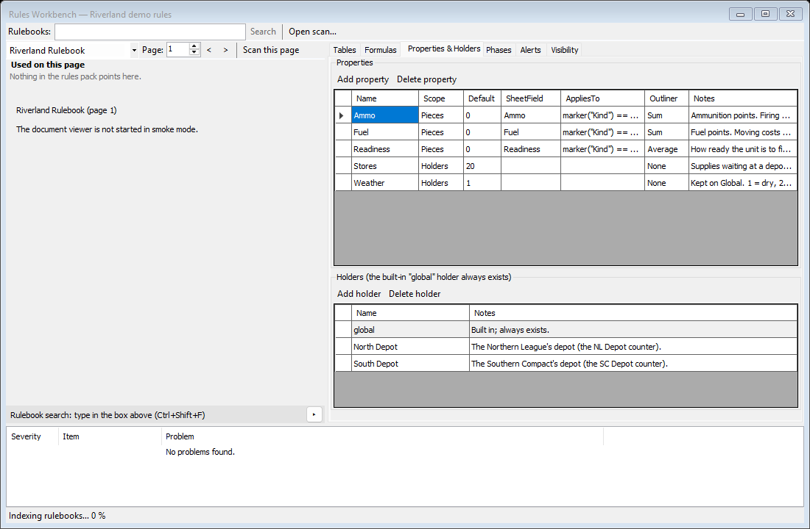
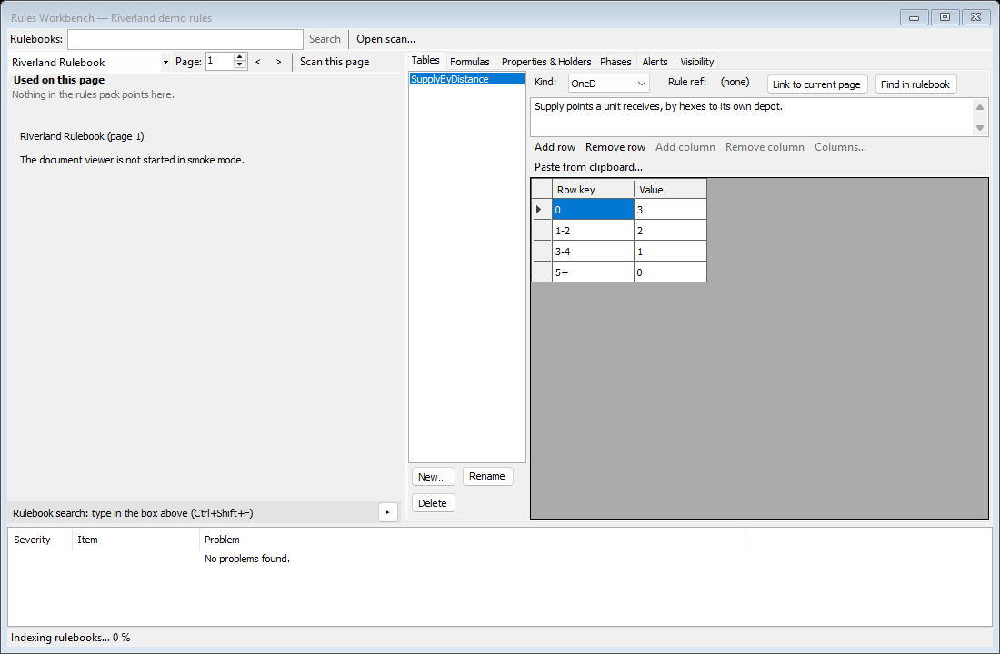
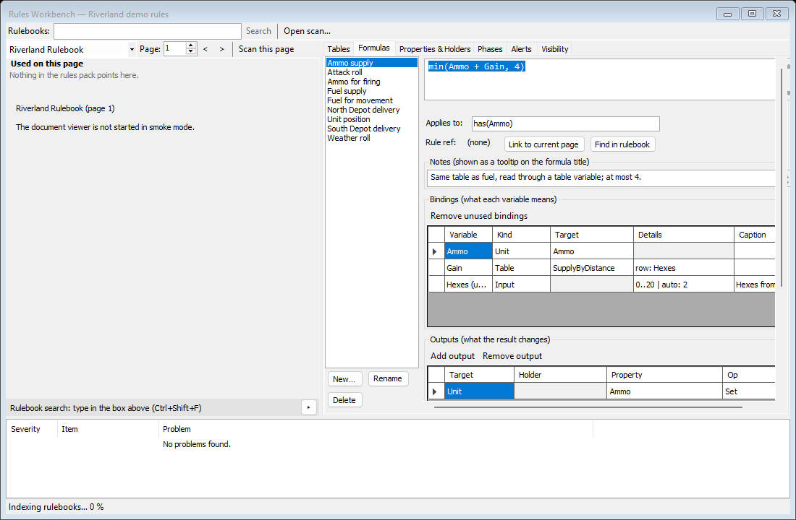
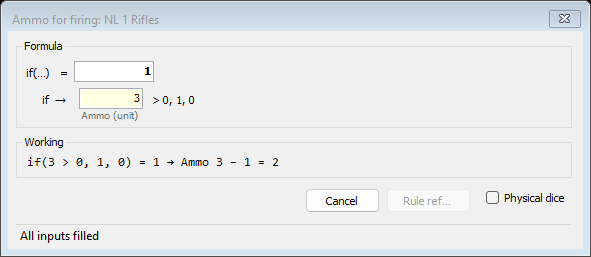
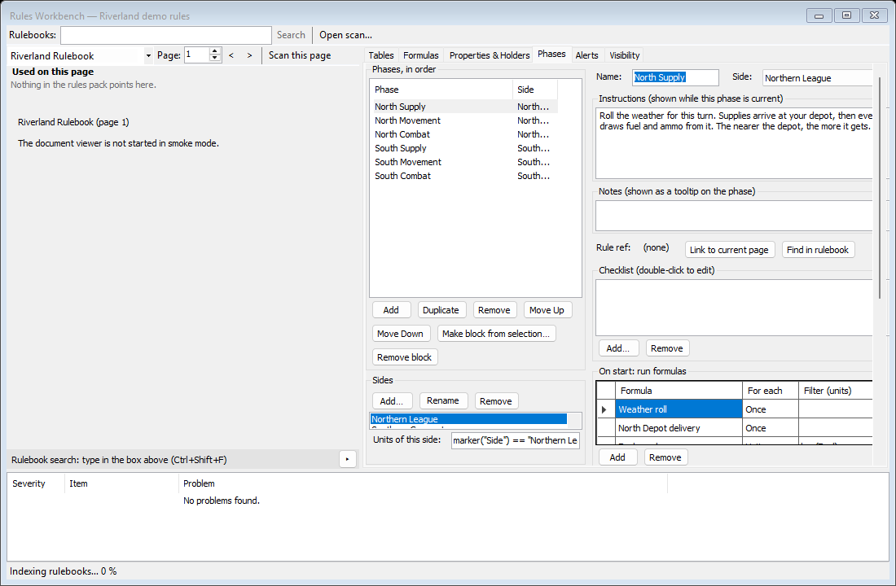

# Making a Rules Pack

A rules pack (a `.qrules` file) teaches Quartermaster the parts of your game that VASSAL leaves to you: the values each unit tracks, the charts, the sums, the order of play, warnings, and what each side may see. You write it once in the Rules Workbench, and then every game of that module uses it.

This page builds a rules pack from nothing for Riverland, the invented demo game, step by step. When you finish you will have a working copy of `Riverland-Demo.qrules`, and you will know how to do the same for your own module. The checklist at the end sums it up.

Every formula on this page is copied from the demo pack, so you know it works. For what each control does, see [Rules Workbench](Window-Rules-Workbench). For the full list of functions, see [Formula Reference](Formula-Reference).

## Before you start

- Install Quartermaster ([Install and Update](Install-and-Update)) and download `Riverland-Demo.vmod` and `Riverland-Demo.qrules` (see [Your First Game](Your-First-Game#get-the-demo-files)).
- Keep `Riverland-Demo.qrules` close by. If you get stuck, open it in a second copy of Quartermaster and compare.

Riverland in one paragraph: two sides, the Northern League and the Southern Compact, face each other across a river. Each unit has Fuel, Ammo and Readiness, printed on its property sheet in the module. Each side has a depot that holds Stores. Every turn the weather is rolled, supplies arrive, units draw fuel and ammo by their distance to the depot, then they move (moving costs fuel) and fight. Readiness is secret from the other side.

## Step 1: Create the pack

1. Start Quartermaster. In the launcher, select `Riverland-Demo.vmod` (use **Add module...** if it is not listed yet).
2. Choose **Play offline**, then **New game...**, then **OK**. The main window opens with the map.
3. Choose **File > New Rules Pack...**. Type a name, for example `My Riverland rules`, and choose OK.
4. Choose **Tools > Rules Workbench** (Ctrl+Shift+W). The Workbench opens on the new, empty pack.

If you are happy with a command line, you can do steps 1 to 3 in one go by starting Quartermaster with the module and the `--new-rules` option:

```
Quartermaster.App.exe Riverland-Demo.vmod --new-rules "My Riverland rules"
```

Keep the game open while you work. Everything you change in the Workbench applies to the open game at once, so you can test as you go.

Watch the **Problems** list at the bottom of the Workbench. While the pack is half-built it lists what is still missing. When everything is in place it reads "No problems found." Double-click a problem to jump to it.

## Step 2: Properties (the values units track)

Open the **Properties & Holders** tab.



Choose **Add property** three times and fill in the rows:

| Name | Scope | Default | SheetField | AppliesTo | Outliner |
|---|---|---|---|---|---|
| Fuel | Pieces | | Fuel | `marker("Kind") == "Unit"` | Sum |
| Ammo | Pieces | | Ammo | `marker("Kind") == "Unit"` | Sum |
| Readiness | Pieces | | Readiness | `marker("Kind") == "Unit"` | Average |

- **SheetField** is the name of a row on the counters' property sheet in the module. Riverland's units have a sheet called "Unit Sheet" with the rows Fuel, Ammo and Readiness, so each property starts at the number printed there. The drop-down suggests the row names it finds in the module.
- **AppliesTo** says which counters have the property. Riverland's counters carry a marker called Kind, which is `Unit` for fighting units, `Depot` for depots and `Marker` for the turn marker. So this filter means "only units":

```formula
marker("Kind") == "Unit"
```

Now the values that do not belong to a counter. Add two more properties:

| Name | Scope | Default | Notes |
|---|---|---|---|
| Stores | Holders | 20 | Supplies waiting at a depot |
| Weather | Holders | 1 | Kept on global. 1 = dry, 2 = mud |

A **holder** is a place that keeps values without being a counter. The built-in **global** holder always exists; Weather lives there. For the depots, choose **Add holder** twice and name the holders `North Depot` and `South Depot`.

**Test it:** in the main window choose **View > Ledger** (Ctrl+L). The **Units** tab already lists every unit with its Fuel, Ammo and Readiness from the module. The **Depots & Global** tab lists global and the two depots, with Stores 20. See [Ledger](Window-Ledger).

## Step 3: A table (the supply chart)

Riverland's supply chart: a unit 0 hexes from its depot gets 3 points, 1-2 hexes gets 2, 3-4 hexes gets 1, 5 or more gets nothing.

Open the **Tables** tab and choose **New...**. Name the table `SupplyByDistance` (one word: formulas refer to tables by name). Leave **Kind:** on **OneD** (one row key and one value). Choose **Add row** until there are four rows, and type:

| Row key | Value |
|---|---|
| 0 | 3 |
| 1-2 | 2 |
| 3-4 | 1 |
| 5+ | 0 |



Row keys can be single numbers, ranges like `1-2`, or open ranges like `5+`. A chart from a spreadsheet can be pasted in with **Paste from clipboard...**, and a scan of a printed chart can be read with **Open scan...** (see [Rulebook search and OCR](Window-Rulebook-Search-and-OCR)).

## Step 4: Formulas

Open the **Formulas** tab. For each formula below, choose **New...**, type the name, then type the formula in the big box. Every name you use in the formula (Fuel, Hexes and so on) appears as a row under **Bindings**. Fill in each row's **Kind**, **Target** and **Details** as shown, so Quartermaster knows where each value comes from. Then set the **Outputs**: what the result changes in the ledger.



### Fuel supply: reading the table with lookup

```formula
min(Fuel + lookup(SupplyByDistance, Hexes), 6)
```

In words: the unit's fuel plus the chart value for its distance to the depot, but never more than 6. **Applies to:**

```formula
has(Fuel)
```

| Variable | Kind | Target | Details | Caption |
|---|---|---|---|---|
| Fuel | Unit | Fuel | | |
| Hexes | Input | | `0..20 \| auto: 2` | Hexes from this unit to its depot |

- A **Unit** binding reads a property of the counter the formula runs on.
- An **Input** binding is a number the player types in the formula dialog. `0..20` limits it; `auto: 2` is the value used when the game fills things in by itself (Fully automatic). The caption is shown under the box.
- `SupplyByDistance` inside `lookup(...)` is the table's name, so it needs no binding.

**Outputs:** choose **Add output** and set Target **Unit**, Property **Fuel**, Op **Set**. (A new output starts as Subtract; change it.)

### Ammo supply: the same table through a table variable

```formula
min(Ammo + Gain, 4)
```

**Applies to:** `has(Ammo)`. Here the table is read by a binding instead of `lookup`:

| Variable | Kind | Target | Details | Caption |
|---|---|---|---|---|
| Ammo | Unit | Ammo | | |
| Gain | Table | SupplyByDistance | `row: Hexes` | |
| Hexes | Input | | `0..20 \| auto: 2` | Hexes from this unit to its depot |

When you type `row: Hexes` into Gain's Details, a Hexes row appears in the bindings by itself, because the row expression uses it. Set it up as in Fuel supply. With a table variable the formula stays short, and the cheat sheet shows the whole table with the cell that was used (see [Formula dialog](Window-Formula-Dialog#cheat-sheet)).

**Outputs:** Target **Unit**, Property **Ammo**, Op **Set**.

### Fuel for movement: distance moved and a global value

```formula
ceil(Moved * Weather / 2)
```

One fuel for every two hexes moved, rounded up, and twice that in mud. **Applies to:** `has(Fuel)`.

| Variable | Kind | Target | Details |
|---|---|---|---|
| Moved | Moved | | |
| Weather | Global | Weather | |

**Moved** is the distance the counter just moved, in hexes. **Global** reads a value kept on the global holder. **Outputs:** Target **Unit**, Property **Fuel**, Op **Subtract**.

### Attack roll: dice

```formula
Die + floor(Readiness / 2)
```

**Applies to:**

```formula
has(Readiness)
```

| Variable | Kind | Target | Details |
|---|---|---|---|
| Die | Roll | | `1d6` |
| Readiness | Unit | Readiness | |

A **Roll** binding rolls dice; Details takes dice notation such as `1d6` or `2d6`. This formula has no outputs: it only shows the result, and the player decides what happens.

### Ammo for firing

```formula
if(Ammo > 0, 1, 0)
```

**Applies to:** `has(Ammo)`. One binding: Ammo, Kind **Unit**, Target **Ammo**. **Outputs:** Target **Unit**, Property **Ammo**, Op **Subtract**.

### Weather roll: writing to global

```formula
if(Die >= 5, 2, 1)
```

No **Applies to** (leave it empty: the formula is not about a counter). Die is a **Roll** with `1d6`. **Outputs:** Target **Global**, Property **Weather**, Op **Set**.

### Depot deliveries: reading and writing a holder

Make two formulas, `North Depot delivery` and `South Depot delivery`, with the same text:

```formula
min(Stores + Delivery, 30)
```

| Variable | Kind | Target | Details |
|---|---|---|---|
| Stores | Holder | North Depot: Stores | |
| Delivery | Roll | | `1d6` |

For South Depot delivery, pick **South Depot: Stores** instead. **Outputs:** Target **Holder**, Holder **North Depot** (or **South Depot**), Property **Stores**, Op **Set**.

### Try each formula

Under the bindings, the **Preview** shows the [formula dialog](Window-Formula-Dialog) as players will see it. Pick a counter in **Test piece:** (for example NL 1 Rifles) and try values. Nothing you type in the preview is saved.



You can also try a formula in the game itself: right-click a unit on the map and choose **Calculate**, then the formula. **Apply to ledger** writes the result, and the Ledger shows the new value. **Edit > Undo** (Ctrl+Z) takes it back.

## Step 5: Sides and phases

Open the **Phases** tab.



### Sides

Under **Sides**, choose **Add...** and type `Northern League`. In **Units of this side:** type the filter that picks its units:

```formula
marker("Side") == "Northern League"
```

Do the same for `Southern Compact`:

```formula
marker("Side") == "Southern Compact"
```

Sides decide whose turn it is, which units a phase works on, and who may see private values.

### North Supply

Under **Phases, in order**, choose **Add** and name the phase `North Supply`. Set **Side:** to Northern League and write the **Instructions** (shown to players while the phase is current), for example "Roll the weather for this turn. Supplies arrive at your depot, then every unit draws fuel and ammo from it."

In **On start: run formulas**, choose **Add** four times:

| Formula | For each | Filter (units) |
|---|---|---|
| Weather roll | Once | |
| North Depot delivery | Once | |
| Fuel supply | Units | `has(Fuel)` |
| Ammo supply | Units | `has(Ammo)` |

**Once** runs the formula one time. **Units** runs it for every unit of the acting side that passes the filter.

### North Movement

Add a phase `North Movement`, side Northern League. In **On move: run formulas for moved units**, add **Fuel for movement** with the filter `has(Fuel)`. Now every move during this phase charges fuel.

Under **Warnings**, add a row with this **Condition**:

```formula
Fuel <= 0
```

and the **Message** `{unit} has no fuel and cannot move`. `{unit}` is replaced by the unit's name.

### North Combat

Add a phase `North Combat`, side Northern League. Under **Checklist**, choose **Add...** for each item: "Choose attackers", "Run Attack roll for each attacker", "Run Ammo for firing for each attacker". Add a warning:

```formula
Ammo <= 0
```

with the message `{unit} is out of ammo`.

### The Southern Compact's phases

Select North Supply and choose **Duplicate**. Change the copy's **Name:** to `South Supply`, set **Side:** to Southern Compact, remove the Weather roll row (the weather is rolled once a turn) and change North Depot delivery to **South Depot delivery**. Duplicate North Movement and North Combat the same way. Use **Move Up** and **Move Down** until the order is North Supply, North Movement, North Combat, South Supply, South Movement, South Combat.

**Test it:** in the main window choose **Start game**. The phase strip shows North Supply, and the phase panel shows your instructions and the formulas waiting to run. See [Phases](Window-Phases).

## Step 6: An alert

Open the **Alerts** tab and choose **Add**. Set **Name:** to `Low fuel`, the **Condition** to

```formula
Fuel < 2
```

the **Message ({unit} = unit name):** to `{unit} is low on fuel`, and **Severity:** to Warning. Leave **Side:** on (any).

**Test it:** a **Low fuel** chip appears in the main window's alert bar at once, because NL 6 Recon starts with 1 fuel. See [Main window](Window-Main-Window#alert-bar).

## Step 7: Visibility (who may see what)

Open the **Visibility** tab.

- In **Properties**, new properties start as **Private**. Set Fuel, Ammo, Stores and Weather to **Public**, and leave **Readiness** Private. Now only the side that owns a unit sees its Readiness.
- In **Holders**, set North Depot's owner to Northern League and South Depot's to Southern Compact. Each depot now belongs to its side.
- Leave **Maps and org displays** and **Formulas** as they are. (Tick **Private dice** on a formula when its rolls should be secret.)

How hidden values behave in hot-seat and online play is explained in [Playing With Others](Playing-With-Others).

## Step 8: Test in the Ledger

With the game open and the Workbench beside it:

1. Open the **Ledger** (Ctrl+L). Check that every unit has the Fuel, Ammo and Readiness printed on its counter sheet, and that the depots have Stores 20.
2. Choose **Start game** (or **Next Phase**) to reach North Supply. In the phase panel, under **Decisions left**, double-click each waiting calculation (for example "Fuel supply — 0 of 7 applied") and apply it. The Fuel and Ammo columns go up, but never above 6 and 4.
3. Choose **Next Phase** to reach North Movement and drag a unit two hexes. The Fuel for movement dialog opens; apply it and see the unit's Fuel drop by 1 (2 in mud).
4. Hover a value in the Ledger to see its breakdown: every change, step by step.

If a number is wrong, fix the formula in the Workbench, then undo (Ctrl+Z) and try again. The Workbench shows the changed pack straight away.

## Step 9: Save the pack

Choose **File > Save Rules Pack** in the main window. The first time, it asks where to save; name the file `My-Riverland-rules.qrules`. Later saves go to the same file, and **Save Rules Pack As...** makes a copy. Quartermaster asks before closing if the pack has unsaved changes.

Quartermaster remembers the pack for this module, so the next time you open the module the launcher shows it under "Rules pack:".

## Step 10: Share it

The `.qrules` file is all another player needs, together with the same module file. They choose **change...** in the launcher and pick it ([Launcher](Window-Launcher)). A rules pack is made for one exact module file: if the module is a different version, Quartermaster warns "Rules pack was made for a different module". In an online game, guests get the host's pack automatically and cannot change it.

A rules pack holds only what you typed in. It never contains the module's rulebooks, pictures or counters, so you can share your own work without sharing anyone else's.

## Do it for your own module

- [ ] Open your module, start a game, and choose **File > New Rules Pack...**. Open **Tools > Rules Workbench**.
- [ ] Open the module in VASSAL's editor and note the **markers** your counters carry (side, unit type, and so on) and the **property sheet** rows they have. Those are what your filters and sheet fields use.
- [ ] **Properties & Holders:** add a property for each number your game tracks per unit. Point **SheetField** at a property-sheet row if the module already prints it, and set **AppliesTo** so only the right counters have it. Add **holders** for depots, pools or anything else that keeps values off the map, and properties with Scope **Holders** for game-wide values on global.
- [ ] **Tables:** type in or paste the charts your formulas read. Name each table with one word.
- [ ] **Formulas:** one per calculation in the rules. For each variable choose where it comes from (Unit, Global, Holder, Table, Location, Input, Roll or Moved), and add an output for each ledger value it changes. Try it in the **Preview** with a **Test piece:**.
- [ ] **Phases:** add your sides with their unit filters, then the phases in order, with the side that plays each one, instructions, formulas to run at the start or on each move, checklists and warnings.
- [ ] **Alerts:** add a condition for each situation players must not miss.
- [ ] **Visibility:** make public every property both sides may see (new ones start Private), and give each holder its owner.
- [ ] Wait for "No problems found." in the Problems list.
- [ ] Play a turn and check the Ledger.
- [ ] **File > Save Rules Pack**, then share the `.qrules` file with the people you play with.
