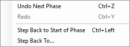

<!--
Class to page mapping (for completeness review). Every Form, dock, panel and tab in src/Quartermaster.App and src/Quartermaster.App/Workbench.

| Class | Page |
|---|---|
| LauncherForm | Window-Launcher |
| PlayOfflineForm | Window-Launcher |
| SetupChooserDialog | Window-Launcher |
| PlayersEditor | Window-Launcher (also Window-Settings, Game tab) |
| UpdateBar | Window-Launcher |
| UpdateDialog | Window-Launcher |
| WhatsNewDialog | Window-Launcher |
| MainForm (menus, toolbar, status bar) | Menus-and-Windows, Window-Main-Window |
| ModuleTreePanel | Window-Main-Window |
| TablesTreePanel | Window-Main-Window |
| DocumentTabStrip | Window-Main-Window |
| WindowManager (floating windows) | Window-Main-Window |
| AlertBar | Window-Main-Window |
| TourOverlay | Window-Main-Window |
| MapWindow | Window-Map |
| MapCanvas (+ MapDragController, LosTool) | Window-Map |
| CounterDetailPopup | Window-Map |
| BreakdownTip | Window-Map (also Ledger, Outliner, Inventory) |
| PropertySheetDialog | Window-Map |
| InputDialog | Window-Map (also Ledger manual change, physical dice, New Rules Pack) |
| ExportChoiceDialog | Window-Map |
| ExportProgressDialog | Window-Map |
| OverviewWindow | Window-Map |
| PhaseStrip | Window-Phases |
| PhasePanel, PhaseDock, PhaseFloatForm | Window-Phases |
| NextPhaseDialog | Window-Phases |
| StepBackDialog | Window-Phases |
| FormulaDialog, FormulaFormView | Window-Formula-Dialog |
| CheatSheetWindow | Window-Formula-Dialog |
| BatchGridWindow | Window-Formula-Dialog |
| MissingInputDialog | Window-Formula-Dialog |
| LedgerWindow (+ .Tabs, .Counters) | Window-Ledger |
| EditTabsDialog | Window-Ledger |
| CounterPreviewTip (+ Popup) | Window-Ledger (also Formula-Dialog batch grid) |
| LogPanel, LogDock, LogFloatForm | Window-Log-and-Panels |
| ChatBox | Window-Log-and-Panels |
| OutlinerPanel, OutlinerDock, OutlinerFloatForm | Window-Log-and-Panels |
| PalettePanel, PaletteDock, PaletteFloatForm | Window-Log-and-Panels |
| NotesWindow | Window-Notes-and-Inventory |
| InventoryWindow | Window-Notes-and-Inventory |
| DiceTools (menus and buttons) | Window-Dice-and-Turn |
| DiceDialog | Window-Dice-and-Turn |
| TurnDialog | Window-Dice-and-Turn |
| WorkbenchWindow | Window-Rules-Workbench |
| TablesTab | Window-Rules-Workbench |
| FormulasTab (+ .Grids) | Window-Rules-Workbench |
| PropertiesTab | Window-Rules-Workbench |
| PhasesTab (+ BlockDialog) | Window-Rules-Workbench |
| AlertsTab | Window-Rules-Workbench |
| VisibilityTab | Window-Rules-Workbench |
| ColumnsDialog | Window-Rules-Workbench |
| PasteTableDialog | Window-Rules-Workbench (also Search-and-OCR, Import into table) |
| SearchPanel | Window-Rulebook-Search-and-OCR |
| PdfViewerControl | Window-Rulebook-Search-and-OCR (also Documents-and-Diagnostics) |
| ScanPane, ImagePane | Window-Rulebook-Search-and-OCR |
| OcrPanel | Window-Rulebook-Search-and-OCR |
| SettingsDialog | Window-Settings |
| SettingsTabs (General, Game, Display, Map, Dice and Log, Toolbar, Folders) | Window-Settings |
| KeyboardTab | Window-Settings |
| ShortcutCaptureDialog | Window-Settings |
| HandoverForm | Window-Multiplayer |
| OnlineLobbyForm | Window-Multiplayer |
| JoinDialog | Window-Multiplayer |
| HostSavedDialog | Window-Multiplayer |
| HostSidesPanel | Window-Multiplayer |
| SeatsDialog | Window-Multiplayer |
| SideChoiceDialog | Window-Multiplayer |
| SendTurnDialog | Window-Multiplayer |
| SendWaitForm | Window-Multiplayer |
| WhoAreYouDialog, MailboxOptions | Window-Multiplayer |
| ReplayBar | Window-Multiplayer |
| PdfWindow | Window-Documents-and-Diagnostics |
| ChartWindow | Window-Documents-and-Diagnostics |
| DiagnosticsWindow | Window-Documents-and-Diagnostics |

Not windows (helpers with no screen of their own): LauncherShots, OffscreenShots, OnlineSmoke, SmokeOcrTable, PaletteDrop, PaletteThumbs, CounterCellImages, PhaseWatcher, SidesWatch, AppUpdates.
-->
# Menus and Windows

This part of the wiki lists everything you can see in Quartermaster: every menu item, every shortcut and every window. The examples use Riverland, the invented demo game from [Your First Game](Your-First-Game).

## Window pages

| Page | What it covers |
|---|---|
| [Launcher](Window-Launcher) | The first window: your module list, Play offline, New game, updates |
| [Main window](Window-Main-Window) | Toolbar, status bar, the left-hand trees, document tabs, floating windows, the alert bar, the interface tour |
| [Map](Window-Map) | The map window, moving and selecting counters, line of sight, counter menus, saving the map as a picture, the overview |
| [Phases](Window-Phases) | The phase strip, the phase panel, the Next Phase check and Step Back |
| [Formula dialog](Window-Formula-Dialog) | The formula dialog, the cheat sheet, the batch grid and the missing-values dialog |
| [Ledger](Window-Ledger) | The Ledger window and your own Ledger tabs |
| [Log and side panels](Window-Log-and-Panels) | The log, chat, the outliner and the counter palette |
| [Notes and Inventory](Window-Notes-and-Inventory) | The Notes and Inventory windows |
| [Dice and turn](Window-Dice-and-Turn) | Dice buttons and menus, custom rolls, the turn counter |
| [Rules Workbench](Window-Rules-Workbench) | The editor for rules packs, tab by tab |
| [Rulebook search and OCR](Window-Rulebook-Search-and-OCR) | Searching the module's PDF rulebooks and reading charts from scans |
| [Settings](Window-Settings) | Every Settings tab, including keyboard shortcuts |
| [Multiplayer](Window-Multiplayer) | Hot-seat hand-over, the online lobby, seats, turn files and the replay bar |
| [Documents and Diagnostics](Window-Documents-and-Diagnostics) | Rulebook and chart windows from the module, and the Diagnostics list |

## Menu bar

The main window's menu bar has File, Edit, Game, View, Tools, Window and Help. An item that needs an open module, an open game or a rules pack is greyed out until you have one. Shortcuts shown here are the defaults. You can change them in [Settings](Window-Settings), on the Keyboard tab, and the menus then show your own keys.

### File

| Item | Shortcut | What it does |
|---|---|---|
| Open Module... | Ctrl+O | Opens a VASSAL module (`.vmod`) |
| New Game | Ctrl+N | Starts a game: the [new game dialog](Window-Launcher#new-game-dialog) asks for the start, the difficulty and the players |
| Load Setup... | | The same dialog, with the module's first saved setup selected |
| Open Game... | Ctrl+G | Opens a saved game (`.qsave`) |
| Open Autosave... | | Opens one of the automatic saves |
| Open Turn File… | | Opens a turn file from another player (see [Multiplayer](Window-Multiplayer#replay-bar)) |
| Save Game | Ctrl+S | Saves the game |
| Save Game As... | Ctrl+Shift+S | Saves the game under a new name |
| Export Viewer Copy… | | Only for a guest in an online game: saves a read-only copy of what you can see |
| New Rules Pack... | | Asks for a name and starts an empty rules pack for this module |
| Open Rules Pack... | | Opens a rules pack (`.qrules`) |
| Save Rules Pack | | Saves the rules pack |
| Save Rules Pack As... | | Saves the rules pack under a new name |
| Back to launcher | | Closes the game and returns to the [launcher](Window-Launcher) |
| Exit | | Closes Quartermaster (it asks first if something is not saved) |

### Edit

| Item | Shortcut | What it does |
|---|---|---|
| Undo | Ctrl+Z | Undoes the last whole action. The menu names it, for example "Undo Next Phase" |
| Redo | Ctrl+Y (also Ctrl+Shift+Z) | Redoes what you undid |
| Step Back to Start of Phase | Ctrl+Left | Goes back to the start of the current phase (see [Phases](Window-Phases#step-back)) |
| Step Back To... | | Lists earlier phases and turns to go back to |

When an item is greyed out, its tooltip says why: for example, an online guest cannot undo, and a turn you already sent cannot be undone.

### Game

The Game menu appears once a game is open.

| Item | What it does |
|---|---|
| Send Turn… | Saves your turn as a turn file for another player |
| Players… | Only while online: the [seats dialog](Window-Multiplayer#players-seats-dialog) |
| Leave Online Game | Only while online: leaves the online game |

### View

| Item | Shortcut | What it does |
|---|---|---|
| Module Tree | | Shows or hides the trees on the left |
| Diagnostics | Ctrl+D | Opens the [Diagnostics](Window-Documents-and-Diagnostics#diagnostics) list |
| Show Grid | | Draws the map grid on every map |
| Log | Ctrl+Shift+L | Shows or hides the [log](Window-Log-and-Panels#log) under the map |
| Phase panel | | Shows or hides the [phase panel](Window-Phases#phase-panel) (needs a rules pack with phases) |
| Outliner | | Shows or hides the [outliner](Window-Log-and-Panels#outliner) |
| Ledger | Ctrl+L | Opens the [Ledger](Window-Ledger) (needs a rules pack) |
| Overview | | Opens the [overview](Window-Map#overview) of the active map |
| Counter palette | | Only in game master mode: shows or hides the [counter palette](Window-Log-and-Panels#counter-palette) |

### Tools

| Item | Shortcut | What it does |
|---|---|---|
| Rules Workbench | Ctrl+Shift+W | Opens the [Rules Workbench](Window-Rules-Workbench) |
| Inventory | | Opens the [Inventory](Window-Notes-and-Inventory#inventory) |
| Notes | | Opens the game's [Notes](Window-Notes-and-Inventory#notes) |
| Dice > 1d6, 2d6, the module's own dice, Custom..., Multi-roll... | F5 (1d6), F6 (2d6) | Rolls dice (see [Dice and turn](Window-Dice-and-Turn)) |
| Turn > Next turn, Previous turn, Set... | Ctrl+Right (see below) | Changes the turn counter |
| Settings... | Ctrl+, | Opens [Settings](Window-Settings) |

### Window

| Item | What it does |
|---|---|
| Cascade, Tile Horizontally, Tile Vertically | Arranges the open windows inside the main window instead of showing them as full-size tabs |
| Close All | Closes every window inside the main window |
| Pop Out Active Window | Moves the active window out into a window of its own |
| Floating windows | Appears when a window floats: each one has **Activate** and **Dock** |
| (list of open windows) | Click one to bring it to the front |

### Help

| Item | What it does |
|---|---|
| Interface Tour | Starts the [interface tour](Window-Main-Window#interface-tour) (needs an open game) |
| Check for updates… | Checks for a new version now (see [Install and Update](Install-and-Update)) |
| About | Shows the version |

## Keyboard shortcuts

These are the default shortcuts. Every one of them can be changed in [Settings](Window-Settings#keyboard), on the Keyboard tab.

| Command | Default |
|---|---|
| Open module | Ctrl+O |
| New game | Ctrl+N |
| Open game | Ctrl+G |
| Save game | Ctrl+S |
| Save game as | Ctrl+Shift+S |
| Diagnostics | Ctrl+D |
| Ledger | Ctrl+L |
| Log panel | Ctrl+Shift+L |
| Hide counters | H |
| Line of sight | L |
| Rules workbench | Ctrl+Shift+W |
| Settings | Ctrl+, |
| Roll 1d6 | F5 |
| Roll 2d6 | F6 |
| Next turn | Ctrl+Right |
| Undo | Ctrl+Z |
| Redo | Ctrl+Y |
| Redo (alternative) | Ctrl+Shift+Z |
| Step back to start of phase | Ctrl+Left |
| Step back to... | (none) |

Notes:

- **Next turn** (Ctrl+Right) does **Next Phase** when the rules pack has phases. Without phases it adds one to the turn counter.
- **H** and **L** are single keys, so they only work while the map has the focus (click the map first). They hide the counters and switch line of sight on the active map.
- While you type in a box, shortcuts that would edit text there (arrows, Ctrl+Z, Ctrl+C and so on) go to the box instead.

These keys belong to the windows and cannot be changed:

| Key | What it does |
|---|---|
| Ctrl+Tab, Ctrl+Shift+Tab | Next or previous document tab |
| Ctrl+W | Closes the active tab, or a floating window |
| F11 or Alt+Enter | In a floating window: maximise or restore it |
| Ctrl+Shift+F | In the Rules Workbench: jump to the rulebook search box |
| Esc | On the map: cancels a drag or the line-of-sight line |
