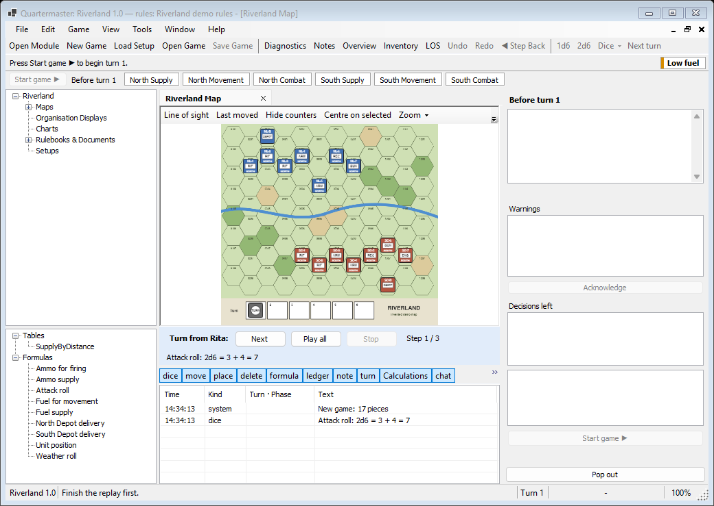

# Playing With Others

There are three ways to play with other people:

| Way | Best for |
|---|---|
| Hot-seat | Everyone around one computer |
| Live online play | Everyone at their own computer at the same time |
| Turn files | Players who are not online at the same time |

## Hot-seat

Players share one computer. Set the players and the sides each one holds on the new game page, or later in Settings, on the Game tab. When the turn passes to another player a hand-over screen hides every window ("Pass to Player 1 (Northern League)") until they press **Continue**. See [Your First Game](Your-First-Game) for the screens.

Each player sees only their own side's secrets. In the Rules Workbench's Visibility tab you mark which properties are private, which organisation displays and maps belong to a side, and which formulas roll their dice in private. Other players see lines such as "Northern League ledger changed" or "Southern Compact rolled dice" in the log, never the numbers. Hot-seat is honour-based: the information is hidden on screen but still in memory.

## Live online play

Online games go through a **relay**, a small server program that passes messages between players. You run it yourself, on any server you control. If you are the one hosting, see [Hosting a Relay](Hosting-a-Relay). If someone else runs it, you only need its address.

In the launcher, select the module and choose **Online lobby**. The lobby window has a **Relay:** box for the relay's address, and these buttons:

- **Join…** joins a game from the list shown for this module. The list refreshes every ten seconds, and **Refresh** reloads it now. You give your name, and a password if the lobby has one, then choose a side.
- **Create lobby…** starts a new game for others to join. You choose the start, the difficulty, your own name and sides, the lobby's name, and an optional password.
- **Host a saved game…** picks a `.qsave` file and continues that game online, with a lobby name, a password and the seats you want to keep open.

The lobby list only shows games for the module you selected, so everyone needs the same module.

### Passwords

Give the lobby a password and the game is end-to-end encrypted, so the relay cannot read it. An open lobby with no password can be read by the relay.

### Seats and hidden information

A seat is a player's place in the game, tied to one or more sides. The host's copy runs the game. Guests send what they want to do and receive only what their own sides may see, never another side's private values.

As the host you can manage seats from **Game > Players…**. It lists every seat with its sides and whether the player is connected, and lets you assign free sides or free the seat of a player who left. Free sides show up in the lobby list as open seats.

If a guest drops, their seat is kept and they rejoin where they left off. Chat appears in the log.

### What only the host can do

Only the host can undo, step back and save. A guest can use **File > Export Viewer Copy…** to keep a copy of their own view. To leave an online game, use **Game > Leave Online Game**.

## Turn files

Turn files let you play with someone who is not online at the same time.

### Sending a turn

When you have finished your turn, choose **Game > Send Turn…**. A short dialog asks who you are sending to, and then you choose where to save the file. It is saved as a `.qturn` file, which you give to the other player by e-mail, chat or any other way.

### Receiving a turn

The other player opens the file with **File > Open Turn File…**, or **Open turn file…** in the launcher's Play offline window. A replay bar appears above the log with three buttons:

- **Next** shows the next step.
- **Play all** steps through automatically, with each log line shown in turn.
- **Stop** pauses it.

They see everything you did before they take over. Dice results are stored in the file, so nothing is rolled again. Quartermaster checks that the turn fits your game and says plainly if it does not, for example when it belongs to another module.

### The mailbox

Instead of e-mail or chat, a turn can go through a mailbox on your own relay. In the Send Turn dialog, tick **Also send through my relay**, then fill in the relay address and, if you like, a password. The file is encrypted before it leaves your computer, so the relay only stores unreadable data, for up to 30 days.

Quartermaster checks the mailbox when you open a game and every five minutes, and shows "New turn waiting from {player}". Setting up the mailbox on the relay is covered in [Hosting a Relay](Hosting-a-Relay).

### Hidden information in turn files

A turn file carries the whole game, so hidden information is only hidden on screen: anyone who has the file could extract it. Use turn files with people you trust.

## Which should I use?

- Same room: hot-seat.
- Same evening, different places: live online play.
- Different schedules: turn files, with or without the mailbox.

More questions are answered in the [FAQ](FAQ).
