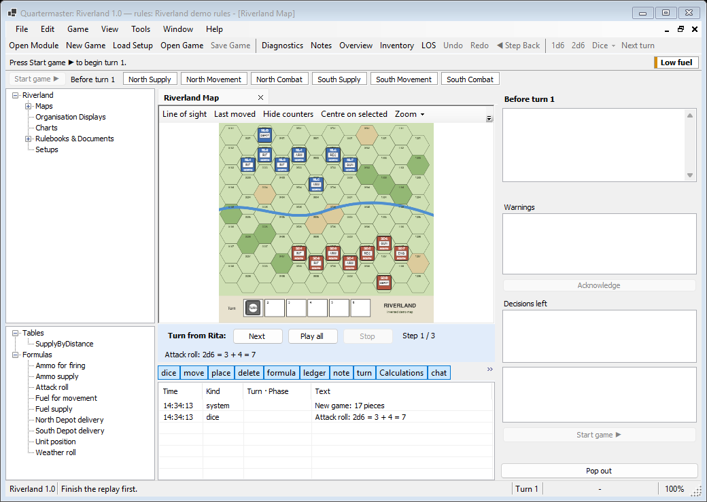

# Playing With Others

There are three ways to play with other people:

| Way | Best for |
|---|---|
| Hot-seat | Everyone around one computer |
| Live online play | Everyone at their own computer at the same time |
| Turn files | Players who are not online at the same time |

## Hot-seat

Players share one computer. Set the players and the sides each one holds on the new game page, or later in Settings, on the Game tab. When the turn passes to another player a hand-over screen hides every window ("Pass to Player 1 (Northern League)") until they press **Continue**. See [Your First Game](Your-First-Game) for the screens.

Each player sees only their own side's secrets. In the Rules Workbench's Visibility tab you mark which properties are private, which organisation displays and maps belong to a side, and which formulas roll their dice in private. Other players see lines such as "Northern League ledger changed" or "Southern Compact rolled dice" in the log, never the numbers. Hot-seat is honour-based: the information is hidden on screen but still in memory.

## Live online play

Online games go through a **relay**, a small server program that passes messages between players. You run it yourself, on any server you control. If you are the one hosting, see [Hosting a Relay](Hosting-a-Relay). If someone else runs it, you only need its address.

In the launcher, select the module and choose **Online lobby**. The lobby window has a **Relay:** box for the relay's address, and these buttons:

- **Join…** joins a game from the list shown for this module. The list refreshes every ten seconds, and **Refresh** reloads it now. You give your name, and a password if the lobby has one, then choose a side.
- **Create lobby…** starts a new game for others to join. You choose the start, the difficulty, your own name and sides, the lobby's name, and an optional password.
- **Host a saved game…** picks a `.qsave` file and continues that game online, with a lobby name, a password and the seats you want to keep open.

The lobby list only shows games for the module you selected, so everyone needs the same module.

### Passwords

Give the lobby a password and the game is end-to-end encrypted, so the relay cannot read it. An open lobby with no password can be read by the relay.

### Seats and hidden information

A seat is a player's place in the game, tied to one or more sides. The host's copy runs the game. Guests send what they want to do and receive only what their own sides may see, never another side's private values.

As the host you can manage seats from **Game > Players…**. It lists every seat with its sides and whether the player is connected, and lets you assign free sides or free the seat of a player who left. Free sides show up in the lobby list as open seats.

If a guest drops, their seat is kept and they rejoin where they left off. Chat appears in the log.

### What each player sees

- **Public values of a side's holder.** Another side's holder shows its **Public** properties to every side (for example the Northern League's North Depot shows its Stores to the Southern Compact) and keeps its Private ones hidden. Seeing is not acting: you still cannot write to another side's holder.
- **Side alerts.** An alert limited to a side shows only to players holding that side or an ally of it, in every phase. The alerts for values below zero list only your own counters and holders.
- **Sealed answers.** When a phase asks every side in secret, each side answers on its own (any player of the side's alliance may answer for it, and allies see each other's answers before release); everyone sees `{Side} has answered {formula} (sealed)` and nothing else until the last side has answered, when the answers are applied together. A second answer is refused: `Your sealed answer is already in.` While a side still has to answer, another guest's Next Phase says `{Side} is playing {phase}; wait for your phase.` See [Sealed answers](Making-a-Rules-Pack#sealed-answers).
- **Choices and picks.** The list of choices or counters you are offered is built from what you can see, so two players may be offered different lists. A formula that reads data you cannot see is worked out by the host, and its result box reads `hidden` until the host has applied it.
- **When the game ends.** Every player then sees everything. Undoing out of the game over hides it again; what a player has already seen stays seen. See [When the game ends](Making-a-Rules-Pack#when-the-game-ends).

### What only the host can do

Only the host can undo, step back and save. A guest can use **File > Export Viewer Copy…** to keep a copy of their own view. To leave an online game, use **Game > Leave Online Game**.

### Sides that react

A phase can name sides that also act in it. Online, a guest who holds only such a side may run formulas that need no counter and write global values in that phase; ticking, acknowledging and Next Phase stay with the phase's own side, and the panel tells the guest `{side} is playing {phase}; you may react`. In a hot-seat game the reacting player takes the screen with **Game > Current Player** (the hand-over itself still goes to the phase's own side's player). A guest's Due list is built from what that guest sees and may act on. Only the host decides when the game ends; after it ends every Next Phase press says `The game is over.` See [Sides that react](Making-a-Rules-Pack#sides-that-react).

### Allies

When the rules pack puts sides in one alliance (for example the Northern League and the Hill Clans in `Upriver Pact`), their players are allies. An ally sees what the other sees (hidden values, lines, dice, asked runs, checklists, maps, alerts), moves the other's counters, changes the other's holders, and acts, ticks, acknowledges and presses Next Phase in the other's phase. A side outside the alliance sees and does nothing more than before. This works the same in hot-seat, online (the host checks every guest action with the allies included, and a guest sees the allies' values) and turn files.

Seats do not change: each side is still held by exactly one player, and **Game > Players…** shows the same seats. In hot-seat the hand-over still goes to the player holding the phase's side, and an ally at the screen may act meanwhile. A run made in an ally's phase is stamped with the ally's side. In a sealed phase each side still has its own answer, and its window opens by itself only for that side's player; any ally may open it from the phase panel and give it, and allies see each other's answers before release. If a pack changes a side's id, saves that use the old id read as the new side when opened (see [Former side ids](Making-a-Rules-Pack#former-side-ids)); a received turn file is not translated, so both players open their saves with the new pack before they exchange turns. See [Alliances](Making-a-Rules-Pack#alliances).

## Turn files

Turn files let you play with someone who is not online at the same time.

### Sending a turn

When you have finished your turn, choose **Game > Send Turn…**. A short dialog asks who you are sending to, and then you choose where to save the file. It is saved as a `.qturn` file, which you give to the other player by e-mail, chat or any other way.

### Receiving a turn

The other player opens the file with **File > Open Turn File…**, or **Open turn file…** in the launcher's Play offline window. A replay bar appears above the log with three buttons:

- **Next** shows the next step.
- **Play all** steps through automatically, with each log line shown in turn.
- **Stop** pauses it.

They see everything you did before they take over. Dice results are stored in the file, so nothing is rolled again. Quartermaster checks that the turn fits your game and says plainly if it does not, for example when it belongs to another module.

### The mailbox

Instead of e-mail or chat, a turn can go through a mailbox on your own relay. In the Send Turn dialog, tick **Also send through my relay**, then fill in the relay address and, if you like, a password. The file is encrypted before it leaves your computer, so the relay only stores unreadable data, for up to 30 days.

Quartermaster checks the mailbox when you open a game and every five minutes, and shows "New turn waiting from {player}". Setting up the mailbox on the relay is covered in [Hosting a Relay](Hosting-a-Relay).

### Hidden information in turn files

A turn file carries the whole game, so hidden information is only hidden on screen: anyone who has the file could extract it. Use turn files with people you trust.

## Which should I use?

- Same room: hot-seat.
- Same evening, different places: live online play.
- Different schedules: turn files, with or without the mailbox.

More questions are answered in the [FAQ](FAQ).
