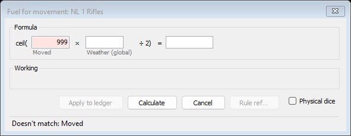
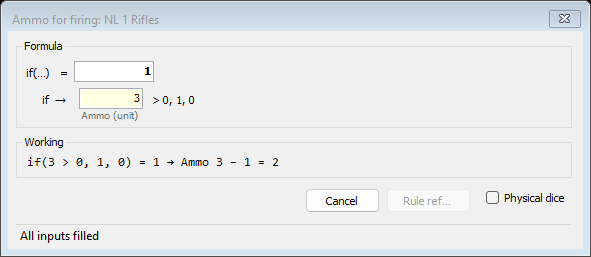
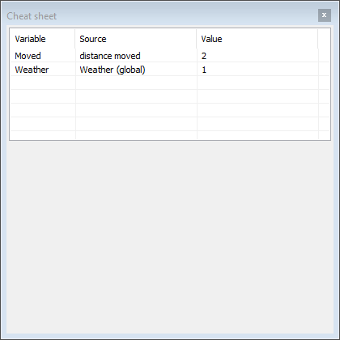
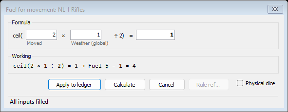
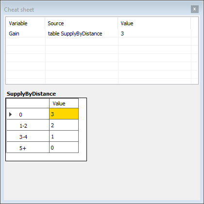

# Formula dialog

A formula dialog works out one formula of the rules pack for one counter and writes the result into the ledger. It opens:

- from a counter's right-click menu, under **Calculate** (see [Map](Window-Map#counter-menu));
- from a waiting calculation in the [phase panel](Window-Phases#phase-panel);
- by itself when a phase runs a formula on a move, for example Riverland's "Fuel for movement" during a Movement phase.

How formulas are written is covered in [Making a Rules Pack](Making-a-Rules-Pack).

## The dialog

The title names the formula and the counter, for example "Fuel for movement: NL 1 Rifles".

| Part | What it shows |
|---|---|
| **Formula** | The formula written out, with a box for each value. The caption under each box says where the value comes from, for example "Moved" (the distance moved) or "Weather (global)". The box after **=** is the result. Hover the formula to see its notes |
| **Working** | The sum worked through, and what it does to the ledger, for example `ceil(2 × 1 ÷ 2) = 1 → Fuel 3 − 1 = 2` |
| **Apply to ledger** | Writes the result into the ledger and closes the dialog |
| **Calculate** | Fills every box with the game's own value, rolling any dice. The boxes stay editable |
| **Cancel** | Closes without changing anything |
| **Rule ref…** | Opens the rulebook at the formula's rule reference (greyed out when it has none) |
| **Physical dice** | Asks you for each die instead of rolling it |
| Status line | "All inputs filled", or what is still wrong |

Dice values have a small **↻** button that rolls that die again.

What you type depends on the difficulty:

- **Hardcore** and **Semi-automatic**: you type each value. Quartermaster checks it against its own value. A wrong value turns red, the status line says "Doesn't match: Moved", and **Apply to ledger** stays greyed out until it is right. **Calculate** fills in the right values.
- **Fully automatic**: the game fills everything in. You can still change a value before you apply.

In the [Rules Workbench](Window-Rules-Workbench#formulas-tab) the same dialog appears as a preview, with no Apply button:

## Cheat sheet

In **Semi-automatic** mode, a **Cheat sheet** window opens beside the formula dialog and closes with it. It lists where each value comes from:

| Column | Shows |
|---|---|
| Variable | The name in the formula, for example "Moved" |
| Source | Where it comes from, for example "distance moved", "Weather (global)" or "table SupplyByDistance" |
| Value | The value to type |

When the formula reads a table, the cheat sheet draws the whole table under the list, with the cell it uses in gold. Here Riverland's "Ammo supply" reads row 0 of SupplyByDistance:

A wrong value looks the same as in Hardcore mode:

## Batch grid

When a phase runs a formula for several units at once (for example Riverland's "Fuel supply" for each unit at the start of a Supply phase), double-clicking it in the phase panel opens a batch grid instead of one dialog per unit. It opens as a tab named after the formula and its progress, for example "Fuel supply — 0 of 7 applied".

| Column | Shows |
|---|---|
| Unit | The unit, with its counter picture. Hover the picture for a big preview |
| One column per value | The values of the formula. Type them in, as in the dialog. A cell that does not match turns red; hover it to see why |
| Result | The result, or "Applied" once the row is done |
| Ledger | What the row would change, for example "Fuel 3 → 5". Hover it to see the history of that value |
| Exceptions | "goes negative" when a value would drop below zero, and any phase warning that matches the unit |

| Button | What it does |
|---|---|
| **Calculate all** | Fills every row with the game's own values |
| **Apply all** | Applies every row that matches. Rows with a red cell are skipped |
| **Apply row** | Applies the selected row |

Double-click a row to open that unit's formula dialog. In Semi-automatic mode a cheat sheet on the right follows the selected row. A line at the bottom reports what happened, for example "Applied 7 row(s); rows with a red cell were skipped."

There is no screenshot of the batch grid yet.

## Missing values

In **Fully automatic** mode the game calculates everything itself. When a formula needs a value it cannot work out (an input such as Riverland's "Hexes from this unit to its depot"), a small dialog named after the formula asks for it once, with one box per missing value. The answer is used for every unit of that run.

- **OK** applies the run with your answers, and the dialog reports how many units were applied.
- **Per unit…** opens the batch grid (or the formula dialog for a single unit) so you can give each unit its own value.
- **Cancel** leaves the calculation waiting in the phase panel.

There is no screenshot of this dialog yet.
