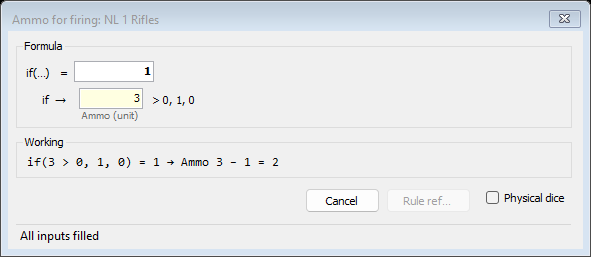
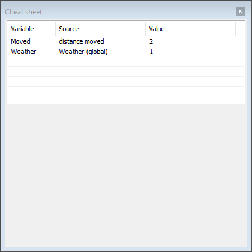
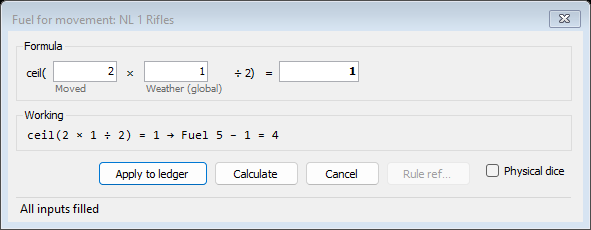
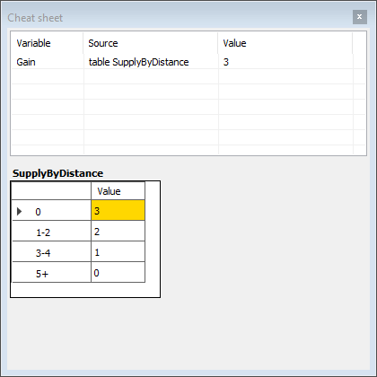
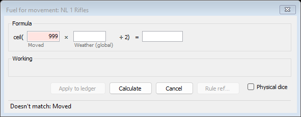

# Formula dialog

A formula dialog works out one formula of the rules pack for one counter and writes the result into the ledger. It opens:

- from a counter's right-click menu, under **Calculate** (see [Map](Window-Map#counter-menu));
- from a waiting calculation in the [phase panel](Window-Phases#phase-panel);
- by itself when a phase runs a formula on a move, for example Riverland's "Fuel for movement" during a Movement phase.

How formulas are written is covered in [Making a Rules Pack](Making-a-Rules-Pack).

## The dialog

The title names the formula and the counter, for example "Fuel for movement: NL 1 Rifles".

| Part | What it shows |
|---|---|
| **Formula** | The formula written out, with a box for each value. The caption under each box says where the value comes from, for example "Moved" (the distance moved) or "Weather (global)". The box after **=** is the result. Hover the formula to see its notes |
| **Working** | The sum worked through, and what it does to the ledger, for example `ceil(2 × 1 ÷ 2) = 1 → Fuel 3 − 1 = 2` |
| **Apply to ledger** | Writes the result into the ledger and closes the dialog |
| **Calculate** | Fills every box with the game's own value, rolling any dice. The boxes stay editable |
| **Cancel** | Closes without changing anything |
| **Rule ref…** | Opens the rulebook at the formula's rule reference (greyed out when it has none) |
| **Physical dice** | Asks you for each die instead of rolling it |
| Status line | "All inputs filled", or what is still wrong |

A value whose **Only when** condition is false shows `not used` in a greyed box: it is not asked and does not count. A value whose condition depends on a box you have not filled yet stays blank and closed; the status line names the boxes still to fill (`Waiting for: Coast`), and says `Waiting for the other inputs` only when no box you can see is missing. When the formula's **Only runs when** condition is false, the run is refused: the status line shows the formula's refusal message (or `{formula name} cannot be run now`), no result is shown and **Apply to ledger** stays greyed out. A guest's run that is refused gets the same message from the host, unless the formula reads hidden values: then the guest sees `The formula could not be calculated.` On an online guest, an **Only when** or **Only runs when** condition that reads the other side's hidden data is decided by the host: the box stays open to type in, and the host asks for it or ignores it.

With **Physical dice** on, a roll of several dice shows `Type each die, separated by spaces` in its empty box: type the dice as `1 2 5 6` (or `1,2,5,6`), exactly as many as the roll has, each within the dice's range. A formula that uses `count()` needs the dice typed this way; a single number is taken as the total. A roll of several dice is shown on one line, the total and then the dice: `13 (1+2+5+5)`. A Roll whose count depends on hidden data is rolled by the engine even with physical dice: its box reads `hidden`, and its dice appear in the log after Apply.

Dice values have a small **↻** button that rolls that die again.

When a formula reads data you may not see (another side's private value, or a counter you cannot see), the box after **=** reads `hidden` (`hidden — the host calculates` for a guest online) and so does any box that holds such a value: a result shown before Apply could give the hidden value away. Apply still works, and after it the ledger shows what you may see. A reveal output shows nothing before Apply (the working says `reveal {Property}`); its line appears in the log afterwards.

What you type depends on the difficulty:

- **Hardcore** and **Semi-automatic**: you type each value. Quartermaster checks it against its own value. A wrong value turns red, the status line says "Doesn't match: Moved", and **Apply to ledger** stays greyed out until it is right. **Calculate** fills in the right values.
- **Fully automatic**: the game fills everything in. You can still change a value before you apply.

An input marked **(always asked)** after its caption (shown in every mode) is never filled in from its automatic value: Fully automatic asks you for it, and **Calculate** leaves it as you typed it (empty if you have not).

In the [Rules Workbench](Window-Rules-Workbench#formulas-tab) the same dialog appears as a preview, with no Apply button:

## Cheat sheet

In **Semi-automatic** mode, a **Cheat sheet** window opens beside the formula dialog and closes with it. It lists where each value comes from:

| Column | Shows |
|---|---|
| Variable | The name in the formula, for example "Moved" |
| Source | Where it comes from, for example "distance moved", "Weather (global)" or "table SupplyByDistance" |
| Value | The value to type |

When the formula reads a table, the cheat sheet draws the whole table under the list, with the cell it uses in gold. Here Riverland's "Ammo supply" reads row 0 of SupplyByDistance:

A wrong value looks the same as in Hardcore mode:

## Batch grid

When a phase runs a formula for several units at once (for example Riverland's "Fuel supply" for each unit at the start of a Supply phase), double-clicking it in the phase panel opens a batch grid instead of one dialog per unit. It opens as a tab named after the formula and its progress, for example "Fuel supply — 0 of 7 applied".

| Column | Shows |
|---|---|
| Unit | The unit, with its counter picture. Hover the picture for a big preview |
| One column per value | The values of the formula. Type them in, as in the dialog. A cell that does not match turns red; hover it to see why |
| Result | The result, or "Applied" once the row is done |
| Ledger | What the row would change, for example "Fuel 3 → 5". Hover it to see the history of that value |
| Exceptions | "goes negative" when a value would drop below zero, and any phase warning that matches the unit |

| Button | What it does |
|---|---|
| **Calculate all** | Fills every row with the game's own values |
| **Apply all** | Applies every row that matches. Rows with a red cell are skipped |
| **Apply row** | Applies the selected row |

Double-click a row to open that unit's formula dialog. In Semi-automatic mode a cheat sheet on the right follows the selected row. A line at the bottom reports what happened, for example "Applied 7 row(s); rows with a red cell were skipped."

There is no screenshot of the batch grid yet.

## Running on several counters

Select some counters (drag a box on the map, or right-click a stack) and open the counter menu: **Calculate on selection** (or **Calculate on stack**, for the stack under the pointer) lists the formulas that apply to the counters you may act on. Choosing one opens a batch grid for those counters, one row each, with a first line **All rows**: a value typed into an Input or Piece cell of that line is used by every row that has no value of its own. A counter you cannot act on is left out.

The grid works like the phase batch grid above, with these differences:

- The title reads `{formula} — {n} runs`. Buttons are **Calculate all**, **Apply all**, **Add row** and **Remove row**; there is no **Apply row**.
- The rows are applied in order, and each row sees what the rows before it changed (a row for a counter that an earlier row removed shows `removed by an earlier row` in Exceptions and is skipped).
- **Apply all** applies the whole batch as one step: one Undo takes all of it back. Each row is its own run, with its own line in the log. When a row cannot be applied yet, nothing is applied and the status reads `Nothing applied: row {n} cannot be applied yet.` If a row fails while the batch is being applied, the rows before it stay applied and the status reads `Applied {a} run(s) as one step. Row {n}: cannot be applied yet.`
- After a full **Apply all** the grid closes. After a refusal or a stop it stays open, so you can finish.
- The grid is not saved: closing it forgets it. A batch holds at most 100 rows; with more counters the status reads `A batch holds at most 100 rows: only the first 100 were taken.`
- When the formula has **Roll once for the group** ticked, the first row rolls and the other rows reuse its dice (their Roll boxes read `(group roll)`).
- Online, a guest's **Apply all** is one request to the host, which checks every row and decides; the status then reads `The host applied {n} run(s) as one step.` or names the first row it refused (`Row {n}: {message}`). A refusal never names a counter you cannot see.

The undo entry reads `{formula} on {n} units` when every row is a different counter, otherwise `{formula}: {n} runs`.

### Several runs on one counter

The formula dialog has a **Several runs…** button (tooltip `Open a batch grid for this counter: one row per run, applied in order as one step.`), shown when the dialog is for a counter and was not opened from a phase run's link. It opens the same grid with one row for this counter, holding the values you have typed. Use **Add row** for each further run, for example to run Riverland's `Ford crossing` three times on one barge. Each row sees the result of the rows before it, so a counter's Fuel drops row by row. The button is not shown for a run started from a phase (use that run's own batch grid).

## Picking another counter

A **Piece** variable shows as a list of the counters you can see. The counters in the same hex as the counter the formula runs on are listed first, then the rest, each part sorted by name. A variable marked **Same hex** lists only the other counters in that hex. A masked enemy counter shows as `Unknown piece`. See [Reading another counter](Formula-Reference#where-names-get-their-values).

## Choosing a holder

A Holder binding with **Holder choices** shows as a drop-down of holder names, such as `Ford Dump`, `Mill Dump`, `North Depot`. It lists only the holders you may act on now (no owner, or owned by a side you hold or an ally of one), in the order the pack lists them. The box is always asked: Fully automatic stops for it, and the working line names the holder, `Stores of Ford Dump`. With none to offer, the status line says `No holder to choose`. In a batch grid the column is a list too, and the **All rows** line fills it. See [Choosing a holder when the formula runs](Making-a-Rules-Pack#choosing-a-holder-when-the-formula-runs).

## Drawing at random

A **Draw** variable shows a box holding k, the number of members that will be drawn (or `hidden` when you may not see the pool). Its tooltip reads `Drawn at random when you apply; the log names the counters.` Nothing says which counters were drawn before **Apply to ledger**: each output on the drawn counters shows as one line in the formula's results, `Boats of the drawn counters changes`, and the split is fixed when you apply. Previewing again draws nothing new. After Apply the log names the counters, one line each, to the side that owns each counter. In a batch grid, once a row draws, the rows after it show masked until you Apply all. See [Random draws among counters](Making-a-Rules-Pack#random-draws-among-counters).

## Missing values

In **Fully automatic** mode the game calculates everything itself. When a formula needs a value it cannot work out (an input such as Riverland's "Hexes from this unit to its depot"), a small dialog named after the formula asks for it once, with one box per missing value. The answer is used for every unit of that run. Inputs marked "(always asked)" open this dialog every time, even though they have an automatic value.

- **OK** applies the run with your answers, and the dialog reports how many units were applied.
- **Per unit…** opens the batch grid (or the formula dialog for a single unit) so you can give each unit its own value.
- **Cancel** leaves the calculation waiting in the phase panel.

There is no screenshot of this dialog yet.
