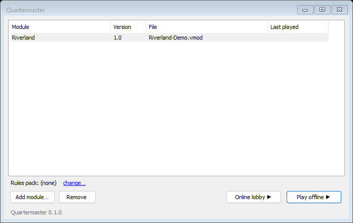
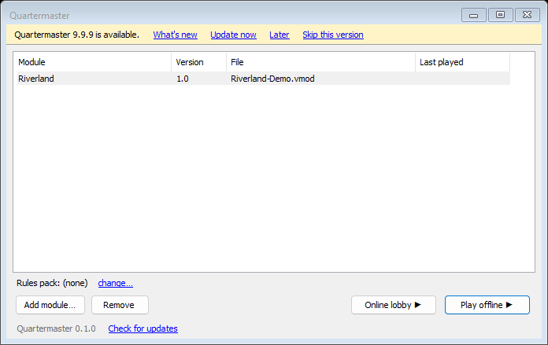
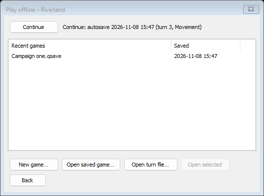
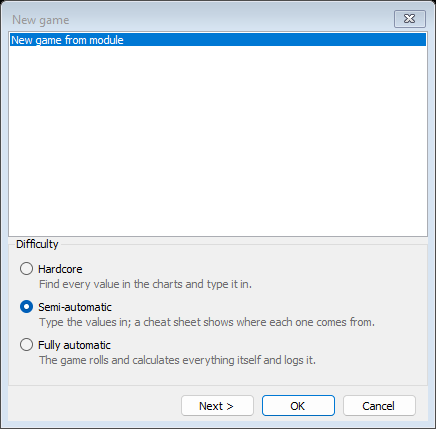

# Launcher

The launcher is the first window you see when you start Quartermaster. It keeps a list of your modules and starts games from them. **File > Back to launcher** in the main window brings you back here.

## Module list

| Column | Shows |
|---|---|
| Module | The module's name, for example "Riverland" |
| Version | The module's version |
| File | The file name. A module whose file has moved or been deleted shows "(file not found)" and is greyed out |
| Last played | When you last played it |

Double-click a module (or select it and press Enter) to play it offline. Select a module and press Delete to remove it from the list (the file itself is not deleted).

## Controls

| Control | What it does |
|---|---|
| **Rules pack:** line | Shows the rules pack used with the selected module, or "(none)" |
| **change…** | Picks a rules pack (`.qrules`) for the selected module, for example `Riverland-Demo.qrules` |
| **use (none)** | Appears when a rules pack is set: plays the module without one |
| **Add module…** | Adds one or more `.vmod` files to the list |
| **Remove** | Removes the selected module from the list |
| **Online lobby ▶** | Opens the [online lobby](Window-Multiplayer#online-lobby) for the selected module |
| **Play offline ▶** | Opens the Play offline window for the selected module |
| Version line and **Check for updates** | The installed version, and a link that checks for a new one now |

When you add a module the launcher reads it first, and the line next to the rules pack shows "Checking modules…". Wait for it to finish before you play.

## Update bar

When a new version is out, a yellow bar appears across the top of the launcher with **What's new**, **Update now**, **Later** and **Skip this version**.

- **What's new** opens a window with the release notes and a link to the release page.
- **Update now** downloads the update in a small progress window (with **Cancel**), checks it and starts the new version.
- **Later** hides the bar for now. **Skip this version** stops offering this version.

[Install and Update](Install-and-Update) explains updates in full.

## Play offline

| Control | What it does |
|---|---|
| **Continue** | Reopens the newest autosave of this module. The line next to it says which one, for example "autosave ... (turn 3, Movement)", or "(no autosave yet)" |
| Recent games list | Your saved games for this module, with the time each was saved. A missing file shows "(file not found)" |
| **New game…** | Opens the new game dialog (below) |
| **Open saved game…** | Browses for a `.qsave` file |
| **Open turn file…** | Opens a turn file from another player (see [Playing With Others](Playing-With-Others)) |
| **Open selected** | Opens the game selected in the list (double-click or Enter does the same) |
| **Back** | Returns to the launcher |

## New game dialog

The same dialog opens from **New game…** here, from **File > New Game** and **File > Load Setup...** in the main window, and (titled "Create lobby") when you create an online lobby.

- **The list** at the top holds "New game from module" plus every setup saved in the module. Double-clicking a setup in the main window's module tree opens this dialog with that setup selected.
- **Difficulty**: **Hardcore** (you find every value and type it in), **Semi-automatic** (you type the values in, and a cheat sheet shows where each one comes from) or **Fully automatic** (the game rolls and calculates everything itself and logs it). The dialog remembers your last choice. You can change it later in [Settings](Window-Settings#game).
- **Next >** goes to the **Players** page, **< Back** returns. **OK** starts the game, **Cancel** closes the dialog.

On the Players page each row is one player with a name, a tick box for each side of the rules pack and a **Remove** button. **Add player** adds a row. Each side is held by exactly one player, with at most 6 players. Without a rules pack, or with fewer than two sides, one player plays everything. When you create an online lobby, the first page also asks for a **Lobby name** and a **Password** (with a warning while the password is empty), and the second page is called "You and the open seats": **Your name**, and a tick box for each side you hold. Every side you do not tick is an open seat for other players.

Your First Game walks through this dialog with Riverland: see [Your First Game](Your-First-Game).
