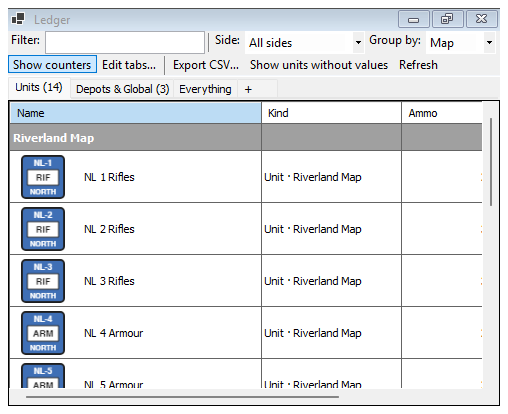
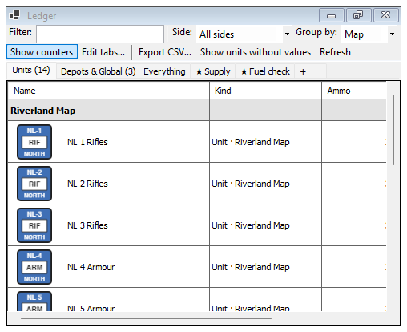
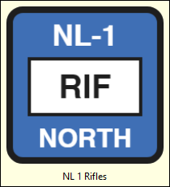
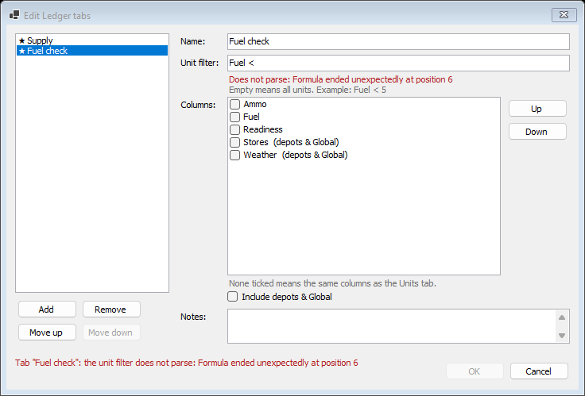

# Ledger

The Ledger lists every tracked value of the game, one row per unit or depot and one column per property. In Riverland the columns are Ammo, Fuel and Readiness for units, and Stores and Weather for the depots and Global. Open it with **View > Ledger** (Ctrl+L). It needs a rules pack.

## Toolbar

| Control | What it does |
|---|---|
| **Filter:** | Shows only rows whose name or kind contains the text |
| **Side:** | "All sides", or one side's units, for example "Northern League" |
| **Group by:** | Map (the default), Side or None. Groups get bold header rows |
| **Show counters** | Shows each unit's counter beside its name |
| **Edit tabs…** | Adds, removes or changes your own tabs (below) |
| **Export CSV…** | Saves the current tab's rows and columns as a CSV file |
| **Show units without values** | Also lists units that have no ledger values |
| **Refresh** | Reloads the list |

## Tabs

| Tab | Shows |
|---|---|
| Units | Every unit, with the number of rows in brackets, for example "Units (14)" |
| Depots & Global | The depots and the built-in Global holder |
| Everything | Both together |
| ★ your own tabs | Tabs you made with Edit tabs… |
| **+** | Adds a new tab of your own |

## Working with the rows

- Click a column header to sort by it. Rows stay under their group header.
- Hover a value to see its breakdown: how it got to where it is, change by change.
- Type in a value cell to change it by hand. Quartermaster asks why ("Manual change"); the reason is required and is kept with the change. You cannot change a value that belongs to a side you do not hold.
- With **Show counters** on, hover a counter picture to see it large, and double-click it to find the counter on the map.

## Your own tabs

**Edit tabs…** (or the **+** tab) opens the **Edit Ledger tabs** dialog. Your tabs are kept on this computer for this module. They are never saved in the rules pack, a saved game or a turn file.

| Control | What it does |
|---|---|
| Tab list | Your tabs, in order |
| **Add**, **Remove**, **Move up**, **Move down** | Change the list |
| **Name:** | The tab's name |
| **Unit filter:** | Which units the tab shows, written like a formula. Empty means all units. Example: `Fuel < 5`. A filter that does not parse shows the error in red, as in the picture |
| **Columns:** | Tick the properties to show. None ticked means the same columns as the Units tab. **Up** and **Down** change their order |
| **Include depots & Global** | Also lists the depots and Global |
| **Notes:** | Your own notes about the tab |
| **OK**, **Cancel** | OK is greyed out while any tab has a problem; the line at the bottom says which |

A tab whose filter does not parse shows no rows, and a red line at the top of the Ledger says why.
