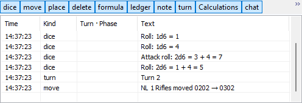
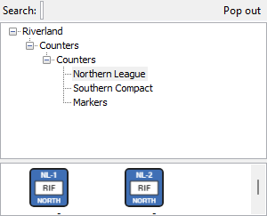

# Log and side panels

Four panels sit around the map in the main window: the log underneath, the outliner and the phase panel on the right, and in game master mode the counter palette. The phase panel has [its own page](Window-Phases#phase-panel). Each panel has a **Pop out** button that moves it into a window of its own; the button then reads **Dock** and puts it back.

## Log

The log lists everything that happens in the game: moves, dice, formulas, ledger changes, notes, turns and phases. Show or hide it with **View > Log** (Ctrl+Shift+L).

| Control | What it does |
|---|---|
| Kind buttons (dice, move, place, delete, formula, ledger, note, turn, Calculations, chat) | Show or hide that kind of row. All are on at first |
| **Search:** | Shows only rows that contain the text |
| **Copy** | Copies the selected rows, or every shown row when none is selected |
| **Export log…** | Saves the shown rows as a text or HTML file |
| **Pop out** | Moves the log into its own window |

The columns are Time, Kind, Turn · Phase and Text. Double-click a row about a counter, for example "NL 1 Rifles moved 0202 → 0302", to find that counter on the map.

The time format, and whether move, place and delete rows are shown at all, are set in [Settings](Window-Settings#dice-and-log), on the Dice & Log tab.

In hot-seat and online games each player sees only what their own sides may see. A hidden roll shows as a line such as "Southern Compact rolled dice", without the numbers.

### Chat

In an online game a chat box appears under the log ("Chat — press Enter to send"). Type a message and press Enter or **Send**. Chat lines appear in the log as the chat kind.

## Outliner

The outliner lists the pieces on every map and organisation display with their ledger values. Show or hide it with **View > Outliner**.

| Part | What it shows |
|---|---|
| **Group:** | "By map / org display" or "By side" |
| **Now** | The decisions waiting in the current phase, with their number ("Now — 4"). Double-click one to go to it. Hidden when the rules pack has no phases |
| Tree list | Folders, groups and pieces. The columns are Name, Units, then one column per property that the rules pack shows in the outliner, and alert icons |
| **Pop out** | Moves the outliner into its own window |

- Click **+** or **−** beside a group, or press Right and Left, to open or close it.
- Double-click a piece (or press Enter) to find it on the map. Double-click an organisation display's group to open it.
- Group rows add up their pieces. In Riverland, Fuel and Ammo are totals and Readiness is an average. Hover a number to see the pieces behind it, and hover a column header for what it shows.

There is no screenshot of the outliner yet.

## Counter palette

The counter palette shows every counter the module offers, so a game master can place new ones. It is only available in **game master mode**: tick **Game master mode (shows the counter palette)** in [Settings](Window-Settings#general), on the General tab. Then **View > Counter palette** or the toolbar's **Palette** button shows it.

| Part | What it does |
|---|---|
| **Search:** | Searches the counters by name |
| Tree | The module's palette lists. In Riverland: Northern League, Southern Compact and Markers |
| Counter list | The counters of the selected list. Drag one onto a map to place it |
| **Pop out** | Moves the palette into its own window |

In game master mode the counter menu on the map also has **Delete counter**.
