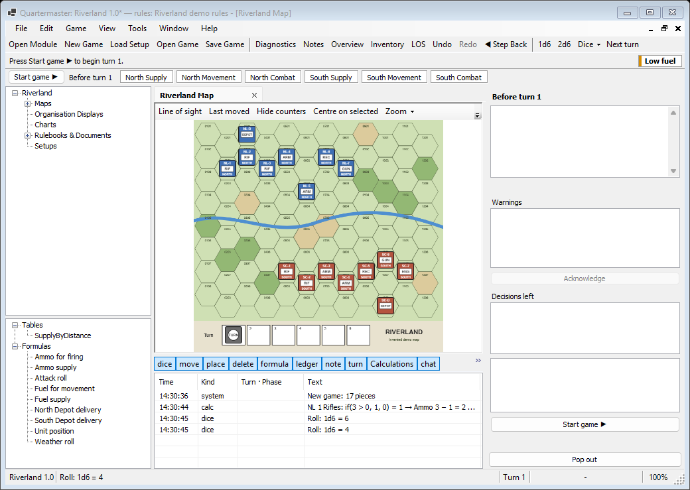
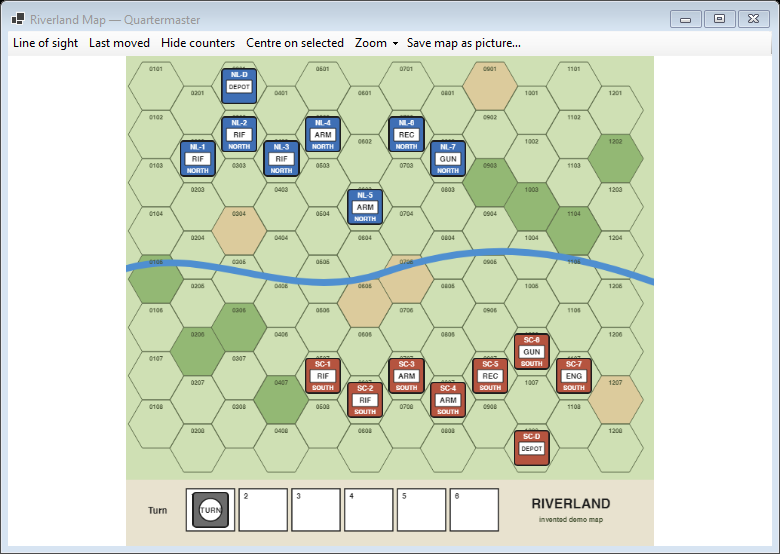
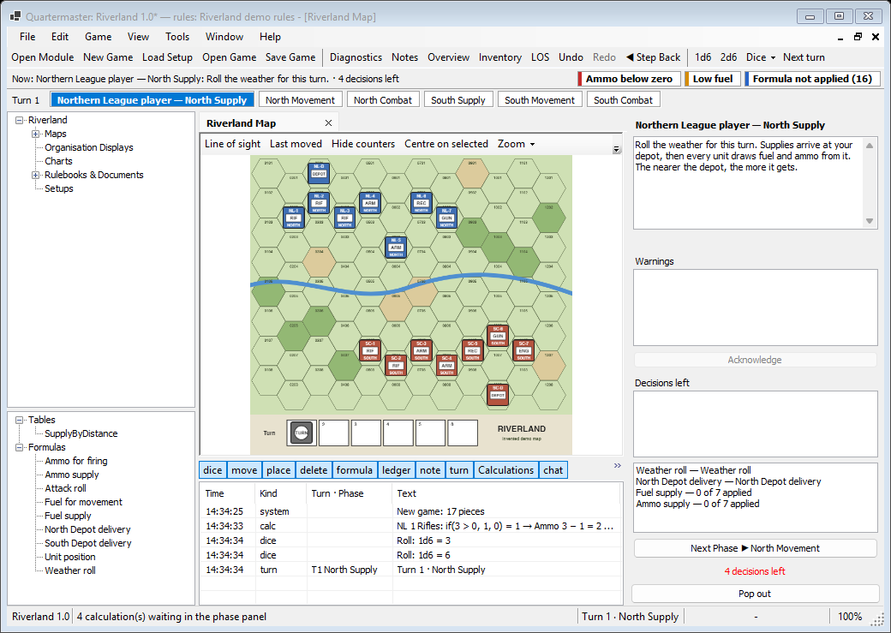
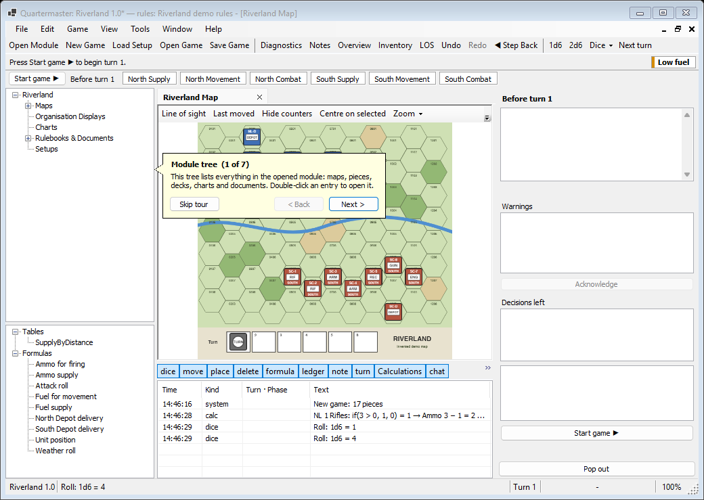
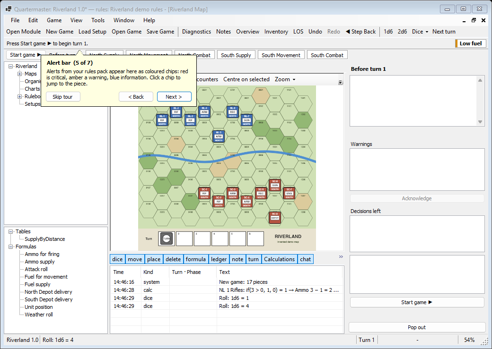
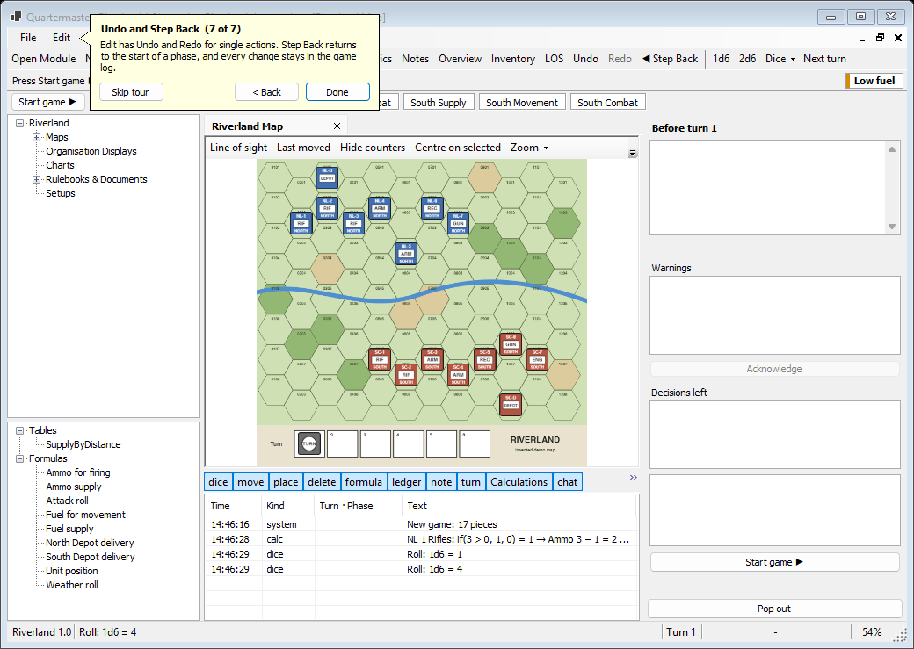

# Main window

The main window opens when you start or load a game. The menus are listed on [Menus and Windows](Menus-and-Windows). This page covers everything else around the map.

From top to bottom:

1. The menu bar.
2. The toolbar.
3. The alert bar (the banner on the left and the alert chips on the right).
4. The [phase strip](Window-Phases#phase-strip).
5. The module tree and the tables tree on the left, the document tabs (maps, rulebooks, Ledger and so on) in the middle, the [phase panel](Window-Phases#phase-panel) and the [outliner](Window-Log-and-Panels#outliner) on the right, and the [log](Window-Log-and-Panels#log) under the map.
6. The status bar.

## Toolbar

| Button | Same as |
|---|---|
| Open Module, New Game, Load Setup, Open Game, Save Game | The File menu items of the same name |
| Diagnostics | View > Diagnostics |
| Notes | Tools > Notes |
| Overview | View > Overview |
| Inventory | Tools > Inventory |
| Palette | View > Counter palette (only in game master mode) |
| LOS | Switches line of sight on the active map (see [Map](Window-Map#line-of-sight)) |
| Undo, Redo, ◀ Step Back | Edit > Undo, Edit > Redo, Edit > Step Back to Start of Phase |
| 1d6, 2d6, Dice ▾ | Roll dice (see [Dice and turn](Window-Dice-and-Turn)) |
| Next turn | Tools > Turn > Next turn |

Untick buttons you do not use in [Settings](Window-Settings#toolbar), on the Toolbar tab.

## Status bar

From left to right:

- The open module and its version, for example "Riverland 1.0".
- Messages, such as the last dice roll ("Roll: 1d6 = 4") or "4 calculation(s) waiting in the phase panel". When the module has problems, click here to open [Diagnostics](Window-Documents-and-Diagnostics#diagnostics).
- A progress bar while a map is being prepared.
- While online, the connection state (for example "Online: connecting…").
- In hot-seat games, **Player:** with the current player's name. Click it to hand over to another player.
- The turn and phase, for example "Turn 1 · North Supply".
- The hex under the mouse pointer.
- The zoom of the active map.

## Module tree and tables tree

The **module tree** (top left) lists what is in the module: Maps, Organisation Displays, Charts, Rulebooks & Documents and Setups. Double-click an entry (or select it and press Enter) to open it:

- a map or organisation display opens a [map window](Window-Map);
- a chart or document opens a [document window](Window-Documents-and-Diagnostics);
- a setup opens the [new game dialog](Window-Launcher#new-game-dialog) with that setup selected.

The **tables tree** (bottom left) lists the rules pack's Tables and Formulas, for example `SupplyByDistance` and "Fuel supply". Double-click one to open it in the [Rules Workbench](Window-Rules-Workbench). Without a rules pack it says "(no rules pack)".

**View > Module Tree** hides or shows both trees. Drag the line between them to change their sizes.

## Document tabs

Maps, documents, the Ledger, the Rules Workbench, Notes and other windows open as tabs in the middle of the main window.

- Click a tab to show it. Ctrl+Tab and Ctrl+Shift+Tab go to the next and previous tab.
- Close a tab with its **×**, a middle click, or Ctrl+W.
- Right-click a tab for **Pop Out**, **Close**, **Close Others** and **Close All**.
- When there are more tabs than fit, arrows at the ends scroll the strip.

## Floating windows

Any tab can float as a window of its own, for example to put the map on a second monitor:

- drag the tab up or down, away from the strip;
- or right-click it and choose **Pop Out**;
- or use **Window > Pop Out Active Window**.

To put a floating window back, drag it by its title bar onto the tab strip, or use **Window > Floating windows > (window) > Dock**. In a floating window, Ctrl+W closes it, and F11 or Alt+Enter maximises or restores it. Shortcuts such as F5 still work while a floating window is active.

The log, the phase panel, the outliner and the counter palette have their own **Pop out** button, which turns into **Dock** while they float. Quartermaster remembers where each window was.

## Alert bar

The bar under the toolbar has two parts.

On the left, the **banner** says what to do now, for example "Now: Northern League player — North Supply: Roll the weather for this turn. · 4 decisions left". Click it to bring up the phase panel.

On the right, each **chip** is an alert from the rules pack, with the number of matches in brackets. The coloured edge shows how serious it is: red is critical, amber a warning, blue information.

- Click a chip to go to the next matching counter (the map centres on it) or depot (the Ledger selects it).
- Right-click a chip for a list of every match, and **Hide this alert until next turn**.
- When there is not room for every chip, a **+N** chip lists the rest, each with **Go to next match** and the hide item.
- Hover a chip to see its message and notes.

In Riverland, the Northern League's recon unit starts with almost no fuel, so the **Low fuel** chip shows from the start.

When a turn from another player is waiting, a notice appears at the left of the bar. Click it to open the turn (see [Multiplayer](Window-Multiplayer#replay-bar)). The bar can be switched off in [Settings](Window-Settings#display), on the Display tab.

## Interface tour

The tour points at the main parts of the window one by one: the module tree, the map, the phase strip, the phase panel, the alert bar, the outliner, the Ledger (in the View menu) and Undo and Step Back (in the Edit menu). Parts that are not on screen are skipped. It starts by itself the first time you open a game, and again from **Help > Interface Tour**.

Each step has **Skip tour**, **< Back** and **Next >**. The last step has **Done** instead of Next. Esc also ends the tour.

