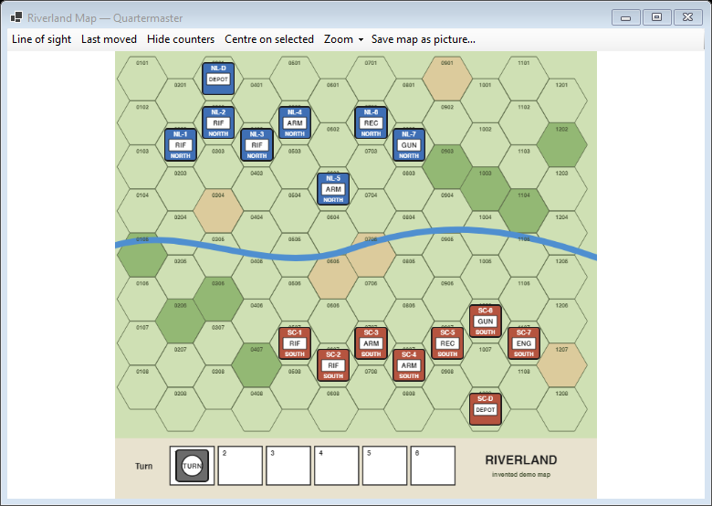
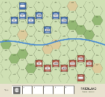
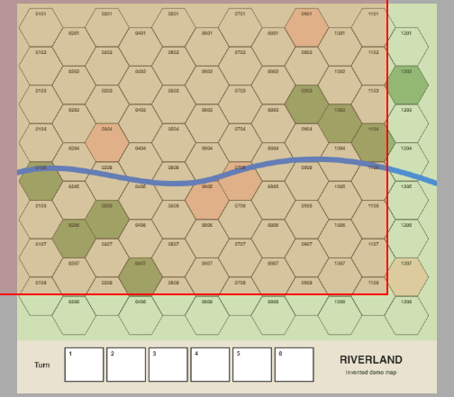

# Map

Each map of the module opens in its own map window: as a tab in the main window, or floating (see [Main window](Window-Main-Window#floating-windows)). Open a map by double-clicking it under Maps or Organisation Displays in the module tree. A new game opens the main map for you.

## Map toolbar

| Button | What it does |
|---|---|
| **Line of sight** | Switches line of sight on and off (see below). Shortcut L |
| **Last moved** | Outlines the counters of the most recent move on this map |
| **Hide counters** | Shows only the board. Shortcut H |
| **Centre on selected** | Scrolls to the selected counters |
| **Zoom ▾** | 25%, 50%, 100%, 200% or Fit |
| **Save map as picture…** | Saves the map as a PNG (see below) |

When the window is narrow, the buttons that do not fit move into a small menu at the right end of the toolbar.

## Mouse

| Action | What happens |
|---|---|
| Click a counter | Selects it |
| Ctrl+click a counter | Adds it to the selection, or takes it out |
| Drag on empty map | Draws a box that selects every counter inside it |
| Drag a counter | Moves it, or the whole selection, keeping its shape. With **Snap pieces to the grid when dropped** on (Settings, Map tab) counters snap to the grid |
| Double-click a stack | Spreads it out, or closes it again |
| Mouse wheel | Zooms in or out at the pointer |
| Middle-button drag, or hold Space and drag | Moves the view |
| Right-click | The counter's menu, or the map's menu on empty map |
| Rest the pointer on a counter | Shows the counter detail popup |
| Esc | Cancels a drag |

Every move is written to the [log](Window-Log-and-Panels#log). In Riverland, moving a unit during a Movement phase starts the "Fuel for movement" formula; see [Formula dialog](Window-Formula-Dialog).

## Counter detail popup

Rest the pointer on a counter or stack for a moment (the delay is set in [Settings](Window-Settings#map), on the Map tab) and a popup lists every counter in the stack at full size, with its name, its properties and its ledger values, for example "Fuel: 3". Ledger values are underlined with dots: move the pointer onto one to see how it was reached, line by line (its breakdown). The popup never takes the focus and goes away when the pointer leaves.

In hot-seat and online games the popup shows only what your side may see.

## Counter menu

Right-click a counter for its menu:

- The commands the module gives that counter (for example opening its property sheet, flipping or rotating it). A property sheet opens a small dialog with one box per row; rows that the rules pack keeps in the ledger say "(managed by ledger: ...)".
- **Calculate** lists the rules pack's formulas that apply to this counter. In Riverland a rifle unit offers formulas such as Fuel supply and Ammo for firing. Choosing one opens the [formula dialog](Window-Formula-Dialog).
- **Show in Ledger** (Ctrl+L) selects the counter's row in the [Ledger](Window-Ledger#show-in-ledger), or the rows of all selected counters when you right-click one of them. Greyed out without a rules pack.
- **Delete counter**, only in game master mode. Quartermaster asks first unless **Ask before deleting pieces** is off in Settings.

A counter that belongs to a side you cannot see shows only "(no commands)".

## Map menu

Right-click empty map for:

| Item | What it does |
|---|---|
| Mark All Unmoved | Clears the moved marks on this map |
| Show Grid | Draws the grid on this map |
| Zoom to Fit, Zoom 100% | Zoom presets |
| Hide counters | Shows only the board |
| Centre on selected | Scrolls to the selected counters |
| Save map as picture… | See below |

## Line of sight

Switch on **Line of sight** (or press L with the map focused, or use the main toolbar's **LOS** button), then drag from one hex to another. Quartermaster draws the line and writes the range on it, for example "0605 → 0805: 2 hexes". On a square grid it counts squares, and without a grid it measures in pixels. Right-click or Esc removes the line.

Line of sight only measures. It does not apply any rule about what blocks sight.

## Save map as picture

**Save map as picture…** asks what to save:

- **Current view**: exactly what the window shows now.
- **Whole map at** 25%, 50% or 100%.

Then it asks for a file name. A whole map is drawn in the background in a "Saving map as picture" window with a **Cancel** button. When it is done the status bar says where it was saved.

## Overview

**View > Overview** (or the **Overview** toolbar button) opens a small picture of the whole active map. The red rectangle is the part the map window shows. Click or drag in the overview to move the map there.

