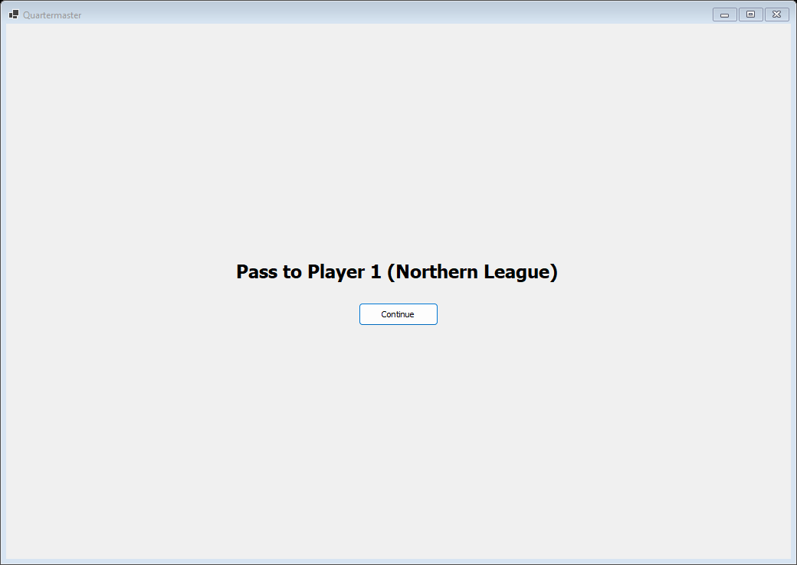
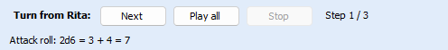

# Multiplayer windows

This page lists the windows used when several people play. How the three ways of playing work, and which to choose, is explained in [Playing With Others](Playing-With-Others). Running your own relay is covered in [Hosting a Relay](Hosting-a-Relay).

## Hot-seat hand-over

In a hot-seat game (two or more players set on the new game dialog, or in [Settings](Window-Settings#game) on the Game tab), a full-window hand-over screen covers everything when the turn passes to another player:

It reads "Pass to {player} ({sides})", for example "Pass to Player 1 (Northern League)". The next player presses **Continue**. Closing it closes the game (with the usual question about saving).

The status bar's **Player:** button shows who is playing now. Click it and pick a player to hand over at any time.

## Online lobby

**Online lobby ▶** in the [launcher](Window-Launcher) opens the lobby for the selected module.

| Control | What it does |
|---|---|
| **Relay:** | The address of the relay. A line beside it shows how the connection is going |
| Lobby list | Lobby, Host, Free sides and Players for every open game of this module. It refreshes every ten seconds |
| **Join…** | Joins the selected lobby (below) |
| **Create lobby…** | Starts a new game for others to join: the [new game dialog](Window-Launcher#new-game-dialog) titled "Create lobby", with a lobby name, a password and the sides you hold |
| **Host a saved game…** | Picks a `.qsave` file and continues it online (below) |
| **Refresh** | Reloads the list now |
| **Close** | Closes the lobby |

There is no screenshot of the lobby yet.

### Join

The **Join** dialog shows who hosts the lobby and its free sides, and asks for **Your name** and, if the lobby has one, its **Password**. A note explains that the host's copy runs the game, that you see only your sides' view, and that the host's rules pack is sent to you. **Join** connects.

Then **Choose your side** lists the free sides under "Play these sides:". Tick the ones you will play and press **OK**.

### Host a saved game

The **Host a saved game** dialog asks for a **Lobby name** and a **Password**, and under "You and the open seats" for **Your name** and the **Sides you hold** (every other side is an open seat). **Host** opens the lobby.

## While online

- The status bar shows the connection, for example "Online: connecting…".
- A chat box sits under the [log](Window-Log-and-Panels#chat).
- The **Game** menu gets **Players…** and **Leave Online Game**.
- A guest cannot save, undo or change the rules. **File > Export Viewer Copy…** keeps a read-only copy of what the guest sees. In the [Rules Workbench](Window-Rules-Workbench) the guest sees the host's pack read-only.

### Players (seats dialog)

**Game > Players…** opens the seats dialog.

| Control | What it does |
|---|---|
| List | Player, Sides and Status (connected or not) of every seat |
| **Assign sides…** | Picks the sides the selected player holds ("Sides this player holds:") |
| **Free seat** | Frees the seat of a player who has left or holds no side |
| **Close** | Closes the dialog |

Free sides show up in the lobby list as open seats.

## Turn files

### Send Turn

**Game > Send Turn…** opens the **Send Turn** dialog. The first time, Quartermaster asks **Who are you?** ("Which player are you? This computer remembers it for this game.") and lists the players with their sides.

| Control | What it does |
|---|---|
| **Send to:** | The player the turn is for, for example "Player 2 (Southern Compact)" |
| **Also send through my relay** | Also puts the turn in your relay's mailbox. Fill in **Relay:** and, if you like, **Mailbox password (optional, the same for every player)** |
| Note | "Turn files carry the whole game; hidden information is only hidden on screen." |
| **Send…** | Asks where to save the `.qturn` file |
| **Cancel** | Sends nothing |

While the turn goes to the relay, a small "Sending turn…" window shows.

### Opening a turn

**File > Open Turn File…** (or **Open turn file…** in the Play offline window) opens a turn. When a mailbox turn arrives, a notice in the [alert bar](Window-Main-Window#alert-bar) says "New turn waiting from ..."; click it to open the turn. When this computer does not know yet which player you are (for example the first turn of a new game), **Who are you?** asks ("This turn is from ... Which player are you?") and offers **Watch the turn mailbox on my relay**, with the same relay and password boxes.

### Replay bar

A received turn plays back in a bar above the log:

| Control | What it does |
|---|---|
| "Turn from {player}:" | Who sent the turn |
| **Next** | Shows the next step |
| **Play all** | Steps through by itself |
| **Stop** | Pauses Play all |
| "Step 1 / 3" | Where you are |
| Line under the buttons | The log line of the step just shown, for example "Attack roll: 2d6 = 3 + 4 = 7" |

While the turn replays, nothing can change the game: the Edit menu items, dice, the turn counter and **Tools > Rules Workbench** are greyed out until the replay ends.
