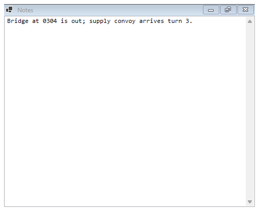
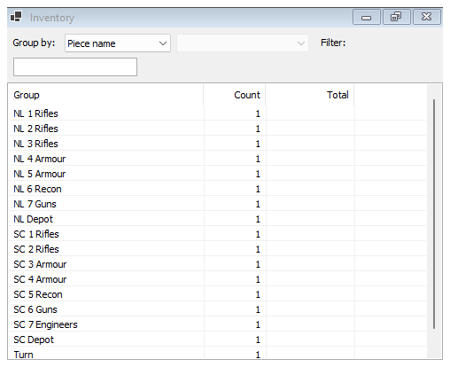

# Notes and Inventory

Both windows open as tabs in the main window and need an open game.

## Notes

**Tools > Notes** (or the toolbar's **Notes** button) opens the game's notes: one free text box for anything you want to remember. The notes are saved with the game.

There is nothing to press: what you type is kept a moment after you stop typing, when you leave the box, and when you close the window. Each change shows in the [log](Window-Log-and-Panels#log) as "notes updated".

## Inventory

**Tools > Inventory** (or the toolbar's **Inventory** button) counts the counters in play, grouped the way you choose.

| Control | What it does |
|---|---|
| **Group by:** | **Piece name**, **Map**, **Marker** or **Ledger property** |
| Second list | For Marker: which marker, for example Side, Kind or Type in Riverland. For Ledger property: which property, for example Fuel |
| **Filter:** | Counts only counters whose name contains the text |

| Column | Shows |
|---|---|
| Group | The name, map or marker value |
| Count | How many counters are in the group |
| Total | Only when grouping by a ledger property: the sum of that property. Hover it to see the counters that add up to it |

Double-click a row to find a counter of that group on the map. Double-click again to go to the next one.

Examples with Riverland: group by **Marker** and **Side** to count each side's counters; group by **Ledger property** and **Fuel** to see each unit's fuel and the totals.
