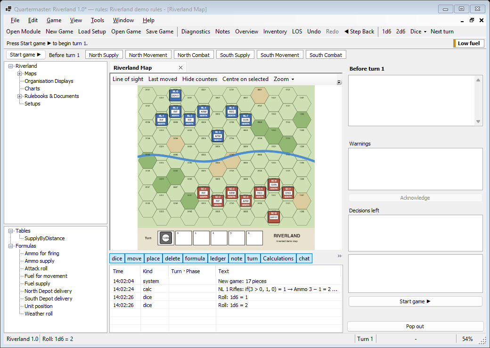
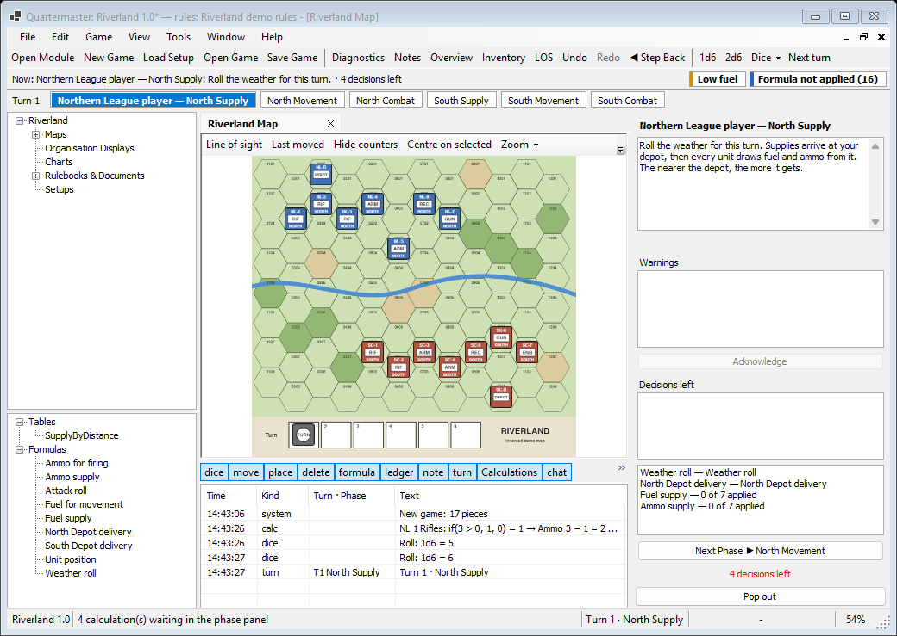
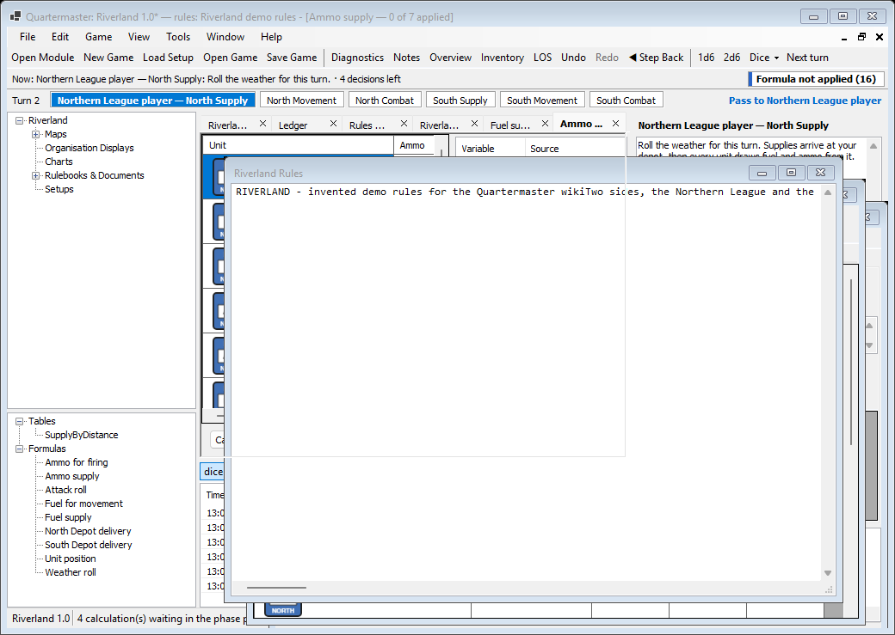
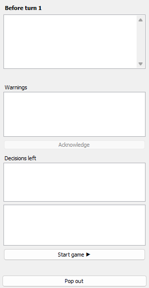
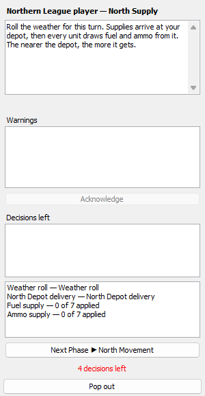
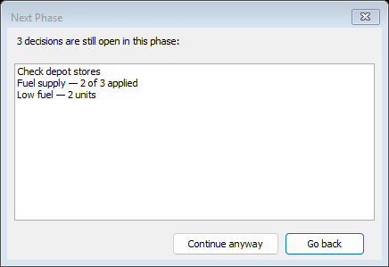
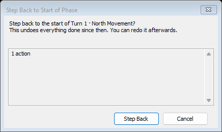
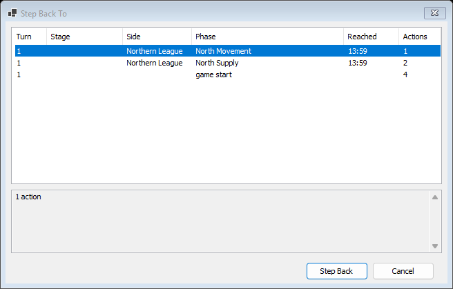

# Phases

When the rules pack has phases, Quartermaster tracks the turn for you: the phase strip shows where you are, the phase panel says what to do, and Next Phase moves on. Riverland has six phases per turn: North Supply, North Movement, North Combat, South Supply, South Movement and South Combat. The phases themselves are written in the [Rules Workbench](Window-Rules-Workbench#phases-tab).

## Phase strip

The strip sits under the toolbar and shows the turn and one chip per phase. Done phases are greyed, and the current phase is highlighted with the side that plays it, for example "Northern League player — North Supply".

Before the game starts, the strip shows **Start game ▶** and "Before turn 1":

After **Start game**, turn 1 begins with the first phase:

When the last phase ends, the turn wraps to the next one. In a hot-seat game, a notice at the right of the strip says who plays next, for example "Pass to Northern League player":

If the rules pack has no phases, the strip says "No phases defined — add them in the Rules Workbench (Phases tab)".

### Skipped phases

A phase can have a condition (the **Runs only if** field in the Workbench). When Next Phase or Start game reaches a phase whose condition is false, that phase is skipped and the game moves on to the next one in a single step, so one press of Undo or Step back undoes it all.

- A phase skipped this pass is greyed and struck through. Its tooltip says "Skipped this pass (condition false)".
- An upcoming phase that will be skipped is faded. Its tooltip says "Will be skipped unless {condition} changes".
- The label of the Next Phase button names the phase you will really land on.

Four notices tell you what happened:

- In the log, one line per skipped phase: `Skipped {phase name} (condition false)`.
- On the strip: `Skipped: {name}, {name}`.
- If every phase was skipped: `Every phase was skipped; check the phase conditions`.
- If a condition cannot be worked out: `Condition of {phase name} failed: {message}; phase not skipped`. A condition that fails never skips its phase.

The two notices about a problem (every phase skipped, a condition that failed) are also written to the log, so everyone in an online game can read them.

Loading a game or changing the rules never moves the game because of a condition. (If the rules no longer have the phase the game was in, the game is still moved to the phase now in that place.) Online, a guest may press Next Phase in their own phase; the host works out the conditions and everyone gets the result.

### Start formulas run in order

The rows of **On start** run strictly from top to bottom, in every difficulty. The next row's units are chosen only after the runs queued by the row above have all been answered, so a row can read what the row above wrote. In Semi-automatic and Hardcore a row with units always waits for you; in Fully automatic it waits only when a unit needs a value from you. The rows after it then continue when you apply the last waiting run, in the same action, so Undo takes back the answer and everything it released.

If you press **Next Phase** while rows have not run yet, the game moves on and the log says `not run: {formula names}`, in row order, for example `not run: Fuel supply, Ammo supply`. Runs that were open are logged as skipped, as before.

### Asked runs

A phase with no side can give a start (or end) row **Asks side**. The run is queued for that side in every difficulty and shows in the open list as `{formula} — {side name} answers`. Only a player holding that side or an ally of it sees and applies it (in a solo game, anyone); another player who tries is told `That calculation belongs to a side you don't hold.` Its window opens by itself only for the player holding the asked side; an ally finds it in the phase panel's open list and may open and answer it from there. The rows after it wait for the answer.

### Sealed answers

A start row with **Sealed** ticked (a phase with no side) queues one run for every side, in pack order. A side answers its own run like an asked run: it opens by itself only for the player holding that side, and an ally may also open it from the phase panel and answer it (see [Alliances](Making-a-Rules-Pack#alliances)). The phase panel then says `Answer sealed; it is applied when every side has answered.` and the log says `{Side} has answered {formula} (sealed)` for everyone, with no value. Allies see each other's answers before release; other sides never do. A side that has answered has no open run left, and a second answer says `Your sealed answer is already in.` Online, another side's player who presses Next Phase while a side still has to answer is told `{Side} is playing {phase}; wait for your phase.` When the last side has answered, the log says `{formula}: every side has answered`, the answers are applied in side order as one step (one Undo takes back the last answer and the whole release), and the rows after it continue. A run that cannot be applied logs `{formula}: {Side}: {error}`. If Next Phase leaves the phase while some answers are in and others missing, the log says `{formula}: not every side answered; the sealed answers were discarded`. See [Sealed answers](Making-a-Rules-Pack#sealed-answers).

### Reset lines

When a phase is entered, properties that reset there are cleared first and the log says `{phase}: reset {property names}`; counters then start again from their starting value, and the start rows run. All of it is one Next Phase step for Undo. See [Values that reset at a phase](Making-a-Rules-Pack#values-that-reset-at-a-phase).

### End-of-phase formulas

A phase can run formulas when it is left, listed under **On end: run formulas** in the Workbench. They have the same columns as **On start** (Formula, For each, Filter (units), Asks side). In the log they are tagged `end`, as start formulas are tagged `start`.

When you press **Next Phase** in a phase that has end formulas:

- If every run is made automatically, the same press runs them and moves on to the next phase. Undo takes it all back in one step.
- If a run needs you (an input to fill in, or a confirmation in the semi-automatic mode), the game **stays in the phase**, the runs are shown just as start formulas are, and the notice reads `Finish the end-of-phase runs, then press Next Phase again`. When you have finished them, press **Next Phase** again: the game moves on and does not run them a second time.

A phase that is skipped (its condition is false) runs no end formulas.

### Moves by the other side

An **On move** entry has a **Fires for** setting that says whose moves it reacts to, relative to the side that plays the current phase:

| Fires for | Reacts to |
|---|---|
| **Acting side** | Counters of the phase's side and its allies (what older packs always did, when no side has an alliance) |
| **Other side** | Counters that belong neither to the phase's side nor to an ally (and counters of no side) |
| **Any side** | Every moved counter |

A phase with no side treats all three alike: every moved counter fires the entry. The run is made for the counter's owner: it is logged under that player's side, and a run that waits for input is offered to that player, as if they had started it by hand.

Dragging a counter on the map is a move too. To limit an entry to moves on one map (for example, to ignore drags into an off-board box), filter on `map()`: `map() == "Main Map"` (see [Formula Reference](Formula-Reference)).

### Formulas limited to phases

A formula can be limited to some phases (**Only in phases** in the Workbench). The limit applies to formulas that a player starts: the counter menu's **Calculate** list and the **Run** button in the formula dialog.

- Outside the listed phases the formula is greyed in the **Calculate** list, and its tooltip reads `Only in: {phase names}`, for example `Only in: North Movement, North Combat`.
- Before the game starts a limited formula is not allowed. A rules pack with no phases ignores the limit.
- In the formula dialog **Run** is disabled for the same reason. In an online game the host refuses a guest's run with `{formula name} can only be run in: {phase names}`.
- Formulas that run by themselves (**On start**, **On move**, **On end**) ignore the limit.

## Phase panel

The phase panel sits on the right of the main window. **View > Phase panel** shows or hides it, and **Pop out** moves it into a window of its own (the button then reads **Dock**).

From top to bottom:

| Part | What it shows |
|---|---|
| Title | The phase and the side that plays it. Hover it to see the phase's notes |
| Instructions | What the phase asks of you, as written in the rules pack |
| **Rule:** link | Shown when the phase has a rule reference: opens the rulebook at that page |
| **Warnings** | Units that match one of the phase's warnings, for example "has no fuel and cannot move — 2 units". Double-click a unit to find it on the map. A warning that never reads a unit (for example `Weather == 2`) shows as a single line with no units under it |
| **Acknowledge** | Marks the selected decision warning as dealt with |
| **Decisions left**, checklist | The phase's checklist. Tick each item when it is done. An item can link to another item or a formula ([Checklist item ids and links](Making-a-Rules-Pack#checklist-item-ids-and-links)): `{item:spare}` shows as that item's text in double quotes (cut to 40 characters with `…`), `{formula:f-water}` as the formula's name, and a link to nothing as written. A link to an item of a phase whose checklist you may not see also stays as written. An item with an id stays ticked when the pack's items are reordered |
| **Decisions left**, open list | Calculations that are still waiting, for example "Fuel supply — 0 of 7 applied". Double-click one to open it |
| **Next Phase ▶** | Moves to the next phase and names it, for example "Next Phase ▶ North Movement". Before turn 1 it reads **Start game ▶**. When it is greyed out, hover it to see why |
| Count | How many decisions are left, for example "4 decisions left" |
| **Pop out** | Moves the panel into its own window |

How a waiting calculation opens depends on the difficulty: a [formula dialog](Window-Formula-Dialog) for one unit, the [batch grid](Window-Formula-Dialog#batch-grid) for several, or, in fully automatic mode, the [missing values dialog](Window-Formula-Dialog#missing-values) when the game needs a value it cannot work out.

## Next Phase check

**Next Phase** (the button, or Ctrl+Right) never blocks you. If decisions are still open, a dialog lists them first:

- **Continue anyway** moves on.
- **Go back** stays in the phase. Double-click a row to go back and jump straight to that decision.

### Another round or continue

At the last phase of a block that repeats until a player stops, Next Phase asks `End of {label} {n}: play another {label} or continue?` with **Another {label}**, **Continue** and **Cancel**. Continue is the default; Cancel leaves the game where it is. If that phase has end-of-phase formulas, the first press runs them and the strip shows `End-of-phase runs done; press Next Phase again to play another {label} or continue`; the next press asks. The strip's stage text for such a block reads `{label} {n}` (no "of"), and for a block inside a block both parts are shown, joined with a comma. See [Blocks that repeat until a player stops](Making-a-Rules-Pack#blocks-that-repeat-until-a-player-stops).

### Reacting sides

When a phase lists sides that also act in it, the phase panel shows `Reacting: {names}` under the side. A player at the screen who holds only a reacting side sees `{side} is playing {phase}; you may react`: Next Phase and the checklist stay with the phase's own side, but the reacting player can run formulas that need no counter and write global values. See [Sides that react](Making-a-Rules-Pack#sides-that-react).

### Phases of an ally

A player may act in a phase whose side is an ally's (same alliance in the rules pack): run its formulas, tick its checklist, acknowledge its warnings and press Next Phase. The hand-over in hot-seat still goes to the player holding the phase's side. A run made there is stamped with the ally's side. A phase's formulas for each unit, its warnings about units and its On move rows also reach the counters of every side allied to the phase's side. See [Alliances](Making-a-Rules-Pack#alliances).

### Due list

When the pack has a schedule, the phase panel gets a **Due** section under the warnings. Each row shows its label, `Due now` or `Overdue since turn {T}`, and a button: **Place** (counters that arrive or return; they appear on the row's zone map, select them and drag them to their hexes) or **Withdraw** (counters that leave, moved to the zone map). One Place marks the whole row done. A solo game also lists a row without counters, as `Due now, no counter matches` or `Overdue since turn {T}, no counter matches`, with no button. A row that is due now and has counters also shows in the Next Phase check as `Due: {label}`. See [Reinforcements and withdrawals](Making-a-Rules-Pack#reinforcements-and-withdrawals).

### Game over

When the last turn has been played or a victory condition is met, the banner and the phase strip read `Game over: {result}` and the log has a Turn line with the same text. Next Phase then does nothing and says `The game is over.`; counters, ledgers, the log, undo and saving still work, and undo takes the game out of game over. See [The last turn and victory](Making-a-Rules-Pack#the-last-turn-and-victory).

## Step back

**Edit > Step Back to Start of Phase** (Ctrl+Left, or the toolbar's **◀ Step Back**) asks before it goes back, and says what it would undo:

**Edit > Step Back To...** lists every point you can go back to, newest first:

| Column | Shows |
|---|---|
| Turn, Stage, Side, Phase | Where that point is |
| Reached | The time the game got there |
| Actions | How many actions going back would undo |

The box under the list says what would be undone. **Step Back** goes back, **Cancel** leaves the game alone. You can redo a step back afterwards with **Edit > Redo**. Dice rolled after that point are undone too.
