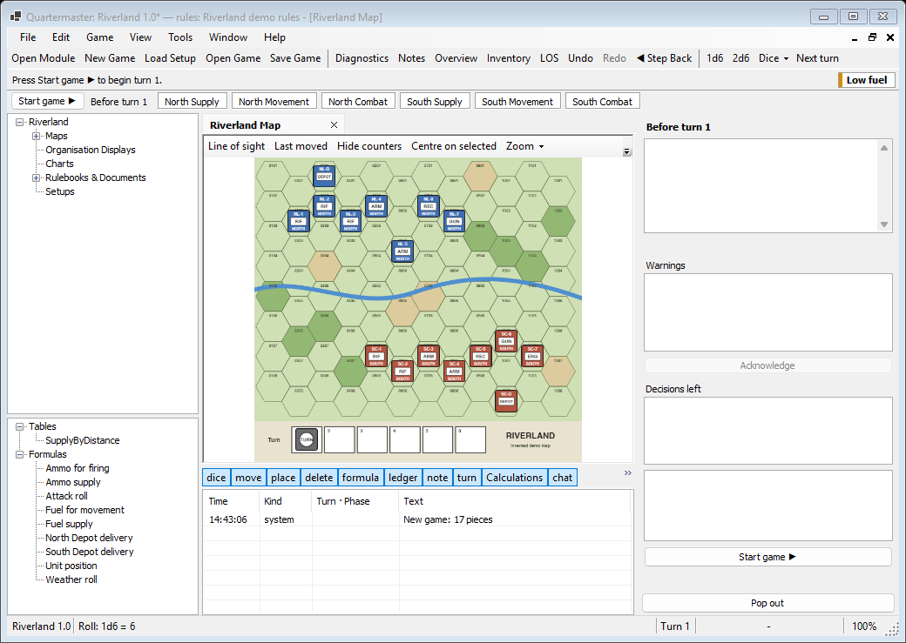
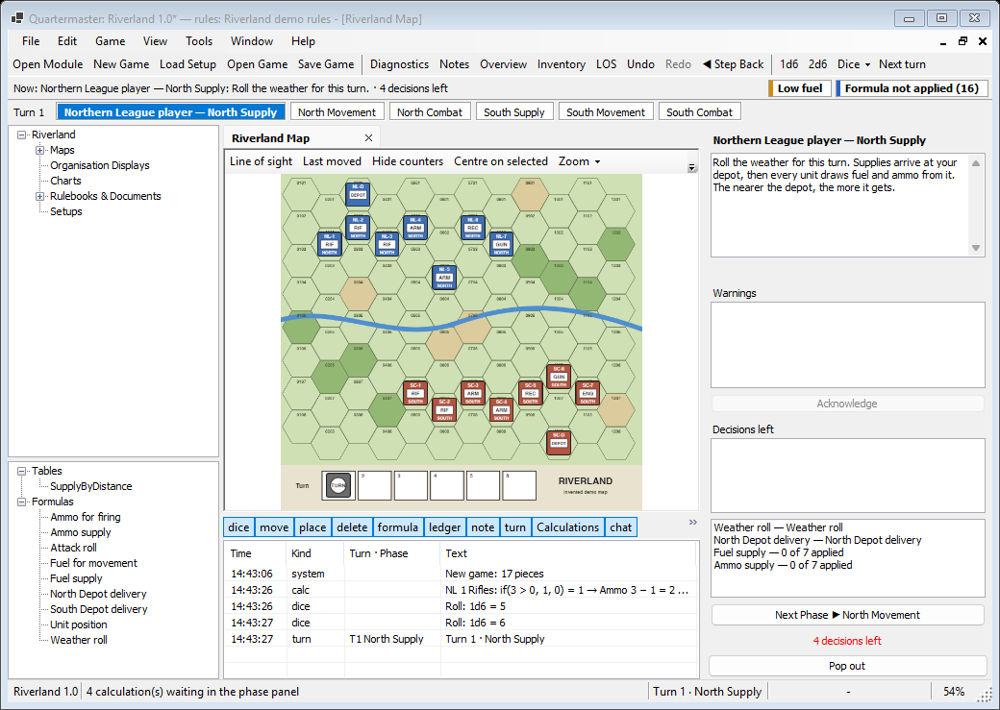
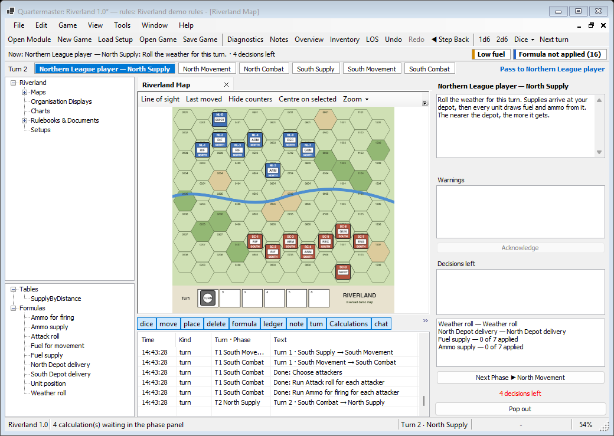
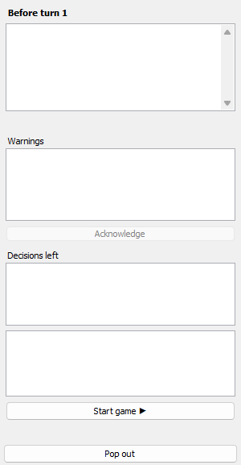
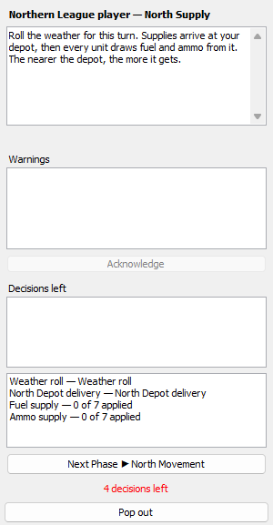
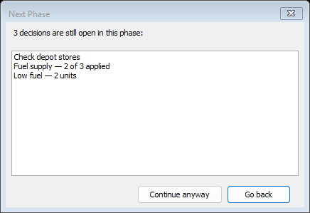
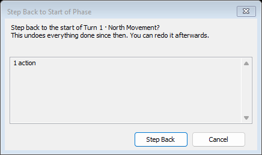
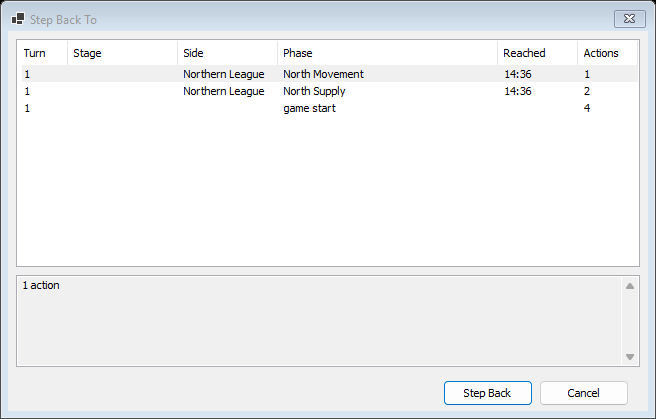

# Phases

When the rules pack has phases, Quartermaster tracks the turn for you: the phase strip shows where you are, the phase panel says what to do, and Next Phase moves on. Riverland has six phases per turn: North Supply, North Movement, North Combat, South Supply, South Movement and South Combat. The phases themselves are written in the [Rules Workbench](Window-Rules-Workbench#phases-tab).

## Phase strip

The strip sits under the toolbar and shows the turn and one chip per phase. Done phases are greyed, and the current phase is highlighted with the side that plays it, for example "Northern League player — North Supply".

Before the game starts, the strip shows **Start game ▶** and "Before turn 1":

After **Start game**, turn 1 begins with the first phase:

When the last phase ends, the turn wraps to the next one. In a hot-seat game, a notice at the right of the strip says who plays next, for example "Pass to Northern League player":

If the rules pack has no phases, the strip says "No phases defined — add them in the Rules Workbench (Phases tab)".

## Phase panel

The phase panel sits on the right of the main window. **View > Phase panel** shows or hides it, and **Pop out** moves it into a window of its own (the button then reads **Dock**).

From top to bottom:

| Part | What it shows |
|---|---|
| Title | The phase and the side that plays it. Hover it to see the phase's notes |
| Instructions | What the phase asks of you, as written in the rules pack |
| **Rule:** link | Shown when the phase has a rule reference: opens the rulebook at that page |
| **Warnings** | Units that match one of the phase's warnings, for example "has no fuel and cannot move — 2 units". Double-click a unit to find it on the map |
| **Acknowledge** | Marks the selected decision warning as dealt with |
| **Decisions left**, checklist | The phase's checklist. Tick each item when it is done |
| **Decisions left**, open list | Calculations that are still waiting, for example "Fuel supply — 0 of 7 applied". Double-click one to open it |
| **Next Phase ▶** | Moves to the next phase and names it, for example "Next Phase ▶ North Movement". Before turn 1 it reads **Start game ▶**. When it is greyed out, hover it to see why |
| Count | How many decisions are left, for example "4 decisions left" |
| **Pop out** | Moves the panel into its own window |

How a waiting calculation opens depends on the difficulty: a [formula dialog](Window-Formula-Dialog) for one unit, the [batch grid](Window-Formula-Dialog#batch-grid) for several, or, in fully automatic mode, the [missing values dialog](Window-Formula-Dialog#missing-values) when the game needs a value it cannot work out.

## Next Phase check

**Next Phase** (the button, or Ctrl+Right) never blocks you. If decisions are still open, a dialog lists them first:

- **Continue anyway** moves on.
- **Go back** stays in the phase. Double-click a row to go back and jump straight to that decision.

## Step back

**Edit > Step Back to Start of Phase** (Ctrl+Left, or the toolbar's **◀ Step Back**) asks before it goes back, and says what it would undo:

**Edit > Step Back To...** lists every point you can go back to, newest first:

| Column | Shows |
|---|---|
| Turn, Stage, Side, Phase | Where that point is |
| Reached | The time the game got there |
| Actions | How many actions going back would undo |

The box under the list says what would be undone. **Step Back** goes back, **Cancel** leaves the game alone. You can redo a step back afterwards with **Edit > Redo**. Dice rolled after that point are undone too.
