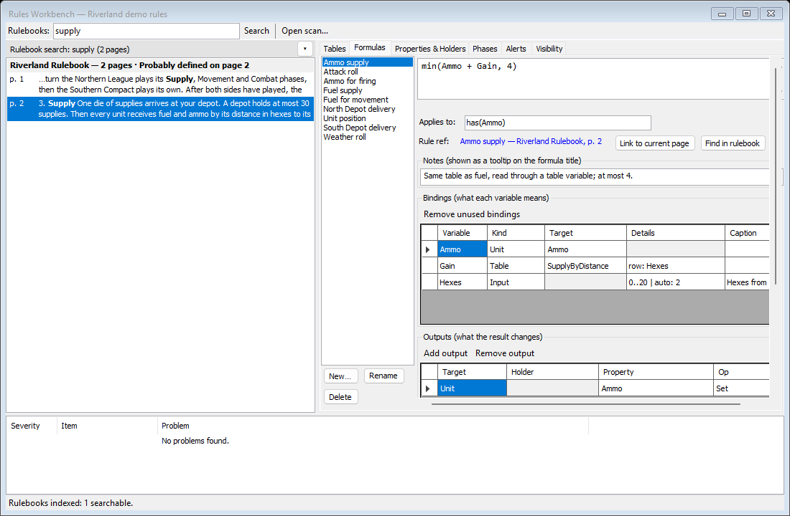
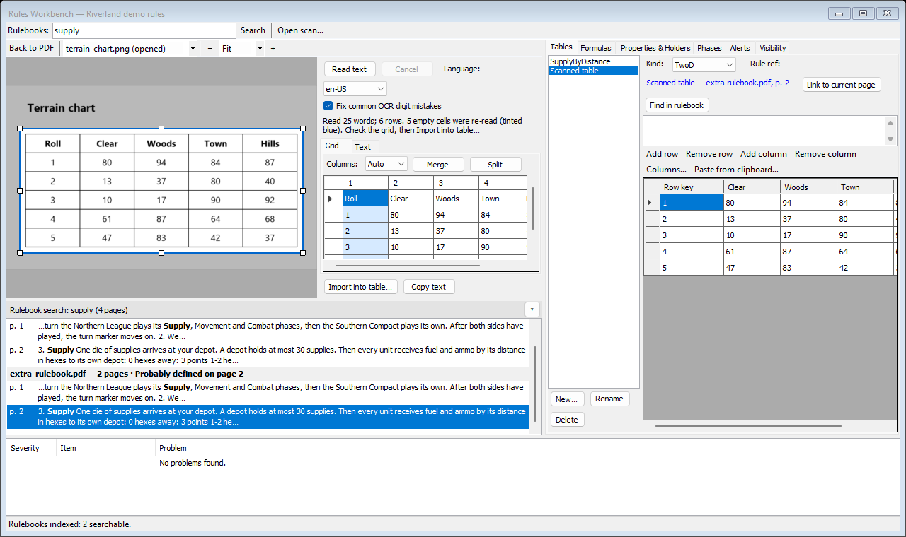

# Rulebook search and OCR

These parts of the [Rules Workbench](Window-Rules-Workbench) help you find a rule in the module's PDF rulebooks and copy a chart out of a scan. They only help you read: nothing goes into the rules pack unless you put it there.

## Rulebook search

When the Workbench opens, it indexes the module's PDF rulebooks in the background. The status bar shows "Indexing rulebooks… N %", then "Rulebooks indexed: 1 searchable." A module with no PDF says so. A PDF that has no text (a scan) is listed greyed out as not searchable.

Type in the **Rulebooks:** box at the top of the Workbench (Ctrl+Shift+F jumps there) and press Enter or **Search**. In Riverland, searching for "supply" finds two pages of the Riverland Rulebook:

| Part | What it does |
|---|---|
| Title line | The search and the number of pages, for example "Rulebook search: supply (2 pages)" |
| **▾** | Folds the results away, or opens them again |
| Document rows | Each rulebook with its number of pages, and where the word is probably defined, for example "Probably defined on page 2" |
| Page rows | The page number and the text around each hit, with the hit in bold |

- Double-click a page row (or press Enter) to open the rulebook at that page in the left pane.
- Right-click a page row and choose **Use as rule ref** to point the selected table, formula or phase at that page.
- Right-click a greyed-out (not searchable) document and choose **Scan page 1** to read it with OCR instead.

The **Find in rulebook** buttons in the Tables, Formulas and Phases tabs run the same search for the selected text or the item's name.

## Rulebook pane

The left pane of the Workbench shows a module document. Its toolbar has a list of the module's documents, **Page:** with **<** and **>**, and **Scan this page** (for PDFs: turns the page into an image to read with OCR). When rule refs point at the page you are on, a **Used on this page** list names them; double-click one to go to that item.

Showing documents needs the Microsoft Edge WebView2 runtime. If it is not installed, the pane says so and gives the download address.

## Scans and OCR

**Open scan…** in the Workbench toolbar opens an image (`.png .jpg .jpeg .bmp .gif .tif .tiff`) or a PDF, for example a photo of a chart from a printed rulebook. **Scan this page** does the same for the PDF page you are reading. The left pane then shows the scan with an OCR panel beside it.

The scan's toolbar:

| Control | What it does |
|---|---|
| **Back to PDF** | Returns to the rulebook (and to the page you scanned) |
| Source list | The module's images and the scans you opened this session. Small images are hidden until you choose **Show all images** at the end of the list |
| **Page:**, **<**, **>** | For a PDF scan: which page |
| **−**, zoom, **+** | Zoom out, the zoom (Fit, or a size), zoom in. Ctrl+wheel also zooms |

On the image, drag a box around the part you want to read; drag its handles to adjust it. Click outside the box to clear it (then the whole image is read). Middle- or right-drag moves the view, and Esc clears the box.

The OCR panel:

| Control | What it does |
|---|---|
| **Read text** | Reads the text in the box with Windows' own text recognition. **Cancel** stops it |
| **Language:** | The recognition language. Windows must have one installed; if not, the panel says how to add one in Windows Settings |
| **Fix common OCR digit mistakes** | Corrects characters that OCR often misreads in numbers. On by default |
| **Grid** tab | The text as an editable grid. **Columns:** (Auto or a number), **Merge** and **Split** fix the columns. Empty cells that were read a second time are tinted blue |
| **Text** tab | The plain text |
| **Import into table…** | Opens the paste preview (with **First row is the column header** and **First column is the row key**) and puts the grid into a table of the Tables tab |
| **Copy text** | Copies the text |

A status line says what was read, for example "Read 25 words; 6 rows. ... Check the grid, then Import into table…". Always check the numbers against the original before you import: OCR does make mistakes, and single characters are often missed.

A table imported from an opened scan gets a rule ref that names the scan's file (never a folder on your computer).
