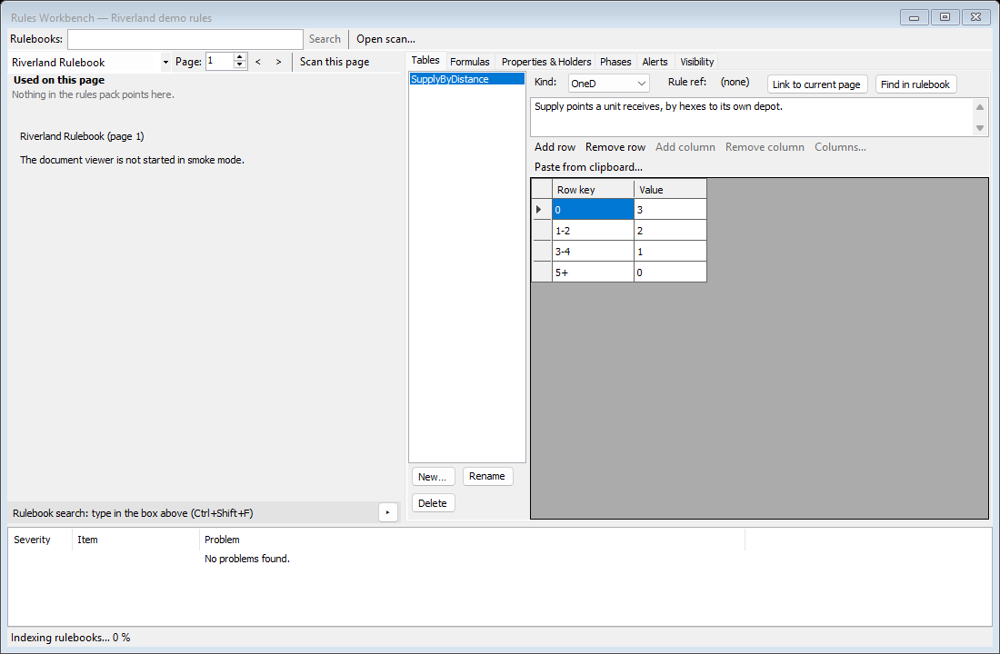
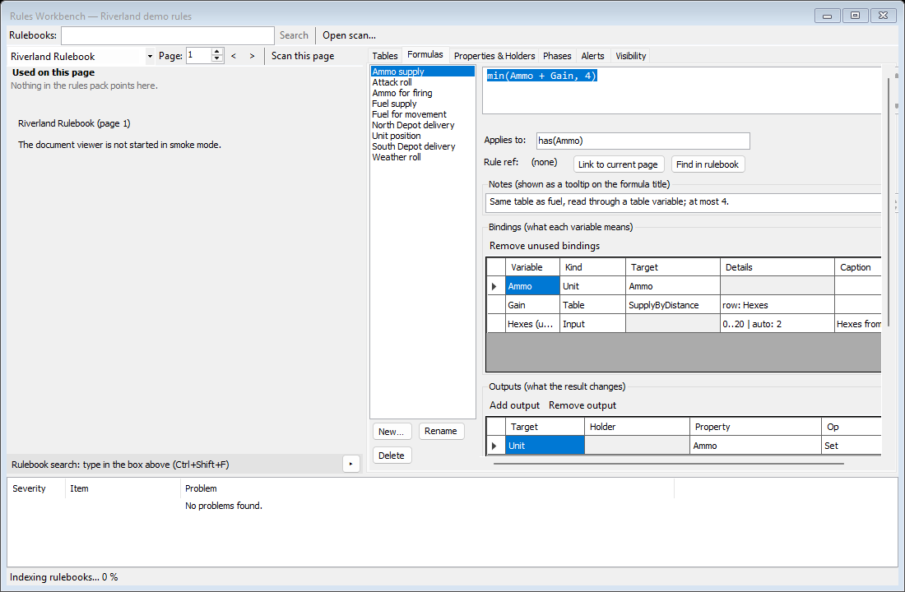
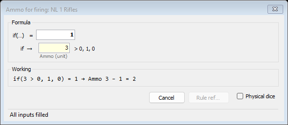
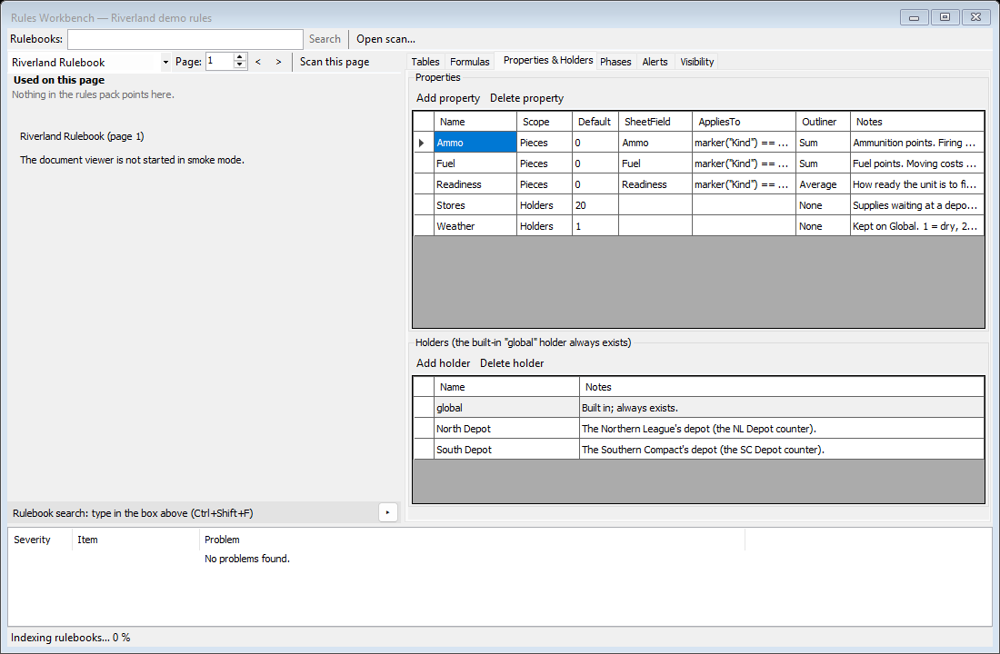
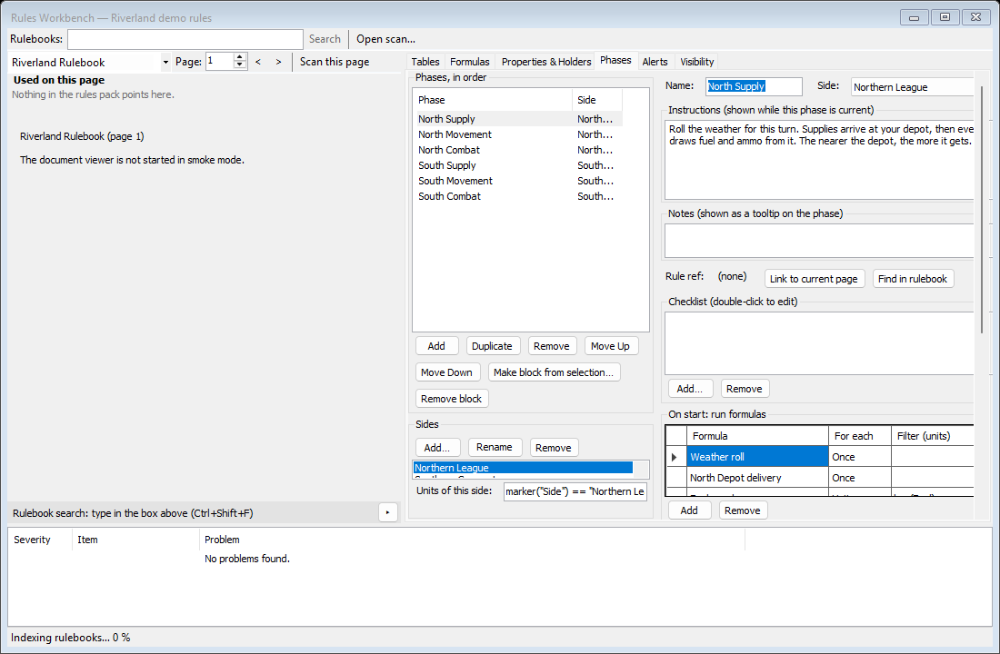

# Rules Workbench

The Rules Workbench is where you write a rules pack: the tables, formulas, properties, phases, alerts and visibility rules that Quartermaster plays by. This page describes the window. For how to build a pack step by step, see [Making a Rules Pack](Making-a-Rules-Pack).

Open it with **Tools > Rules Workbench** (Ctrl+Shift+W), or double-click a table or formula in the tables tree on the left of the main window. The title shows the pack's name, for example "Rules Workbench — Riverland demo rules". Without a rules pack the window offers **New rules pack…** and **Open…** instead.

Nothing is ever copied out of the module's rulebooks for you. Every table and formula is typed or pasted by you; the rulebook is there to read beside the editors.

## Layout

| Part | What it does |
|---|---|
| **Rulebooks:** box, **Search**, **Open scan…** | Search the module's PDF rulebooks, and open a scan or photo of a chart. See [Rulebook search and OCR](Window-Rulebook-Search-and-OCR). Ctrl+Shift+F jumps to the box |
| Left pane | The module's rulebook, to read while you work (the pictures on this page have it closed) |
| Tabs | Tables, Formulas, Properties & Holders, Phases, Alerts, Visibility (below) |
| Problems list | Severity, Item and Problem for everything wrong with the pack, or "No problems found." Double-click a problem to go to it |
| Status bar | Indexing progress, then "Rulebooks indexed: 1 searchable." |

Save the pack with **File > Save Rules Pack**.

In an online game a guest sees the host's pack read-only, with a yellow note saying so.

### Rule references

Tables, formulas and phases can point at a page of the rulebook (a "rule ref"). Each of these tabs has:

- **Rule ref:** the page it points at, for example "Ammo supply — Riverland Rulebook, p. 2", or "(none)". Click it to open the rulebook there.
- **Link to current page** sets the rule ref to the page shown in the left pane.
- **Find in rulebook** searches the rulebook for the selected text, or the item's name.

Properties, holders, alerts, phase warnings and checklist items can have a rule ref too. They get it from a picker: **(none)**, then every rule ref the pack already has, shown as `{label}, page {page}` (for example "Ferry rules, page 4"). The picker only chooses a ref that exists; make one first with **Link to current page** on a table, formula or phase. A ref that no longer exists shows as `{id} (missing)` so you can see it and pick **(none)** to clear it. See [Rule references](Making-a-Rules-Pack#rule-references).

## Tables tab

The list on the left holds the pack's tables, for example `SupplyByDistance`, with **New…**, **Rename…** and **Delete**.

| Control | What it does |
|---|---|
| **Kind:** | **OneD** (one row key and a value), **TwoD** (rows and columns) or **Dice** |
| Notes box | Your notes on the table |
| **Add row**, **Remove row**, **Add column**, **Remove column** | Change the grid |
| **Columns…** | A dialog with one column key per line (a number, a range like 3-5, 7+, or text) |
| **Paste from clipboard…** | Pastes a table copied from a spreadsheet. A preview dialog asks whether the **First row is the column header** and the **First column is the row key** |
| Grid | **Row key** and the values. Row keys can be numbers, ranges (`1-2`) or open ranges (`5+`) |

## Formulas tab

The list on the left holds the pack's formulas, with **New…**, **Rename…** and **Delete**. For the selected formula:

| Part | What it does |
|---|---|
| Formula box | The formula text, for example `min(Ammo + Gain, 4)`. A mistake shows a **Go to error** link |
| **Applies to:** | Which counters the formula is for, for example `has(Ammo)` |
| **Only in phases** | A checkbox for each phase. Tick the phases in which a player may start this formula from the counter menu or the formula dialog; the hint reads "None checked = any phase." See [Phases](Window-Phases#formulas-limited-to-phases) |
| **Only runs when** | A condition that must be true for the formula to run, for example `Fuel > 0`. Empty = always. It cannot use a Roll variable or `dice()`. See [Formulas that can refuse to run](Making-a-Rules-Pack#formulas-that-can-refuse-to-run) |
| **Refusal message** | The reason shown when that condition is false. Empty = `{formula name} cannot be run now` |
| **Roll once for the group** | A check box under the phase list. Dice are rolled once for a group: for a phase entry, one roll per hex and side; in a batch, the first run rolls and the others reuse its dice. See [Rolling once for a group](Making-a-Rules-Pack#rolling-once-for-a-group) |
| **Rule ref:** | See above |
| **Notes** | Shown as a tooltip on the formula title in the formula dialog |
| **Bindings** | What each name in the formula means: Variable, Kind (Unit, Global, Holder, Table, Location, Input, Roll, Moved or Piece), Target, Details, Caption **Only when** (a condition that must be true for the variable to be used; empty = always, see [Variables used only sometimes](Making-a-Rules-Pack#variables-used-only-sometimes)) and, for a Roll, **Dice count** (an expression for the number of dice, 1 to 100; blank = the fixed number in Details, see [a roll per plane](Making-a-Rules-Pack#a-range-chart-and-a-roll-per-plane)) and, for a Piece, **Same hex** (a check box: list only the other counters in this counter's hex; see [Acting on other pieces](Making-a-Rules-Pack#acting-on-other-pieces)) and, for an Input, **Choices table** (a table whose row keys are offered as the choices; blank = none) and **Choices filter** (an expression, true for each row key to offer, with `row()` for the key; open only once a table is set; clearing the table clears the filter; see [Choices from a table](Making-a-Rules-Pack#choices-from-a-table)). **Remove unused bindings** clears names the formula no longer uses. For an Input, Details holds the limits or choices (a range such as `0..20`, or choices separated by commas, with `"double quotes"` around a choice that holds a comma), then optional `\| always ask` and `\| auto: expression` (either order). For a Piece, Target is the property read from the counter the player picks and Details is the **which pieces** filter (a unit filter; blank = every piece; see [Reading another counter](Formula-Reference#where-names-get-their-values)). The Problems list also checks palette entries against the module's palette. A phase's on-move formula gets a warning only when it has no Moved, Input, Unit, Global or Holder binding. A Holder binding's Target offers each holder only the properties it keeps, and a Global binding only what the global holder keeps ([Properties some holders keep](Making-a-Rules-Pack#properties-some-holders-keep)) |
| **Outputs** | What the result changes: Target, Holder, Property and Op (Set, Add or Subtract). A Holder or Global output's **Property** offers only the properties that holder keeps. **Value** is an expression for what this output gets (blank = the formula's result, see [Outputs](Formula-Reference#outputs)). **Choose from** lists properties separated by commas and **Pick by** is an expression that picks one at run time (a number picks the Nth, a name picks that property); the **Property** cell is then not used. **Action** (Write, Place, Remove, SetLayer, SetMask or Reveal; blank is Write), **Piece** (for target Piece: which Piece variable of the formula), **Palette entry** (Place: a palette path or gpid), **Layer** (SetLayer: the layer's name) and **To map** (Remove: `(delete)` or a map name) come after **Pick by**; a cell the action does not use is closed, and changing the action clears the cells it no longer uses. Target also offers **Piece** and **Placed** (see [Acting on other counters](Formula-Reference#acting-on-other-counters)). **Add output**, **Remove output**. **Key** (the last column, after **To map**) is the expression giving the key a Write output writes to a keyed property, such as `hex()`, `turn() + 2` or `"Barge"`; it is closed for other actions, and changing the action clears it. **To map** shows the map a Remove output names by its id or its name. **Margin** (after **Key**) is for a Reveal output only: how wide the revealed range is (tooltip: `Reveal only: how wide the revealed range is. 0 or blank shows the exact value; 2 shows a range such as between 3 and 5 that holds the value.`); it is closed for other actions, and Action **Reveal** is chosen in the **Action** cell like the others (see [Reveal and Margin](Formula-Reference#reveal-and-margin)) |
| **Preview** | The [formula dialog](Window-Formula-Dialog) as it will look, with a **Test piece:** to try it on. Sample values are not saved |

[Formula Reference](Formula-Reference) lists the functions you can use.

## Properties & Holders tab

**Properties** are the values the ledger keeps. **Add property** and **Delete property** change the list. The columns:

| Column | Meaning |
|---|---|
| Name | For example Fuel |
| Scope | Pieces, Holders or Both |
| Default | The starting value |
| SheetField | A property-sheet row of the module's counters that seeds the value |
| AppliesTo | Which counters have it, for example `marker("Kind") == "Unit"` |
| Outliner | How the [outliner](Window-Log-and-Panels#outliner) totals it per group: None, Sum, Min or Average |
| Notes | Your notes |
| Expression | Makes the property **computed**: its value is this expression, worked out whenever it is read and never stored, for example `Fuel * 2 + Readiness`. Default and SheetField are greyed while it is set. Empty means a stored value. See [Computed properties](Formula-Reference#computed-properties) |
| Overrides table | A table this property overrides for the counter that holds it: a read of that table at the row named like the counter gives the counter's own value instead of the printed cell. Pick from the pack's tables; blank means none. See [A piece's own value for a table rating](Formula-Reference#a-pieces-own-value-for-a-table-rating) |
| Column | The overridden column, picked from the table's columns. Greyed for a table with one dimension (it has no column) and when no table is picked |
| Rule ref | The rulebook page for this property, from the rule-ref picker ([Rule references](#rule-references)) |
| Labels | A one-column table (OneD or Dice) whose row for a value gives the text shown next to it, for example `3 (Fog)`. Values stay numbers. Blank = none. See [Labels for numbers](Making-a-Rules-Pack#labels-for-numbers) |
| Holders | For a holder property: the holders that keep it, comma-separated names (`global` is the built-in holder). Blank = every holder. A name that is no holder is refused with `No holder named "{name}"` and the cell goes back to what it was. See [Properties some holders keep](Making-a-Rules-Pack#properties-some-holders-keep) |
| Clone as | What a copy made with the counter's Clone command gets: **Copy** (this counter's current value) or **Default** (what a new counter starts with). See [Clone and ledger values](Making-a-Rules-Pack#clone-and-ledger-values) |
| Starting value | An expression worked out once for each counter that gets this property and has no sheet value, e.g. `lookup(CrewSizes, marker("Kind"))`. It may read the counter, globals and tables; no dice. Blank = Default. See [Starting values from an expression](Making-a-Rules-Pack#starting-values-from-an-expression) |
| Resets at | Phases that clear this property's values when they begin, comma-separated names (not case-sensitive). Counters then start again from their starting value. Blank = never. A name that is no phase is refused with `No phase named "{name}"`. See [Values that reset at a phase](Making-a-Rules-Pack#values-that-reset-at-a-phase) |
| Keyed by | Keep one value per key instead of one value: blank (an ordinary property), **Turn** (keys of past turns are dropped when a new turn starts), **Hex (place)** (place values, kept by the Global holder) or **Table: {name}** (one value per row of that table). Read a value with `keyed(Property, key)`; an output's **Key** chooses the key it writes. See [Places and keyed values](Making-a-Rules-Pack#places-and-keyed-values) |

**Holders** keep values that do not belong to a counter, such as a depot's stores. The built-in **global** holder always exists. **Add holder** and **Delete holder** change the list. The holder grid has Name, Notes and **Rule ref** (from the rule-ref picker; the global holder's row is read-only).

## Phases tab

On the left:

- **Phases, in order**: **Add**, **Duplicate**, **Remove**, **Move Up**, **Move Down**. **Make block from selection…** groups the selected phases into a block that repeats (it asks for a **Repeat count** and a **Label**, or **Until a player stops**, which makes the block repeat until the acting player chooses Continue; a block may lie inside one other block); **Remove block** undoes that. The list marks each phase of a block with the block's label and its count, for example `┃ Day ×2`, or `(until stopped)` for a block that repeats until a player stops.
- **Sides**: **Add…**, **Rename…**, **Remove**, and **Units of this side:**, a filter such as `marker("Side") == "Northern League"`.
  - **Alliance:** a name; sides with the same alliance see what each other sees and may act on each other's units and in each other's phases. Blank = no alliance. See [Alliances](Making-a-Rules-Pack#alliances).
  - **Former ids:** ids this side had in older versions of the pack, separated by commas; saved games that use them read as this side. See [Former side ids](Making-a-Rules-Pack#former-side-ids).
  - **Merge into…** (after **Remove**): asks `Name of the side to merge "{from}" into:`, then confirms `Merge "{from}" into "{into}"? Its phases, holders, maps and alerts move to "{into}", and saved games that used it read as "{into}".` The side's id becomes a former id of the target. Errors: `No side is named "{n}"` and `A side cannot be merged into itself`.

On the right, for the selected phase:

| Part | What it does |
|---|---|
| **Name:**, **Side:** | The phase name and the side that plays it |
| **Instructions** | Shown in the phase panel while this phase is current |
| **Notes** | Shown as a tooltip on the phase |
| **Runs only if** | A condition for the phase; the hint reads "Leave empty to always run. Example: PlayerA == 1, turn() == 1, mod(turn(), 4) == 1." Problems with the condition show in **Problems with this phase** |
| **Rule ref:** | See above |
| **Also acting:** | One box per other side: ticked sides may also act in this phase (run formulas that need no counter and write global values). Only the phase's own side ticks, acknowledges and presses Next Phase. See [Sides that react](Making-a-Rules-Pack#sides-that-react) |
| **Checklist** | Items the player ticks. **Add…**, **Remove**, double-click to edit the text. Each row reads `{id}: {shown text}`, or just the shown text for an item without an id; links are shown as the player sees them. Below the list, the selected item's details: **Id:** (letters, digits, `-`, `_` or `.`; a bad id shows "Use letters, digits, '-', '_' or '.' in an id" and one already used anywhere in the pack shows `Another checklist item already has the id "{id}"`; neither is stored), **Rule ref:** (the rule-ref picker), **Notes:** and **Links:** (each link's target, or `{token} (missing)`). See [Checklist item ids and links](Making-a-Rules-Pack#checklist-item-ids-and-links) |
| **On start: run formulas** | Formulas that run when the phase starts: Formula, For each, Filter (units), **Asks side** (**(none)** or a side name: the side whose player answers the run; only in a phase without a side, with For each = Once; see [Asking a side](Making-a-Rules-Pack#asking-a-side-at-the-start-of-a-phase)) and **Sealed** (ticked: every side answers this row in secret, see [Sealed answers](Making-a-Rules-Pack#sealed-answers); tooltip `Every side answers this row in secret; the answers are applied together, in side order, once every side has answered.`; only on start rows, and the row must run once in a phase with no side). The rows run in order, see [Phases](Window-Phases#start-formulas-run-in-order) |
| **On end: run formulas** | Formulas that run when Next Phase leaves the phase: Formula, For each, Filter (units) and Asks side, like **On start**. See [Phases](Window-Phases#end-of-phase-formulas) |
| **On move: run formulas for moved units** | Formulas that run when a unit moves: Formula, Filter (units) and **Fires for** (**Acting side**, **Other side** or **Any side**; the default is Acting side). See [Phases](Window-Phases#moves-by-the-other-side) |
| **Warnings** | Condition, Message (`{unit}` = the unit's name), Decision (ticked: the warning counts as a decision left until it is acknowledged in the phase panel) and **Rule ref** (the rule-ref picker) |
| **Problems with this phase** | What is wrong with this phase |

## Schedule tab

There is no screenshot of this tab yet.

A grid of reinforcement and withdrawal rows, with **Add**, **Remove**, **Move Up** and **Move Down**. The columns are **Turn**, **Stage** (blank = any stage), **Phase**, **Action** (Arrive, Leave or Return), **Counters** (a unit filter, for example `startswith(name(), "Relief barge")`), **Zone map** (where arrivals wait, or where withdrawals go; blank on a Leave row deletes the counters), **Formula** (run on each counter when the row is placed or withdrawn) and **Label**. A box under the grid lists the problems with the rows. See [Reinforcements and withdrawals](Making-a-Rules-Pack#reinforcements-and-withdrawals).

## End of game tab

There is no screenshot of this tab yet.

At the top, **The game ends after turn** and **Last stage** (each with a number; the box must be ticked for it to apply). On the left, **Victory conditions, in order** with **Add**, **Remove**, **Move Up** and **Move Down**. For the selected condition: **Condition (true ends the game, for example Score >= 10)** with a live result, **Side:**, **Message:**, and **Checked in (phase names, comma-separated; blank = every phase)**. Problems show at the bottom. See [The last turn and victory](Making-a-Rules-Pack#the-last-turn-and-victory).

## Alerts tab

There is no screenshot of this tab yet.

On the left, **Alerts, in order**, with columns Alert and Severity, and **Add**, **Remove**, **Move Up**, **Move Down**. For the selected alert:

| Control | What it does |
|---|---|
| **Name:** | Shown on the alert chip, for example "Low fuel" |
| **Condition** | A unit filter, for example `Fuel < 2` |
| **Message ({unit} = unit name):** | For example "{unit} is low on fuel" |
| **Severity:** | Info (blue), Warning (amber) or Critical (red) |
| **Side:** | Limits the alert to one side's units; only players holding that side see it, in every phase |
| **Rule ref:** | The rulebook page for the alert, from the rule-ref picker ([Rule references](#rule-references)) |
| **Notes** | Shown as a tooltip on the alert |

Alerts appear as chips in the main window's [alert bar](Window-Main-Window#alert-bar).

## Visibility tab

There is no screenshot of this tab yet.

The tab decides what each side may see in hot-seat and online games. It has four boxes:

| Box | What you set |
|---|---|
| **Properties** | Private or Public for each property. Only the owning side's players see a private value. In Riverland, Readiness is private. A Public computed property that reads hidden data is marked "(computed from hidden data)": players who do not hold every side see it as Private |
| **Holders** | An owner side for each holder (none = public) |
| **Maps and org displays** | An owner side for each map (none = public) |
| **Formulas** | Tick **Private dice** to show a formula's rolls only to the rolling side |

A line at the bottom lists any problems. See [Playing With Others](Playing-With-Others) for how hidden information works in play.
