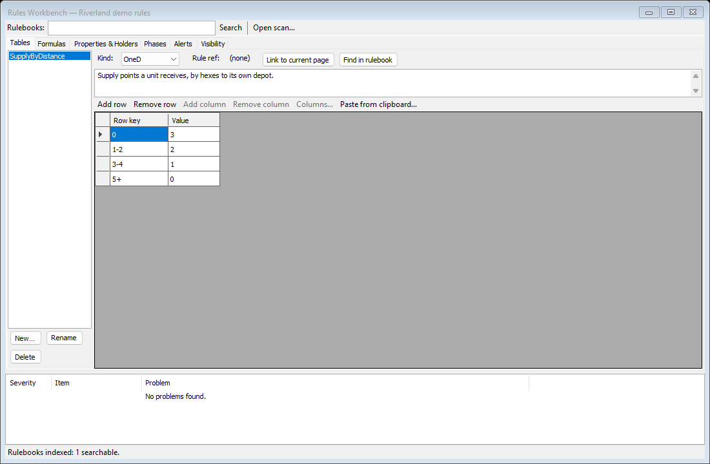
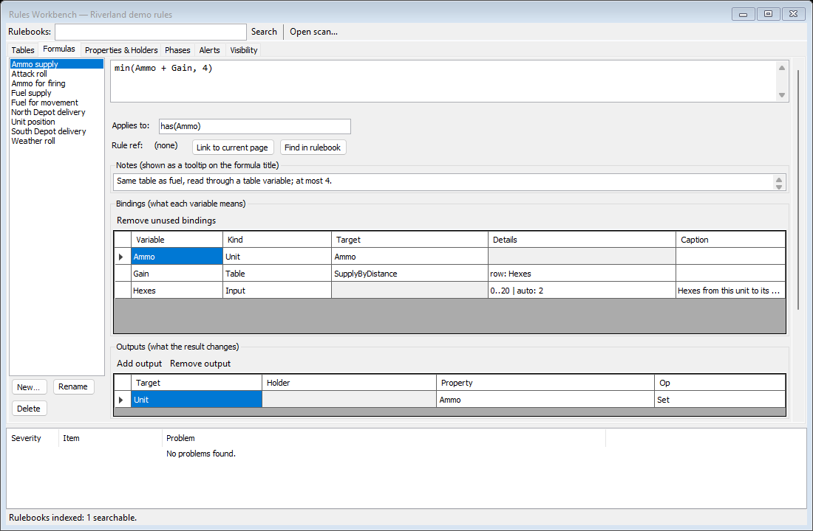
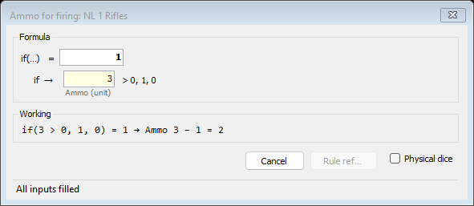
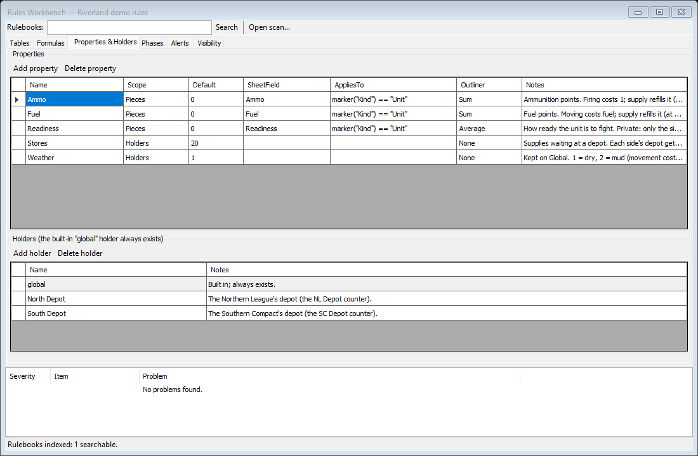
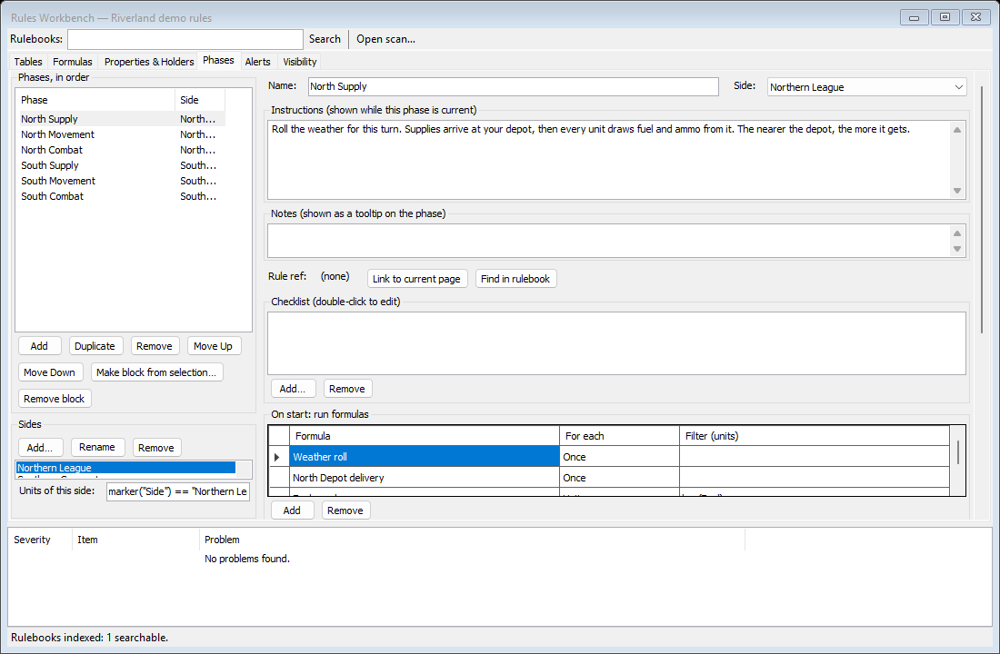

# Rules Workbench

The Rules Workbench is where you write a rules pack: the tables, formulas, properties, phases, alerts and visibility rules that Quartermaster plays by. This page describes the window. For how to build a pack step by step, see [Making a Rules Pack](Making-a-Rules-Pack).

Open it with **Tools > Rules Workbench** (Ctrl+Shift+W), or double-click a table or formula in the tables tree on the left of the main window. The title shows the pack's name, for example "Rules Workbench — Riverland demo rules". Without a rules pack the window offers **New rules pack…** and **Open…** instead.

Nothing is ever copied out of the module's rulebooks for you. Every table and formula is typed or pasted by you; the rulebook is there to read beside the editors.

## Layout

| Part | What it does |
|---|---|
| **Rulebooks:** box, **Search**, **Open scan…** | Search the module's PDF rulebooks, and open a scan or photo of a chart. See [Rulebook search and OCR](Window-Rulebook-Search-and-OCR). Ctrl+Shift+F jumps to the box |
| Left pane | The module's rulebook, to read while you work (the pictures on this page have it closed) |
| Tabs | Tables, Formulas, Properties & Holders, Phases, Alerts, Visibility (below) |
| Problems list | Severity, Item and Problem for everything wrong with the pack, or "No problems found." Double-click a problem to go to it |
| Status bar | Indexing progress, then "Rulebooks indexed: 1 searchable." |

Save the pack with **File > Save Rules Pack**.

In an online game a guest sees the host's pack read-only, with a yellow note saying so.

### Rule references

Tables, formulas and phases can point at a page of the rulebook (a "rule ref"). Each of these tabs has:

- **Rule ref:** the page it points at, for example "Ammo supply — Riverland Rulebook, p. 2", or "(none)". Click it to open the rulebook there.
- **Link to current page** sets the rule ref to the page shown in the left pane.
- **Find in rulebook** searches the rulebook for the selected text, or the item's name.

## Tables tab

The list on the left holds the pack's tables, for example `SupplyByDistance`, with **New…**, **Rename…** and **Delete**.

| Control | What it does |
|---|---|
| **Kind:** | **OneD** (one row key and a value), **TwoD** (rows and columns) or **Dice** |
| Notes box | Your notes on the table |
| **Add row**, **Remove row**, **Add column**, **Remove column** | Change the grid |
| **Columns…** | A dialog with one column key per line (a number, a range like 3-5, 7+, or text) |
| **Paste from clipboard…** | Pastes a table copied from a spreadsheet. A preview dialog asks whether the **First row is the column header** and the **First column is the row key** |
| Grid | **Row key** and the values. Row keys can be numbers, ranges (`1-2`) or open ranges (`5+`) |

## Formulas tab

The list on the left holds the pack's formulas, with **New…**, **Rename…** and **Delete**. For the selected formula:

| Part | What it does |
|---|---|
| Formula box | The formula text, for example `min(Ammo + Gain, 4)`. A mistake shows a **Go to error** link |
| **Applies to:** | Which counters the formula is for, for example `has(Ammo)` |
| **Rule ref:** | See above |
| **Notes** | Shown as a tooltip on the formula title in the formula dialog |
| **Bindings** | What each name in the formula means: Variable, Kind (Unit, Global, Holder, Table, Location, Input, Roll or Moved), Target, Details and Caption. **Remove unused bindings** clears names the formula no longer uses |
| **Outputs** | What the result changes: Target, Holder, Property and Op (Set, Add or Subtract). **Add output**, **Remove output** |
| **Preview** | The [formula dialog](Window-Formula-Dialog) as it will look, with a **Test piece:** to try it on. Sample values are not saved |

[Formula Reference](Formula-Reference) lists the functions you can use.

## Properties & Holders tab

**Properties** are the values the ledger keeps. **Add property** and **Delete property** change the list. The columns:

| Column | Meaning |
|---|---|
| Name | For example Fuel |
| Scope | Pieces, Holders or Both |
| Default | The starting value |
| SheetField | A property-sheet row of the module's counters that seeds the value |
| AppliesTo | Which counters have it, for example `marker("Kind") == "Unit"` |
| Outliner | How the [outliner](Window-Log-and-Panels#outliner) totals it per group: None, Sum, Min or Average |
| Notes | Your notes |

**Holders** keep values that do not belong to a counter, such as a depot's stores. The built-in **global** holder always exists. **Add holder** and **Delete holder** change the list.

## Phases tab

On the left:

- **Phases, in order**: **Add**, **Duplicate**, **Remove**, **Move Up**, **Move Down**. **Make block from selection…** groups the selected phases into a block that repeats (it asks for a **Repeat count** and a **Label**); **Remove block** undoes that.
- **Sides**: **Add…**, **Rename…**, **Remove**, and **Units of this side:**, a filter such as `marker("Side") == "Northern League"`.

On the right, for the selected phase:

| Part | What it does |
|---|---|
| **Name:**, **Side:** | The phase name and the side that plays it |
| **Instructions** | Shown in the phase panel while this phase is current |
| **Notes** | Shown as a tooltip on the phase |
| **Rule ref:** | See above |
| **Checklist** | Items the player ticks. **Add…**, **Remove**, double-click to edit |
| **On start: run formulas** | Formulas that run when the phase starts: Formula, For each and Filter (units) |
| **On move: run formulas for moved units** | Formulas that run when a unit moves: Formula and Filter (units) |
| **Warnings** | Condition, Message (`{unit}` = the unit's name) and Decision (ticked: the warning counts as a decision left until it is acknowledged in the phase panel) |
| **Problems with this phase** | What is wrong with this phase |

## Alerts tab

There is no screenshot of this tab yet.

On the left, **Alerts, in order**, with columns Alert and Severity, and **Add**, **Remove**, **Move Up**, **Move Down**. For the selected alert:

| Control | What it does |
|---|---|
| **Name:** | Shown on the alert chip, for example "Low fuel" |
| **Condition** | A unit filter, for example `Fuel < 2` |
| **Message ({unit} = unit name):** | For example "{unit} is low on fuel" |
| **Severity:** | Info (blue), Warning (amber) or Critical (red) |
| **Side:** | Limits the alert to one side's units, and (when the pack has phases) to the phases that side plays |
| **Notes** | Shown as a tooltip on the alert |

Alerts appear as chips in the main window's [alert bar](Window-Main-Window#alert-bar).

## Visibility tab

There is no screenshot of this tab yet.

The tab decides what each side may see in hot-seat and online games. It has four boxes:

| Box | What you set |
|---|---|
| **Properties** | Private or Public for each property. Only the owning side's players see a private value. In Riverland, Readiness is private |
| **Holders** | An owner side for each holder (none = public) |
| **Maps and org displays** | An owner side for each map (none = public) |
| **Formulas** | Tick **Private dice** to show a formula's rolls only to the rolling side |

A line at the bottom lists any problems. See [Playing With Others](Playing-With-Others) for how hidden information works in play.
