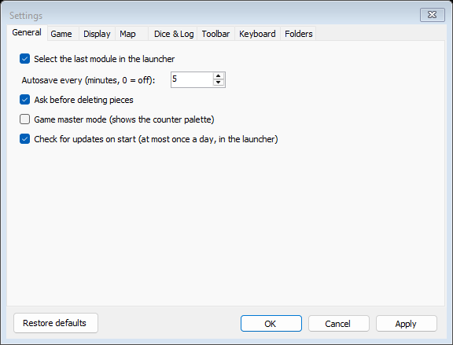
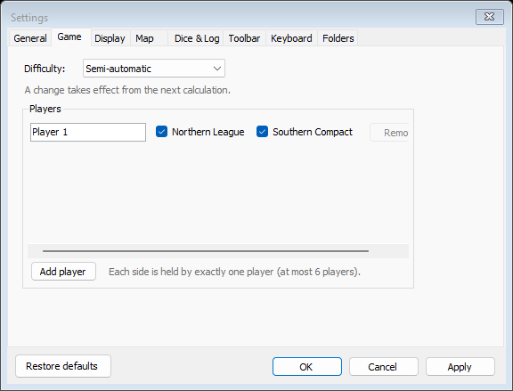
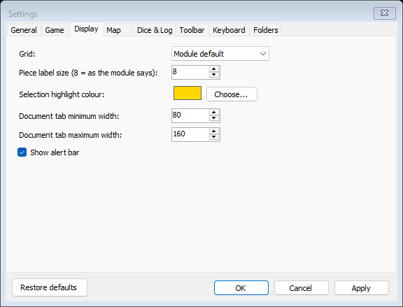
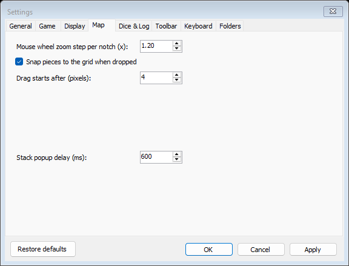
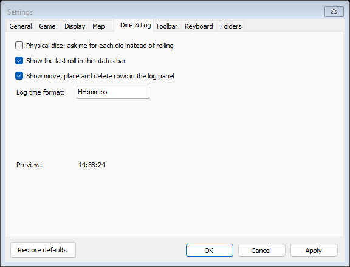
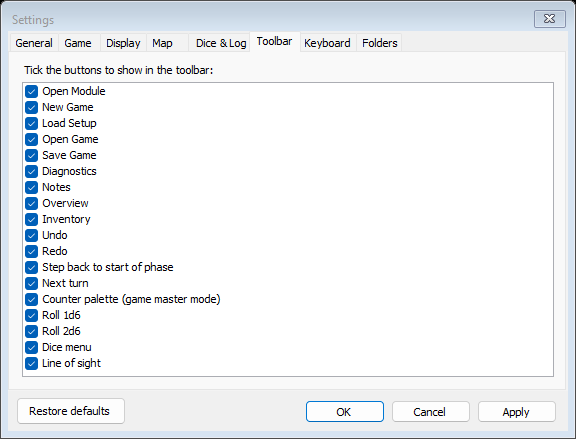
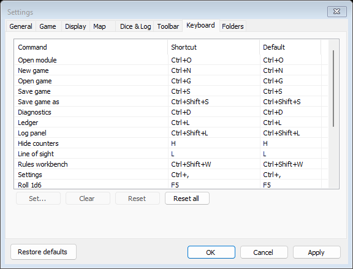
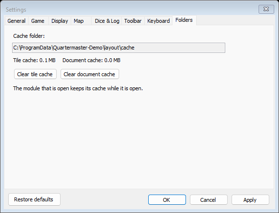

# Settings

Open Settings with **Tools > Settings...** (Ctrl+,). The dialog has eight tabs.

At the bottom of every tab:

- **Restore defaults** resets the tab you are looking at (only that one). Nothing changes until you apply.
- **OK** applies and closes, **Cancel** closes without applying, **Apply** applies and keeps the dialog open.

## General

| Setting | What it does |
|---|---|
| Select the last module in the launcher | The [launcher](Window-Launcher) starts with the module you played last selected |
| Autosave every (minutes, 0 = off) | How often the game is saved automatically. A save is also made at each phase change |
| Ask before deleting pieces | Asks "Delete ...?" before a counter is deleted |
| Game master mode (shows the counter palette) | Shows the [counter palette](Window-Log-and-Panels#counter-palette) and allows deleting counters |
| Check for updates on start (at most once a day, in the launcher) | See [Install and Update](Install-and-Update) |

## Game

This tab needs an open game. Without one it says "Open a game first".

- **Difficulty**: Hardcore, Semi-automatic or Fully automatic (see [Formula dialog](Window-Formula-Dialog)). A change takes effect from the next calculation; open formula dialogs and batch grids close, and waiting calculations stay in the phase panel.
- **Players**: the same player list as in the [new game dialog](Window-Launcher#new-game-dialog). Each row has a name, a tick box for each side and **Remove**; **Add player** adds a row. Each side is held by exactly one player, with at most 6 players. With two or more players the game is played hot-seat (see [Multiplayer](Window-Multiplayer#hot-seat-hand-over)).

## Display

| Setting | What it does |
|---|---|
| Grid | **Module default**, **Always show** or **Never show** the map grid |
| Piece label size (8 = as the module says) | The size of the text on counters |
| Selection highlight colour | The outline of selected counters. **Choose...** picks a colour |
| Document tab minimum width, maximum width | The size of the document tabs |
| Show alert bar | Shows the [alert bar](Window-Main-Window#alert-bar) |

## Map

| Setting | What it does |
|---|---|
| Mouse wheel zoom step per notch (x) | How much one wheel notch zooms, for example 1.20 |
| Snap pieces to the grid when dropped | Dropped counters snap to the grid |
| Drag starts after (pixels) | How far the mouse must move before a click becomes a drag |
| Stack popup delay (ms) | How long to rest on a counter before the [counter detail popup](Window-Map#counter-detail-popup) appears |

## Dice and Log

The tab is labelled **Dice & Log**.

| Setting | What it does |
|---|---|
| Physical dice: ask me for each die instead of rolling | See [Dice and turn](Window-Dice-and-Turn#physical-dice) |
| Show the last roll in the status bar | Shows each roll's result in the status bar for a few seconds |
| Show move, place and delete rows in the log panel | Untick to keep the [log](Window-Log-and-Panels#log) to dice, formulas and other events |
| Log time format | The time column of the log, for example `HH:mm:ss`. **Preview** shows how it looks, or "(not a valid time format)" |

## Toolbar

Tick the buttons to show in the main window's toolbar: Open Module, New Game, Load Setup, Open Game, Save Game, Diagnostics, Notes, Overview, Inventory, Undo, Redo, Step back to start of phase, Next turn, Counter palette (game master mode), Roll 1d6, Roll 2d6, Dice menu and Line of sight.

## Keyboard

Every command and its shortcut. The default list is on [Menus and Windows](Menus-and-Windows#keyboard-shortcuts).

| Control | What it does |
|---|---|
| List | Command, Shortcut (yours, or "(none)") and Default |
| **Set...** | Opens **Set shortcut**: press the new keys. Esc cancels; Backspace or Delete clears the shortcut |
| **Clear** | Removes the selected command's shortcut |
| **Reset** | Puts the selected command back to its default |
| **Reset all** | Puts every command back to its default |

Two commands cannot share a key, and keys the windows keep for themselves (such as Ctrl+Tab, Ctrl+W, Esc, Enter and Alt plus a letter) cannot be used. Settings will not apply until such problems are fixed, and lists what needs fixing.

## Folders

- **Cache folder**: where Quartermaster keeps prepared map tiles and documents for each module.
- The sizes of the tile cache and the document cache.
- **Clear tile cache** and **Clear document cache** free that space. The module that is open keeps its cache while it is open; close it first to clear that too. Everything is rebuilt when it is needed again.
