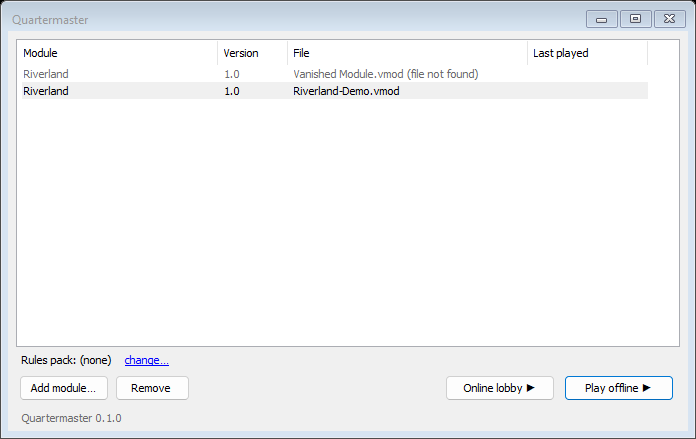
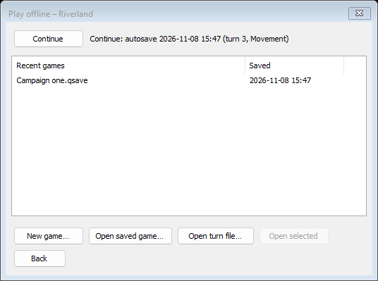
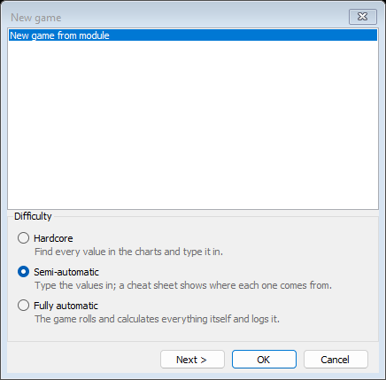
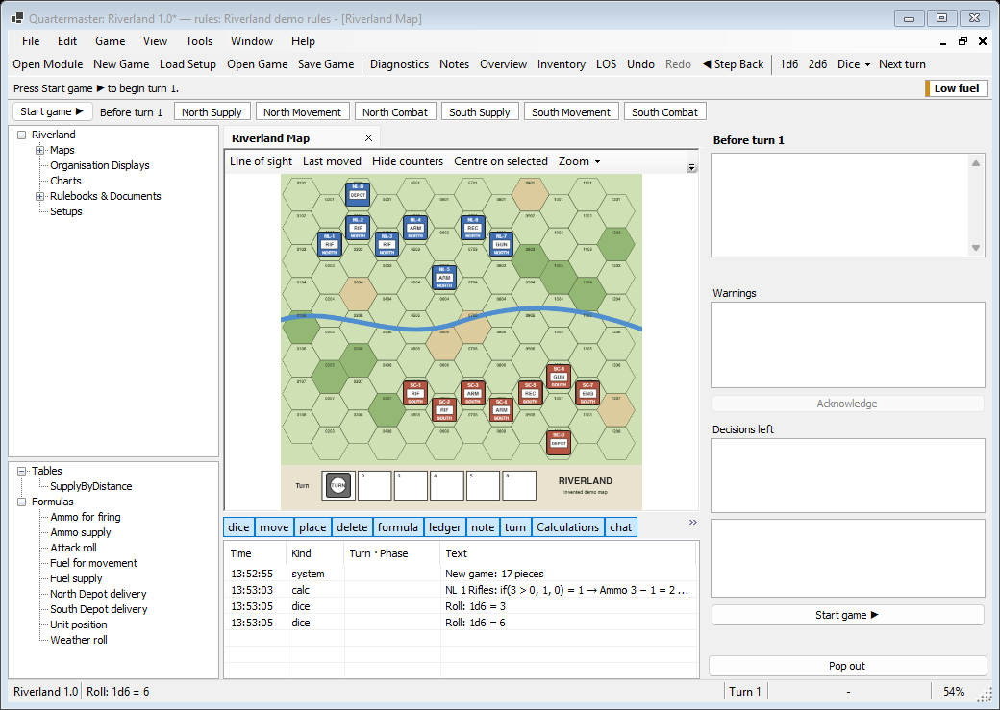
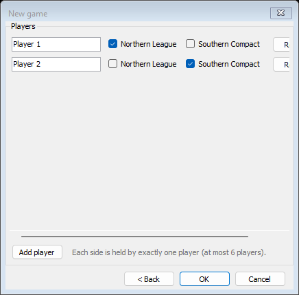
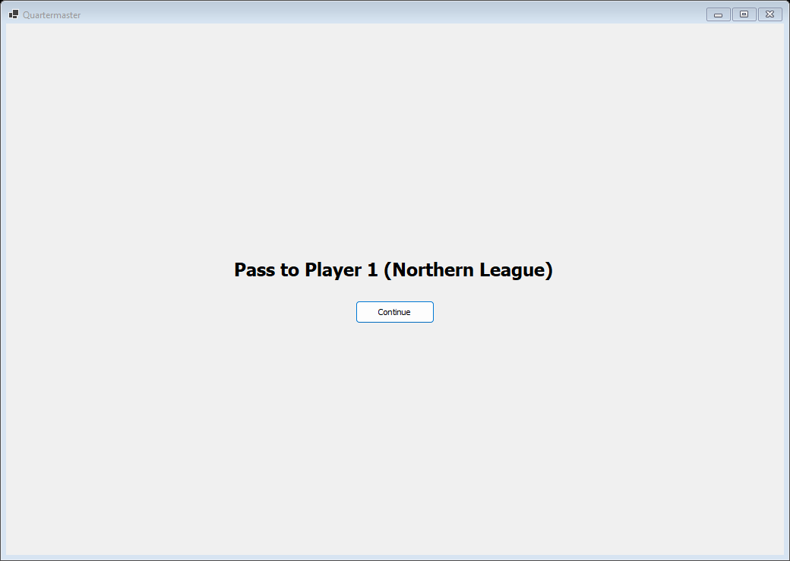

# Your First Game

This walk-through uses Riverland, the invented demo game for this wiki. Two sides, the Northern League and the Southern Compact, face each other across a river. It is made up for documentation and is free to use.

## Get the demo files

Download these two files from the [demo folder](https://github.com/EmojiPlay88/Quartermaster/tree/master/docs/wiki/demo) in the repository:

- `Riverland-Demo.vmod`, the module (map and counters).
- `Riverland-Demo.qrules`, the rules pack (tables, formulas and phases).

The module already contains a short invented rulebook, which opens as a tab in the game.

## Open the module

1. Start Quartermaster. The launcher opens.
2. Choose **Add module...** and pick `Riverland-Demo.vmod`.
3. Select it in the list. The line under the list reads "Rules pack: (none)". Choose **change...** and pick `Riverland-Demo.qrules`.

4. Choose **Play offline**.

This window lists your recent games. **Continue** reopens the newest autosave, **Open saved game...** browses for a `.qsave` file, **Open turn file...** opens a turn file (see [Playing With Others](Playing-With-Others)), and **New game...** starts a fresh game.

## Start a new game

Choose **New game...**. The first page asks for a start and a difficulty.

Pick the module's start, then a difficulty:

- **Hardcore**: you find every value in the charts and type it in.
- **Semi-automatic**: you type the values in, and a cheat sheet shows where each one comes from.
- **Fully automatic**: the game rolls and calculates everything itself and logs it.

Semi-automatic is a good first choice. You can change the difficulty later. Choose **Next >** to set the players, or **OK** to start with the defaults. Player setup is covered under hot-seat below.

## Find your way around

The main window shows the map in the middle, the module's trees on the left, the phase panel on the right and the log under the map.

- The strip under the toolbar shows the turn, the acting side and the phases. Before the game starts it shows **Start game**.
- The **Low fuel** chip on the right is an alert. Riverland's recon unit starts with almost no fuel on purpose.
- Rulebooks and charts from the module are listed on the left and open as tabs beside the map.

Choose **Start game** to begin turn 1.

## Move a counter

Drag a counter with the mouse. Drag a selection or a stack and it moves together, keeping its shape. Every move goes into the log under the map. The toolbar's **1d6**, **2d6** and **Dice** buttons roll dice, and each roll is logged too.

In Riverland, the rules pack has a "Fuel for movement" formula that is meant to run when a unit moves during a Movement phase. If it needs a value that the program cannot work out itself, a formula dialog asks for it.

## Undo and step back

- **Edit > Undo** (Ctrl+Z) and **Edit > Redo** (Ctrl+Y) work on whole actions: a drag, a Next Phase with everything it triggered, a formula Apply. The menu names the action, for example "Undo move of 3 pieces".
- **Edit > Step Back to Start of Phase** returns to the beginning of the current phase. **Edit > Step Back To...** lets you pick any earlier phase or turn from a list that shows what each step would undo. Dice rolled after that point are undone too, so rolling again gives new results.

## Save your game

Choose **File > Save Game** (or **Save Game As...**) and save a `.qsave` file. Reopen it later from **File > Open Game...**, or from the recent games list in the Play offline window.

You do not have to save often. Quartermaster autosaves as you play, keeping the last 20 snapshots for each module plus the first autosave of each turn. **File > Open Autosave...** recovers one, and **Continue** in the Play offline window reopens the newest.

## Hot-seat: two players, one computer

On the new game dialog, choose **Next >** to reach the players page.

Each row is a player. Tick the sides that player holds, and use **Add player** for more. Each side is held by exactly one player. You can also change players later in Settings, on the Game tab.

When the turn passes to a different player, a hand-over screen hides every window until that player presses **Continue**.

Until then the game shows only public information. The **Player:** menu in the status bar lets you hand over to someone else at any time. In Riverland, **Readiness** is a private value, so each player sees only their own side's.

Hot-seat is honour-based. The game hides things on screen, but everything is still in the computer's memory, and a formula dialog can show a held unit's inputs in full. See [Playing With Others](Playing-With-Others) for the other ways to play.

## Next steps

- [Making a Rules Pack](Making-a-Rules-Pack) shows how the demo's tables and formulas work.
- [Menus and Windows](Menus-and-Windows) lists everything on screen.
